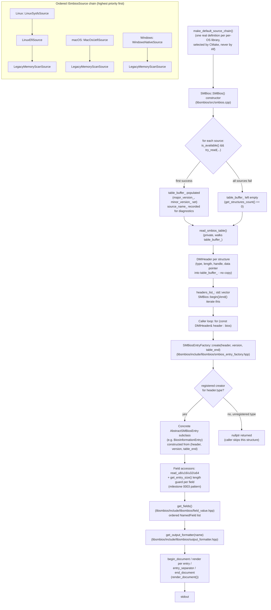

# Architecture overview

This document ties together two design decisions from this project's
roadmap - milestone 0003's field-table accessor pattern and milestone
0005's `ISmbiosSource` chain - into one picture of how a byte read off a
real machine (or a synthetic test buffer) becomes a typed, human-readable
SMBIOS entry. It is written for a reader who was not part of either
milestone's design discussions. It is cross-checked against the current
code (`libsmbios/src/smbios.cpp`, `libsmbios/include/libsmbios/smbios_entry_factory.hpp`,
`libsmbios/include/libsmbios/tables/bios_information_entry.hpp` and `libsmbios/src/bios_information_entry.cpp`), not against
what any roadmap `plan.md` merely describes as intent - several renames
(`smbios`/`libsmbios` swapping names, the repo-root library split) landed
after those plan files were written.

The SDK's front ends - the `smbios` CLI, the `smbios_c` C ABI and the opt-in `smbios_gui` browser - all sit on the same `libsmbios` core described here; packaging sources are in development (roadmap milestones 0012 and 0013).

See `CLAUDE.md`'s own Architecture section for the authoritative list of
per-OS/legacy/interface library directories and their CMake target names;
this document focuses on the runtime data flow between them, not the
build-time library graph (that is `docs/adr/0001-per-os-smbios-source-libraries.md`'s
job).

See also the [architecture diagrams](../diagrams/README.md) (component and process views).

## The two milestones this document connects

- **Milestone 0003 - field-table accessors.** Every concrete SMBIOS entry
  class (`BiosInformationEntry`, `MemoryDeviceEntry`, etc., in
  `libsmbios/include/libsmbios/tables/`) reads its own fixed-offset fields through
  the little-endian `read_u8`/`read_u16`/`read_u32`/`read_u64` helpers
  (`sys_interface/include/smbios/sys_interface/byte_reader.hpp`) plus a
  `get_entry_size()`-based length guard before every read, instead of
  `reinterpret_cast`-ing the raw bytes onto a `#pragma pack` struct. This
  is what makes the parser tolerant of shorter structures from older
  SMBIOS spec revisions: a getter for a field added in, say, SMBIOS 2.6
  checks `get_entry_size() >= <that field's offset + width>` and returns a
  documented default (commonly `0`) rather than reading past the
  structure's actual formatted-area length.
- **Milestone 0005 - the `ISmbiosSource` chain.** Where the raw table
  bytes come from is abstracted behind `ISmbiosSource`
  (`sys_interface/include/smbios/sys_interface/ismbios_source.hpp`): `is_available()`
  (cheap, no actual read), `try_read(out_table, major_version,
  minor_version)`, and `source_name()` for diagnostics. Each platform
  defines its own `make_default_source_chain()` (one real definition per
  per-OS library - this is a **CMake link-time choice**, not a C++ `#if`
  branch) returning an ordered list of sources, highest-priority first.
  `SMBios`'s constructor (`libsmbios/src/smbios.cpp`) tries each source in
  order, stopping at the first one that is both available and
  successfully reads a table.

These two milestones are independent of each other by design: field-table
accessors don't know or care which `ISmbiosSource` produced the bytes
they're reading, and the source chain doesn't know or care how the bytes
it hands back will later be decoded. The data-flow diagram below is where
they actually meet - inside one `SMBios` object, one buffer.

## Data flow: from `ISmbiosSource` to a typed entry



Walking this left to right in prose:

1. **`make_default_source_chain()`** is declared once, platform-neutrally,
   in `sys_interface/include/smbios/sys_interface/smbios_source_chain.hpp`,
   but *defined* exactly once per build inside whichever per-OS library
   `CMakeLists.txt`'s `if(WIN32)/elseif(APPLE)/elseif(...Linux)/else()`
   branch actually links. No translation unit in this codebase chooses
   between platforms with a C++ preprocessor guard any more - CMake's own
   link graph is the only platform switch.
2. **`SMBios`'s constructor** (`libsmbios/src/smbios.cpp`) calls that
   function once and walks the returned vector: `source->is_available() &&
   source->try_read(table_buffer_, major_version_, minor_version_)`,
   breaking on the first success and recording `source->source_name()`
   for later diagnostics (`render_to_description()`'s `"Source: ..."`
   line). If every source fails - no platform mechanism available, no
   legacy BIOS shadow-ROM region reachable - the object is left with an
   empty `table_buffer_` rather than throwing; `get_structures_count()`
   reports `0` and iteration yields nothing.
3. **`read_smbios_table()`** (private) walks `table_buffer_` structure by
   structure: reads the 4-byte wire header (`type`, `length`, `handle`)
   via the same `read_u8`/`read_u16` helpers milestone 0003 standardized,
   bounds-checks the declared `length` against the buffer's actual
   remaining bytes (stopping cleanly, not reading out of bounds, on a
   truncated/malformed structure - see `tests/unit/malformed_table_test.cpp`),
   stops at the `SMBiosHandler::EndOfTable` sentinel, and otherwise
   appends a `DMIHeader` - a *view*, not a copy: `DMIHeader::data` points
   directly into `table_buffer_` - to `headers_list_`.
4. **`SMBios::begin()`/`end()`** return a bidirectional `iterator` over
   `headers_list_`, so a caller (`smbios/src/main.cpp`, or a test) can
   write a plain `for (const DMIHeader& header : bios)` loop.
5. **`SMBiosEntryFactory::create(header, version, table_end)`**
   (`libsmbios/include/libsmbios/smbios_entry_factory.hpp`) looks up
   `header.type` in a module-scope registry populated at static-init time
   by each concrete entry class's own `REGISTER_SMBIOS_ENTRY` invocation,
   and either returns a freshly-constructed concrete
   `AbstractSMBiosEntry` subclass or `nullptr` if `header.type` has no
   registered handler (an unimplemented or vendor/OEM-specific structure
   type - not an error, just "this project doesn't decode this one").
6. **Inside the concrete entry** (e.g. `BiosInformationEntry`), every
   public field accessor follows milestone 0003's pattern: a fixed
   `constexpr size_t offset`, a `get_entry_size() < offset + sizeof(T)`
   guard returning a documented default when the structure is too short
   to carry that field (an older SMBIOS revision, or a deliberately
   truncated/malformed input), and otherwise `read_uN(raw_data(), offset)`.
   String-valued fields go through `AbstractSMBiosEntry::dmi_string(index)`,
   which was already extracted from the structure's trailing string
   section by `parse_dmi_strings()` at construction time, itself
   bounds-checked against `table_end` so a missing double-NUL terminator
   stops cleanly instead of reading past the buffer.

7. **Rendering** (`get_fields()` onward in the diagram). Each concrete
   entry also implements the pure virtual `AbstractSMBiosEntry::get_fields()`
   (`libsmbios/include/libsmbios/field_value.hpp`), returning an ordered list
   of `NamedField` values. `smbios --format <name>` looks the formatter up
   with `get_output_formatter(name)`
   (`libsmbios/include/libsmbios/output_formatter.hpp`) and
   `render_document()` drives `begin_document()`, `render()` per entry,
   `entry_separator()` and `end_document()` to build the text written to
   stdout. See [Output formats](../output-formats.md) for the built-in formats.

## How to add a new structure type

Milestone 0004 established this pattern; it still holds today. To add
support for an SMBIOS structure type this project does not yet decode:

1. **Add the type code** to `SMBios::SMBiosHandler`
   (`libsmbios/include/libsmbios/smbios.hpp`) if it is not already listed,
   using the numeric value from the DMTF SMBIOS specification's "Required
   structures and data" table.
2. **Write one entry class** extending `AbstractSMBiosEntry`
   (`libsmbios/include/libsmbios/abstract_smbios_entry.hpp`), in its own header
   + `.cpp` pair under `libsmbios/include/libsmbios/tables/` + `libsmbios/src/`
   (matching every existing entry, e.g. `BiosInformationEntry`). The
   constructor takes `(const DMIHeader& header, const SMBiosVersion&
   version, const uint8_t* table_end)` and forwards `header`/`table_end`
   to `AbstractSMBiosEntry`'s own constructor unchanged - `table_end` is
   what keeps this class's string-section parsing bounds-checked, so
   never substitute a different pointer or omit it.
3. **Implement field accessors via the `read_uN` + length-guard pattern**
   (see the "Field accessors" step above) - one accessor per fixed-offset
   field, each independently checking `get_entry_size()` against that
   field's own offset + width before reading, so a shorter (older-spec or
   malformed) structure degrades to a documented default per field rather
   than reading past its own formatted-area length. Never
   `reinterpret_cast` the raw bytes onto a packed struct - this project
   deliberately does not do that for entry payloads (only the wire-format
   entry-point structures, `SMBIOSEntryPoint32`/`64`, document a packed
   layout, and even those are read field-by-field via `read_uN` rather
   than being `reinterpret_cast` onto directly, since one of their own
   members - the address field - is a platform-dependent-size `intptr_t`
   that would misalign every field after it if a raw overlay were used on
   a mismatched platform).
4. **Register exactly once**, in the class's own `.cpp` file (never its
   header):
   ```cpp
   REGISTER_SMBIOS_ENTRY(SMBios::YourNewHandlerValue, YourNewEntryClass);
   ```
   This macro (`libsmbios/include/libsmbios/smbios_entry_factory.hpp`) expands
   to a function-local-static-guarded, namespace-scope static initializer
   that calls `smbios::register_smbios_entry()` against a module-scope
   registry (`libsmbios/src/smbios_entry_factory.cpp`) the first time that
   translation unit runs its dynamic initializers. Placing it in the
   header instead would register once per translation unit that
   `#include`s that header, tripping the registry's duplicate-registration
   guard (a thrown `std::logic_error`) the first time two TUs in the same
   binary both include it - this is why the macro's own doc comment and
   every existing entry class's `.cpp` file place it there and nowhere
   else.
   Also implement the pure virtual `get_fields()` (returning the entry's
   decoded fields as an ordered `NamedField` list,
   `libsmbios/include/libsmbios/field_value.hpp`); without it the class is
   abstract and will not compile, and no output format could render it.
5. **No change is needed to `SMBiosEntryFactory`, `SMBios`, or any
   `ISmbiosSource`** - the factory's registry is populated entirely by
   step 4's static initializer, and `SMBios`'s own table walk and the
   source chain that feeds it are completely unaware of which concrete
   entry types exist. Adding a type is purely additive: one new header,
   one new `.cpp`, one `REGISTER_SMBIOS_ENTRY` line.
6. **Add tests** under `tests/unit/`, following any existing
   `*_entry_test.cpp` file's shape: build a synthetic structure via
   `smbios::test::SyntheticTableBuilder` (`tests/unit/synthetic_table_builder.hpp`)
   and assert each accessor against the bytes you constructed, including
   at least one length tier shorter than the full structure to exercise
   the length-guard defaults.

## How to add an output format

An output format turns the `get_fields()` lists of a whole table into one
document. It mirrors the structure-type recipe above: one class, one
registration line, no change to the core.

1. **Write one class** implementing `IOutputFormatter`
   (`libsmbios/include/libsmbios/output_formatter.hpp`): `format_name()` (the
   `--format` value) and `render(entry)` are required; `begin_document()`,
   `entry_separator()` and `end_document()` are optional framing hooks
   defaulting to empty strings. Built-in examples live under
   `libsmbios/include/libsmbios/formatters/`; a complete out-of-tree one is
   `smbios/examples/csv_formatter.cpp`.
2. **Register exactly once**, in the class's own `.cpp` (never a header, for
   the same double-registration reason as `REGISTER_SMBIOS_ENTRY`):
   ```cpp
   REGISTER_OUTPUT_FORMATTER(YourFormatter);
   ```
3. **Make sure the object file is linked.** Like entry classes, the
   registration only runs if the `.cpp` is linked into the binary (the
   `smbios` CLI force-links `libsmbios` as a whole archive; a formatter in
   your own target must be compiled into it directly).
4. **Check it** with `get_output_formatter("<name>")` or
   `registered_output_formatter_names()`, and render with `render_document()`.

See the [custom output formatter guide](../dev/custom-output-formatter.md)
for the full walkthrough and [Output formats](../output-formats.md) for the
built-in formats.
