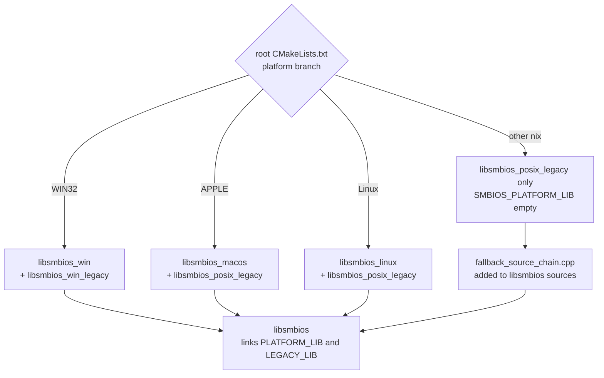
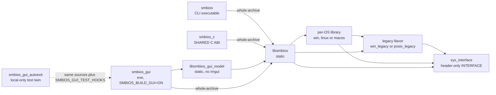
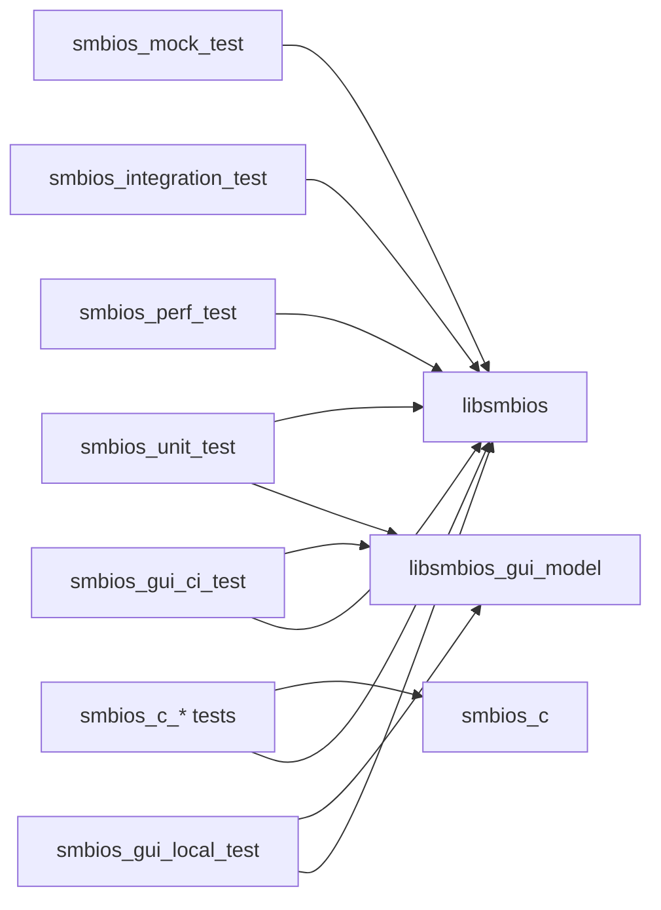

# 1. Components: libraries and link dependencies

Build-time view of every CMake target and how it links. Sources of truth:
the root `CMakeLists.txt`, each `<dir>/CMakeLists.txt`, and
[ADR 0001](../adr/0001-per-os-smbios-source-libraries.md). Mermaid, not
rendered locally; checked by hand against the grammar.

## 1a. Per-platform selection (CMake time, never `#if`)

The root `CMakeLists.txt` branch sets `SMBIOS_PLATFORM_LIB` and
`SMBIOS_LEGACY_LIB`; `libsmbios` links both `PUBLIC`.

## 1b. Link graph of the products

Per-OS and legacy libraries are shown as one node each: exactly one
flavor of each is linked per build (see 1a). `libsmbios_macos` also links
the IOKit and CoreFoundation frameworks; the legacy libraries also link
Boost.

`smbios_gui` and `smbios_gui_autoexit` also link `imgui::imgui`, `glfw`
and `OpenGL::GL` (omitted above to keep the picture small).
`smbios_gui_autoexit` compiles `smbios_gui`'s `main.cpp` again with its
own private definition; it is never created on CI.

## 1c. Test executables and what they link

Tiers are described in [diagram 6](06-test-and-ci-flow.md).

`smbios_unit_test`, `smbios_gui_ci_test`, `smbios_gui_local_test` and
the `smbios_c_*` tests that need entries link `libsmbios` as a whole
archive. The two GUI test executables also link `imgui::imgui`; the local
one adds `glfw` and `OpenGL::GL`. `smbios_c_*` tests link `libsmbios`
directly only for some cases (`tests/c_abi/CMakeLists.txt`).
