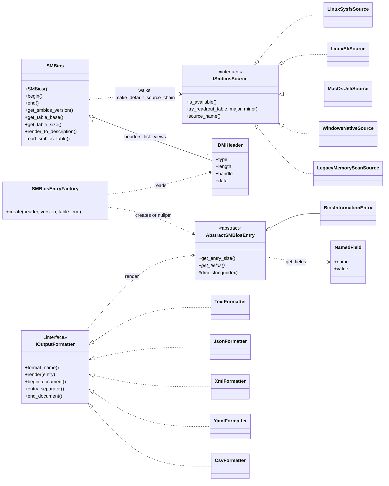
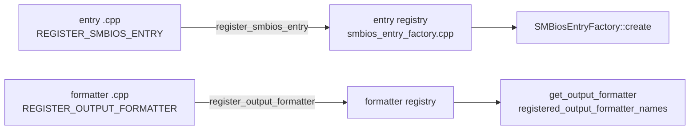

# 2. Components: core class view

Runtime classes of `libsmbios` and how they relate. Sources:
`libsmbios/include/libsmbios/smbios.hpp`, `smbios_entry_factory.hpp`,
`abstract_smbios_entry.hpp`, `output_formatter.hpp`, `field_value.hpp`,
and `sys_interface/include/smbios/sys_interface/`. Only a representative
subset of members and concrete classes is shown. Mermaid, not rendered
locally.

Registration seams (static-init registries, each invoked from the
implementing class's own `.cpp`, never a header):

Notes:

- `LegacyMemoryScanSource` exists twice (one copy per legacy library,
  `libsmbios_win_legacy` and `libsmbios_posix_legacy`); only one is linked.
  Only the Linux, macOS and Windows chains are drawn in
  [diagram 3](03-smbios-construction.md).
- `CsvFormatter` lives in `smbios/examples/csv_formatter.cpp` and is
  compiled into the `smbios` CLI target, not `libsmbios`.
- `BiosInformationEntry` stands for every concrete entry class under
  `libsmbios/include/libsmbios/tables/`.
- `DMIHeader::data` points into `SMBios`'s raw table buffer, so entries
  are views whose lifetime is tied to the `SMBios` object.
