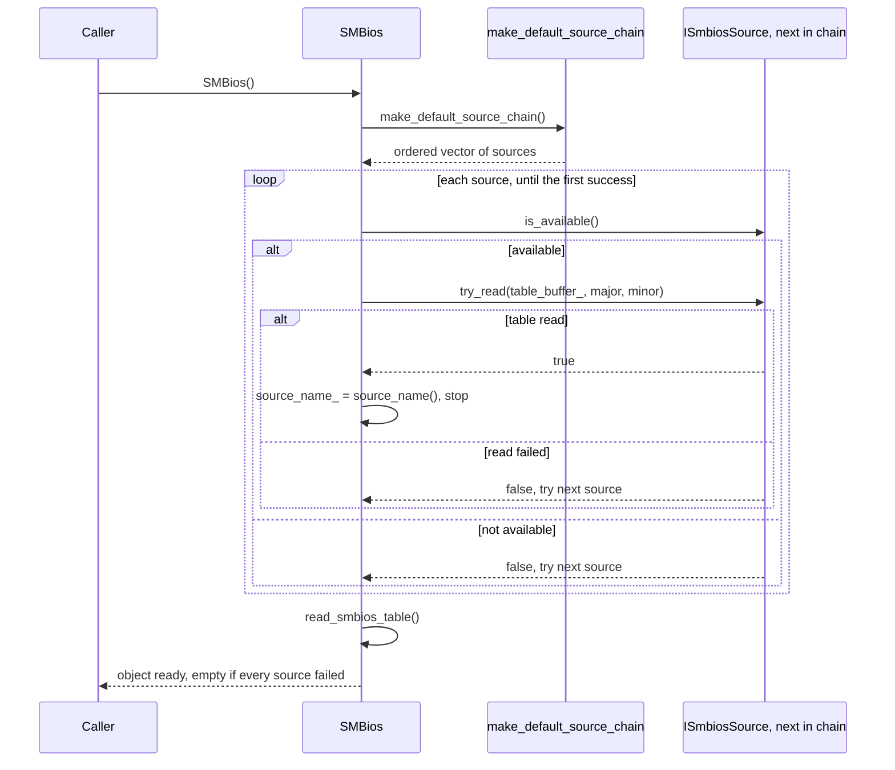
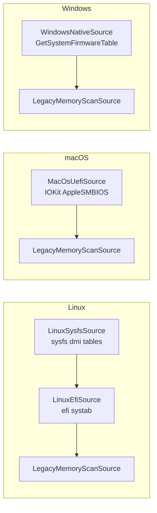
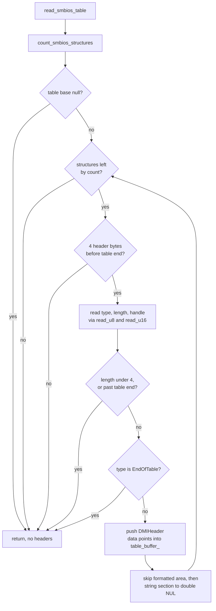

# 3. Process: `SMBios` construction

What `SMBios::SMBios()` does (`libsmbios/src/smbios.cpp`). The source chain
is whatever the linked per-OS library's `make_default_source_chain()`
returns; the chain loop itself is platform-neutral. Mermaid, not rendered
locally.

## 3a. Constructor sequence

If every source fails nothing is thrown: `table_buffer_` stays empty and
`get_structures_count()` is `0`.

## 3b. Source order per platform

Highest priority first; each platform's definition lives in its per-OS
library (`libsmbios_linux/src/linux_source_chain.cpp`,
`libsmbios_macos/src/macos_source_chain.cpp`,
`libsmbios_win/src/windows_native_source.cpp`). Other `*nix` systems use
`libsmbios/src/fallback_source_chain.cpp`, which is not drawn here.

## 3c. `read_smbios_table()` walk

