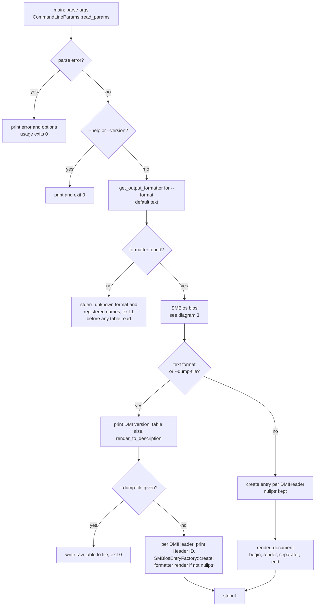

# 4. Process: `smbios` CLI run

Control flow of `smbios/src/main.cpp`. Mermaid, not rendered locally.

Notes and discrepancies for the reviewer:

- Only the structured formats (`xml`, `json`, `yaml`, `csv`) go through
  `render_document()`. The `text` format (and `--dump-file`) keeps the
  legacy per-header loop that calls `formatter->render()` directly, to stay
  byte-identical to the pre-formatter output.
- `--dump-file` ignores `--format`.
- `--read-file` and `--memory-scan` are accepted by the parser
  (`smbios/src/command_line_parser.cpp`) but `main.cpp` does not act on
  them: the read-file branch is an empty `TODO`, and `--memory-scan` is
  never read after parsing. They are left out of the diagram on purpose;
  this looks like unfinished work, not a diagram error.
- An exception while reading or rendering is reported on stderr as
  "Unable to read SMBIOS table" and `main` still returns `0`.
