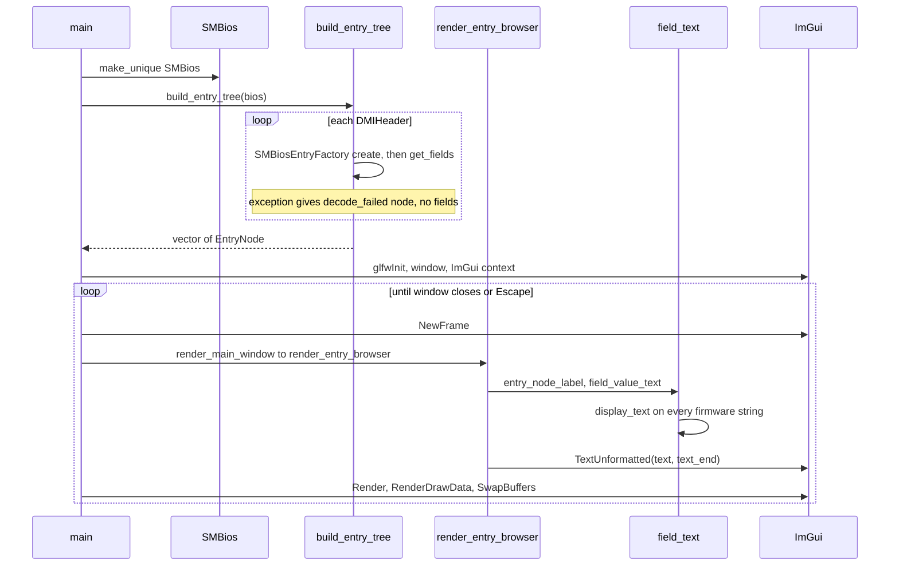
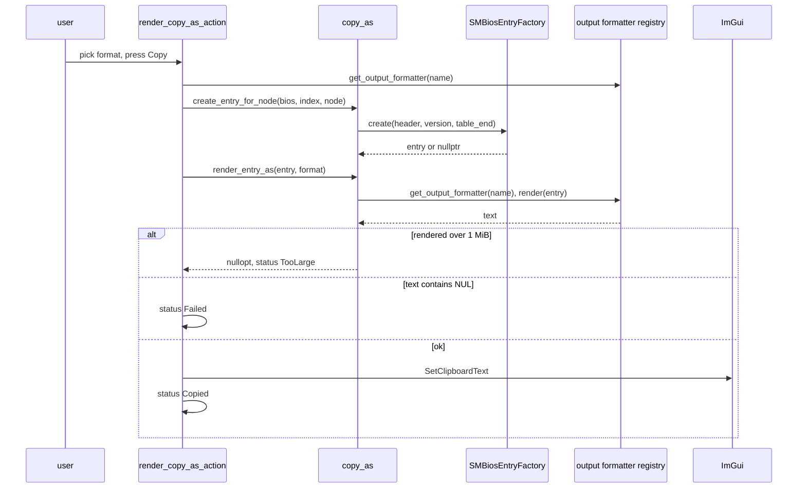

# 5. Process: `smbios_gui` flow

From startup to "Copy as". Sources: `smbios_gui/src/main.cpp`,
`view_model.cpp`, `entry_tree_view.cpp`, `field_text.cpp`, `copy_as.cpp`,
`copy_as_action.cpp`. The view-model layer (`libsmbios_gui_model`) has no
Dear ImGui dependency; the rendering files do. Mermaid, not rendered
locally.

## 5a. Startup and per-frame rendering

Firmware strings reach ImGui only as already sanitized `display_text()`
output passed to `TextUnformatted` (never as a format string, label or
ID).

## 5b. "Copy as" (when the user presses Copy)

The format list comes from `registered_output_formatter_names()`; the
default is `json`. Any format other than `json` shows a note that the
output may contain raw control characters.
