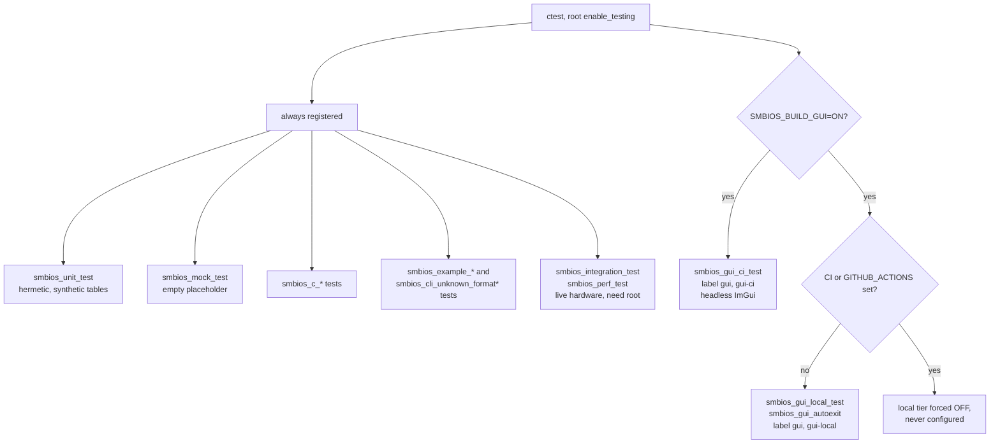
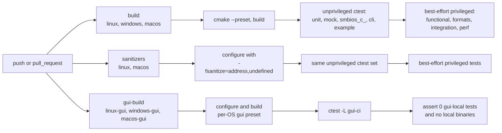

# 6. Process: test tiers and CI jobs

Sources: `tests/CMakeLists.txt`, `tests/gui/CMakeLists.txt`, the root
`CMakeLists.txt` and `.github/workflows/ci.yml`. Mermaid, not rendered
locally.

## 6a. Which tests are registered, and when

`smbios_gui_local_test` needs a real display, OpenGL context, OS clipboard
and live table. Run a tier with
`ctest --test-dir build/<os>-gui -L gui-ci|gui-local|gui`.

## 6b. CI jobs (`.github/workflows/ci.yml`, on push and pull request)

Notes:

- The Windows unprivileged tests run in `build` because sanitizers are not
  set up for MSVC; Linux and macOS run them in `sanitizers`.
- The `gui-build` job never runs `smbios_gui` itself (no display on hosted
  runners).
- Steps that need elevated privileges are `continue-on-error` or print a
  warning; they complement, not replace, the unprivileged suite.
