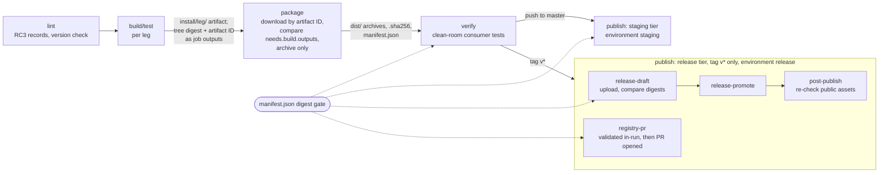
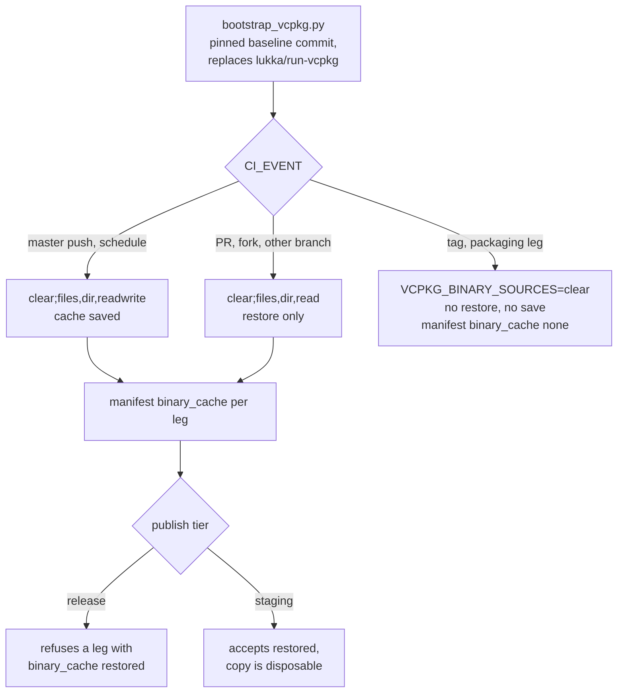
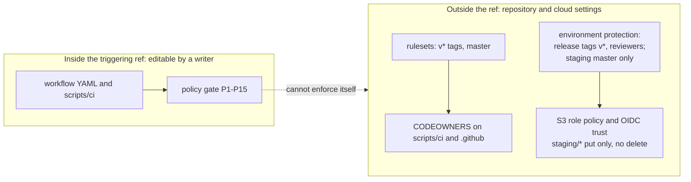
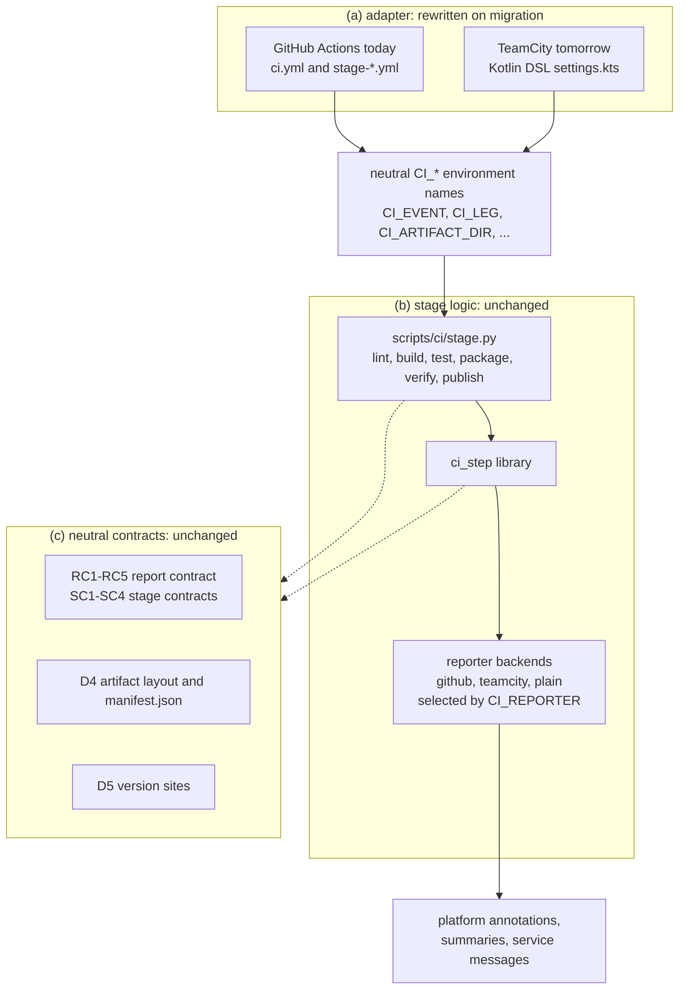

# 7. Process: unified build, package and publish pipeline (planned)

Sources: [ADR 0005](/docs/adr/0005-unified-build-package-publish-pipeline.md)
(D1, D4 to D9, "Platform portability" and "Repository settings required") and the "Pipeline stage
contracts (ADR 0005)" section of
[`../roadmap/0014-ci-rework-from-scratch/plan.md`](../roadmap/0014-ci-rework-from-scratch/plan.md).
This diagram describes the **planned** design (milestones 0012 and 0014); the
as-is `ci.yml` is in [diagram 6](06-test-and-ci-flow.md). Mermaid, not
rendered locally.

## 7a. Stage flow and artifact hand-off

Reading the diagram:

- `$CI_ARTIFACT_DIR/install/<leg>/` is the `cmake --install` output of the
  tested build. `build` computes a tree digest of it and exports the digest
  and the uploaded artifact ID as **job outputs** (not a file inside the
  artifact); `package` and later stages download by artifact ID and compare
  against `needs.<build job>.outputs`, because only the owning job can write
  its outputs while a sibling job could replace an artifact.
- `package` only archives that tree into
  `$CI_ARTIFACT_DIR/dist/libbios-<version>-<leg>.<ext>` plus `.sha256` files
  and `dist/manifest.json` (D4). `<version>` is the D5 version, not the raw
  tag.
- `verify` and `publish` refuse any file whose digest differs from
  `manifest.json`.
- Staging tier (D9, for example S3 staging) runs only on a push to `master`,
  after `verify`, in environment `staging`. Release tier runs only on a `v*`
  tag, after `verify`, in environment `release` (D6). Dispatch, PR (same-repo
  or fork), non-`master` push and nightly never reach any publish job.
- `release-draft` creates the draft once, uploads the files and compares the
  draft's asset digests with the manifest; `release-promote` publishes it;
  `post-publish` downloads the public assets and re-checks them (a loud
  failure, not a rollback).
- `registry-pr` runs the registry validation inside the publish run before
  the PR is opened, because a PR opened with `GITHUB_TOKEN` triggers no
  workflow.
- Sanitizer and GUI legs are `build/test` only and never feed `package`.

### Which events reach which stage (D7)

| Event | lint | build/test | package | verify | publish |
|-------|------|------------|---------|--------|---------|
| Push, docs-only changes | yes | - | - | - | - |
| Push to a non-`master` branch | yes | Linux legs | - | - | - |
| Same-repo PR to `master` | yes | legs not run by the push tier | yes (all packaging legs) | yes | - |
| Fork PR, nightly, dispatch `all` | yes | full matrix | yes | yes | - |
| Push to `master` | yes | full matrix | yes | yes | `staging` tier only |
| Release tag `v*` | yes | full matrix | yes | yes | `release` tier |

There is no separate `release.yml`: a release is the same pipeline on a tag
event (D8).

## 7c. vcpkg bootstrap and binary cache

- Every job's `VCPKG_BINARY_SOURCES` starts with `clear`, so a runner's own
  vcpkg cache is never consulted. No `actions/cache` runs in verify or
  publish jobs (P15).
- The cache never feeds a release artifact (ADR 0005 D9, CR-2).

## 7d. Trust boundary

- For push, PR, dispatch and tag events GitHub runs the YAML of the
  triggering ref, so the in-repo policy gate is not the boundary; the
  settings on the right are. They are maintainer actions listed in
  [ADR 0005, Repository settings required](/docs/adr/0005-unified-build-package-publish-pipeline.md#repository-settings-required).

## 7b. Layering for CI-platform portability

Reading the diagram:

- Only the adapter layer is rewritten on a migration; each `run:` step in
  the adapter is one `stage.py` invocation.
- Scripts read only the neutral `CI_*` names (policy rules P10, P11). Only
  `scripts/ci/reporters/` emits platform workflow commands or service
  messages.
- `stage.py` runs the same way on a developer machine with
  `CI_PLATFORM=local` and `CI_REPORTER=plain`.
- Exit codes: 0 success, 1 a gate failed, 2 usage or environment error,
  128+n killed by signal n.
