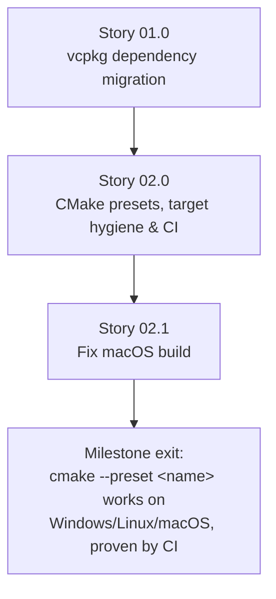

# Milestone 0001 - Portable Build System and Dependencies

**Package:** `smbios` / `smbios_util` | **Module root:** repo root `CMakeLists.txt`, `smbios/`, `smbios_util/`

Replaces the prototype's manually-pointed Boost installation
(`-DWINDOWS_BOOST_DIR` / `-DMY_BOOST_DIR` / `BOOST_ROOT`) and ad hoc,
per-platform build instructions with a **vcpkg manifest** and **CMake
presets**, so `cmake --preset <name> && cmake --build --preset <name>` is the
one documented way to build on Windows, Linux and macOS, and a CI matrix
proves it on every push. This milestone touches build plumbing only - with
one explicit, user-ratified exception (Story 02.1, below) - so every later
milestone (0002 onward) starts from a build that already works the same
way everywhere.

## Stories

| Story | Name                                             | Category        | Output                                                                  |
|-------|---------------------------------------------------|------------------|--------------------------------------------------------------------------|
| 01.0  | vcpkg dependency migration                        | infrastructure   | `vcpkg.json` manifest; `MY_BOOST_DIR`/`WINDOWS_BOOST_DIR` removed       |
| 02.0  | CMake presets, target hygiene & CI                | infrastructure   | `CMakePresets.json`; per-compiler flags cleaned up; GitHub Actions matrix |
| 02.1  | Fix macOS build                                   | bugfix           | Compiler-ID branch matches `AppleClang`; `__APPLE__` added to three `#if` guards; `smbios`/`smbios_util` actually compile and link on macOS |

### Story 02.1 - why this one breaks the milestone's own "no source changes" rule

Verifying Story 02.0 on real hardware (this milestone's own CI matrix, plus
a local macOS build) surfaced that `smbios` does not compile on macOS at
all today - not a build-system problem Stories 01.0/02.0 could fix by
construction. Two independent root causes, both confirmed by direct,
local compilation (see `status.md`):

1. The root `CMakeLists.txt`'s compiler-selection `if` chain checks
   `CMAKE_CXX_COMPILER_ID STREQUAL "Clang"`, but Apple's toolchain reports
   `"AppleClang"` - the branch never fires, no `-std` flag is ever set
   on macOS, and the compiler falls back to a pre-C++14 default.
2. `smbios/include/smbios/unix_bios.h`, `smbios/include/smbios/posix_physical_memory.h`,
   and `smbios/src/physical_memory.cpp`'s `#if` guards each list
   `__linux__`/`__FreeBSD__`/`__NetBSD__`/`__OpenBSD__`/`__sun` explicitly
   but never `__APPLE__` - so on macOS, `SMBiosImpl` and
   `NativePhysicalMemory` have **no definition at all**, yet code
   elsewhere still constructs them through `std::make_unique`, which fails
   to compile against an incomplete type.

The user explicitly asked for this to be fixed as part of milestone 0001
rather than deferred to milestones 0002 (which already owned root cause
#1, as its defect #5) and 0005 (which already owned root cause #2, as a
`status.md` finding) - a deliberate, recorded scope exception, not scope
creep discovered and silently absorbed. Story 02.1 fixes **only** what is
needed to compile and link on macOS - it does not duplicate milestone
0002's full C++20/`-Werror`/sanitizer work, and it does not implement a
real macOS native SMBIOS source (still milestone 0005's `MacOsUefiSource`)
- see that story's own Non-goals.

## Rationale

The current root `CMakeLists.txt` asks the developer to point at a Boost
install manually (`-DWINDOWS_BOOST_DIR=<path>` on Windows, `-DMY_BOOST_DIR` /
`BOOST_ROOT` elsewhere) and requires Boost ≥ 1.61 with four components
(`iostreams`, `program_options`, `unit_test_framework`, `date_time`) already
built for the right compiler/architecture/runtime combination. That is a
reasonable ask for one developer's one machine, and a recurring source of
"works on my machine" friction for anyone else, and for CI. vcpkg (in
manifest mode) resolves and builds exactly the Boost components this project
declares, per target triplet, from a lockfile-pinned baseline - no developer
has to pre-install anything beyond vcpkg itself.

## Key constraints

- **No behavior change, except Story 02.1.** Stories 01.0 and 02.0 edit
  `CMakeLists.txt` files, add `vcpkg.json`/`vcpkg-configuration.json`/
  `CMakePresets.json`, and add a CI workflow; neither touches
  `smbios/include`, `smbios/src`, `smbios_util/include`, or
  `smbios_util/src`. Story 02.1 is the sole, explicitly user-ratified
  exception (see above) - it touches exactly the files named in its own
  tasks, and only to make macOS compile, never to redesign anything
  milestones 0002-0005 already own in full.
- `-DGIT_TAG=ON`'s git-tag-mutating build step (root `CMakeLists.txt`) stays
  **OFF by default** and is not touched by this milestone.
- The existing `file(GLOB ...)` source-list convention is preserved for now
  (re-run `cmake` after adding/removing files); replacing it with explicit
  source lists is in scope for a later milestone if ever, not this one.
- Every change here must keep `./smbios_functional_test` buildable and
  runnable exactly as the existing CLAUDE.md documents
  (`--run_test=SmbiosFunctionalTests/SMBiosCreationTestCase`), including that
  it still needs root/admin on the machine running it - 0006 is where that
  changes, not here.

## Non-goals

- Replacing Boost.Program_options, Boost.Iostreams, Boost.Functional/Bind,
  or Boost.Test with standard-library or third-party alternatives. That is
  milestone 0002's (language/standard-library modernization) and 0004's
  (factory rebuild) concern; this milestone only changes **how** the same
  Boost components are obtained and linked.
- Packaging/publishing `smbios` as a vcpkg port for external consumers
  (`vcpkg.json` here only declares *this repo's own* dependencies, as a
  manifest consumer, not a port).

## Dependency graph

Story 02.1 depends on Story 02.0 (its CI matrix is what surfaced the
macOS build failure, and its target-hygiene variables -
`SMBIOS_CXX_STANDARD_FLAG`, etc. - are what Story 02.1's Task 01 edits).
