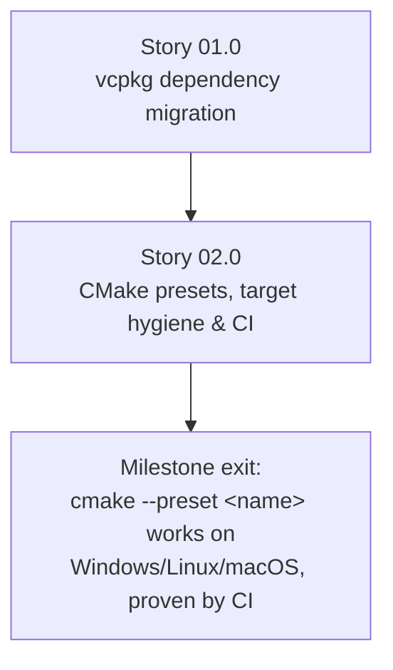

# Milestone 0001 - Portable Build System and Dependencies

**Package:** `smbios` / `smbios_util` | **Module root:** repo root `CMakeLists.txt`, `smbios/`, `smbios_util/`

Replaces the prototype's manually-pointed Boost installation
(`-DWINDOWS_BOOST_DIR` / `-DMY_BOOST_DIR` / `BOOST_ROOT`) and ad hoc,
per-platform build instructions with a **vcpkg manifest** and **CMake
presets**, so `cmake --preset <name> && cmake --build --preset <name>` is the
one documented way to build on Windows, Linux and macOS, and a CI matrix
proves it on every push. This milestone touches build plumbing only - no
`smbios`/`smbios_util` source file changes - so every later milestone (0002
onward) starts from a build that already works the same way everywhere.

## Stories

| Story | Name                                             | Category        | Output                                                                  |
|-------|---------------------------------------------------|------------------|--------------------------------------------------------------------------|
| 01.0  | vcpkg dependency migration                        | infrastructure   | `vcpkg.json` manifest; `MY_BOOST_DIR`/`WINDOWS_BOOST_DIR` removed       |
| 02.0  | CMake presets, target hygiene & CI                | infrastructure   | `CMakePresets.json`; per-compiler flags cleaned up; GitHub Actions matrix |

## Rationale

The current root `CMakeLists.txt` asks the developer to point at a Boost
install manually (`-DWINDOWS_BOOST_DIR=<path>` on Windows, `-DMY_BOOST_DIR` /
`BOOST_ROOT` elsewhere) and requires Boost ≥ 1.61 with four components
(`iostreams`, `program_options`, `unit_test_framework`, `date_time`) already
built for the right compiler/architecture/runtime combination. That is a
reasonable ask for one developer's one machine, and a recurring source of
"works on my machine" friction for anyone else, and for CI. vcpkg (in
manifest mode) resolves and builds exactly the Boost components this project
declares, per target triplet, from a lockfile-pinned baseline - no developer
has to pre-install anything beyond vcpkg itself.

## Key constraints

- **No behavior change.** This milestone edits `CMakeLists.txt` files,
  adds `vcpkg.json`/`vcpkg-configuration.json`/`CMakePresets.json`, and adds
  a CI workflow. It does not touch `smbios/include`, `smbios/src`,
  `smbios_util/include`, or `smbios_util/src`.
- `-DGIT_TAG=ON`'s git-tag-mutating build step (root `CMakeLists.txt`) stays
  **OFF by default** and is not touched by this milestone.
- The existing `file(GLOB ...)` source-list convention is preserved for now
  (re-run `cmake` after adding/removing files); replacing it with explicit
  source lists is in scope for a later milestone if ever, not this one.
- Every change here must keep `./smbios_functional_test` buildable and
  runnable exactly as the existing CLAUDE.md documents
  (`--run_test=SmbiosFunctionalTests/SMBiosCreationTestCase`), including that
  it still needs root/admin on the machine running it - 0006 is where that
  changes, not here.

## Non-goals

- Replacing Boost.Program_options, Boost.Iostreams, Boost.Functional/Bind,
  or Boost.Test with standard-library or third-party alternatives. That is
  milestone 0002's (language/standard-library modernization) and 0004's
  (factory rebuild) concern; this milestone only changes **how** the same
  Boost components are obtained and linked.
- Packaging/publishing `smbios` as a vcpkg port for external consumers
  (`vcpkg.json` here only declares *this repo's own* dependencies, as a
  manifest consumer, not a port).

## Dependency graph

