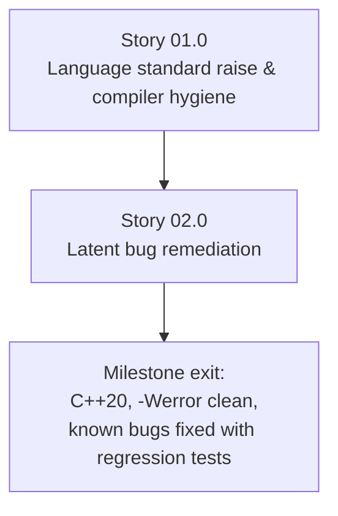

# Milestone 0002 - C++20 Modernization and Latent Bug Remediation

**Package:** `smbios` / `smbios_util` | **Module root:** `smbios/include/smbios/`, `smbios/src/`

Raises the language standard from `gnu++1y`/C++11 to **C++20** and fixes the
specific defects already identified in this codebase before any larger
redesign work (milestone 0003's parsing rewrite, milestone 0004's factory
rebuild, milestone 0005's new sources) builds on top of it. This milestone
is deliberately narrow: it does not redesign anything, it makes the existing
design's actual bugs stop being bugs, on a modern standard, with warnings
promoted to errors so they cannot silently return.

## Stories

| Story | Name                                             | Category    | Output                                                                 |
|-------|----------------------------------------------------|-------------|--------------------------------------------------------------------------|
| 01.0  | Language standard raise and compiler hygiene      | infrastructure | C++20 everywhere; `-Wall -Wextra -Werror` clean; sanitizer CI job     |
| 02.0  | Latent bug remediation                             | bugfix      | `SMBiosVersion` comparison fixed; `unix_bios.cpp` missing return fixed; honest stubs |

## Known defects this milestone fixes

Identified while analyzing the current prototype:

1. **`SMBiosVersion::operator>` / `operator<`** ([smbios.cpp](/smbios/src/smbios.cpp))
   compare `major_version` and `minor_version` **independently** rather than
   lexicographically, so `SMBiosVersion{3,0} > SMBiosVersion{2,8}` evaluates
   incorrectly (`3 > 2` is true, but the minor-version branch is checked
   unconditionally after it and can flip or confuse the result for other
   pairs). Every versioned entry class (`BiosInformationEntry`,
   `MemoryDeviceEntry`) depends on this operator being correct.
2. **`SMBiosImpl::get_table_size()` in `unix_bios.cpp` has no `return`
   statement** - it computes `table_buffer_.size();` as a discarded
   expression and falls off the end of a non-`void` function, which is
   undefined behavior that happens to often "work" by accident on common
   ABIs (the value is still sitting in the return register from the prior
   call). This is a correctness bug, not a style nit, and `-Wreturn-type`
   promoted to `-Werror` (Story 01.0) will make the build fail on it, which
   is how this task is meant to be caught for real.
3. **Dishonest stubs.** `unix_bios.cpp`'s `sysfs_table_exists()` is
   hardcoded `return false` behind `#if 1`, and `reading_from_efi()` /
   `reading_from_sysfs()` are empty bodies with `// TODO` comments, while
   the class-level doc comment claims "has since been reported to work on
   FreeBSD, NetBSD, OpenBSD, BeOS and Solaris." None of that is true today:
   every `*nix` build silently falls through to the legacy 0xF0000-0xFFFFF
   physical-memory scan. This milestone does not implement the stubs
   (milestone 0005 does) - it corrects the doc comment and makes the
   fallback behavior an explicit, logged decision rather than a silent one.
4. **`smbios.cpp`'s `// DEBUG` `<iostream>` include** - dead debug-only
   include with no corresponding usage worth keeping; removed.

## Key constraints

- **No behavior change beyond the bug fixes above.** This is not the
  parsing redesign (0003) or the factory redesign (0004); `reinterpret_cast`
  onto packed structs, the versioned-subclass pattern, and
  `boost::function`/`boost::bind` all stay exactly as they are in this
  milestone.
- Depends on milestone 0001 (needs the vcpkg/preset build to verify every
  change across all three platforms).
- Every fix lands with a regression test proving the specific defect is
  gone (e.g., a `SMBiosVersion{3,0} > SMBiosVersion{2,8}` test case that
  fails against the current operator and passes after the fix).

## Dependency graph

**Why standard-raise before bugfixes:** Story 02.0's regression tests and
fixes are easiest to write and verify once `-Wall -Wextra -Werror` is
already on (Story 01.0) - the compiler itself flags defect #2
(`-Wreturn-type`) once warnings are promoted to errors, which is the
intended way that fix gets rediscovered and locked in.
