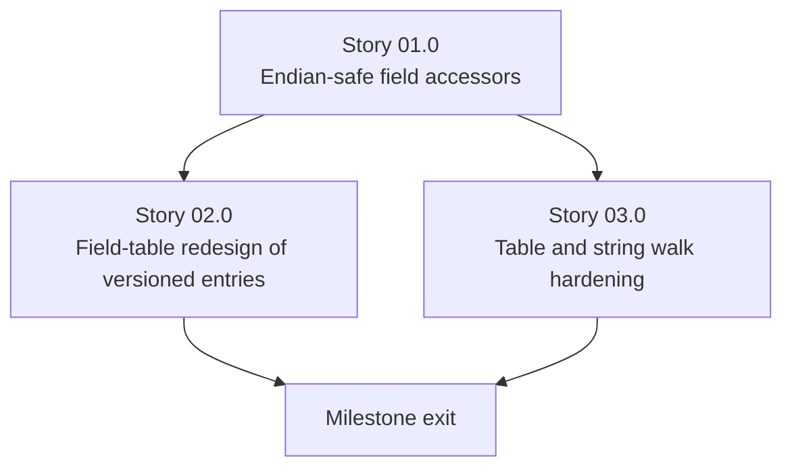

# Milestone 0003 - Portable, Endian-Safe, Bounds-Checked SMBIOS Byte-Level Parsing

**Package:** `smbios` | **Module root:** `smbios/include/smbios/`, `smbios/src/`

This is the milestone the user's design review targeted directly: replace
`reinterpret_cast<const T*>(header.data)` onto `#pragma pack(1)` structs -
the technique every versioned entry class
(`BiosInformationV24`/`V31`, `MemoryDeviceV21`...`V28`) currently uses - with
explicit, bounds-checked, little-endian-aware field accessors. The struct-
overlay technique has three concrete problems, all fixed here:

1. **Not portable to big-endian hosts.** SMBIOS multi-byte fields are
   little-endian on the wire (DMTF spec); `reinterpret_cast` reads them in
   *host* byte order, which only coincidentally matches on x86/x64/ARM
   little-endian targets.
2. **Technically undefined behavior.** Casting raw bytes to a struct
   pointer and dereferencing it violates the strict-aliasing rule even
   under `#pragma pack` - it works in practice on every compiler this
   project currently targets, but is not guaranteed by the C++ standard.
3. **Does not scale.** `MemoryDeviceV21 → V23 → V26 → V27 → V28` is five
   structs (and five `nullptr`-checked pointer members, and five version
   gates duplicated across the constructor and every accessor) for the
   history of *one* SMBIOS structure type through spec 2.8 alone. SMBIOS is
   past 3.7 now; each future field addition under the current pattern is a
   new subclass, not a one-line accessor.

## Stories

| Story | Name                                              | Category | Output                                                                       |
|-------|------------------------------------------------------|----------|---------------------------------------------------------------------------------|
| 01.0  | Endian-safe field accessors                          | core     | `u8`/`u16`/`u32`/`u64` little-endian readers; `DMIHeader` parsing stops using `reinterpret_cast` onto a packed struct |
| 02.0  | Field-table redesign of versioned entries           | core     | `BiosInformationEntry`, `MemoryDeviceEntry`, `PortConnectionEntry` rebuilt on offset+length-guard accessors, replacing every `*V2x`/`*V3x` struct |
| 03.0  | Table and string walk hardening                     | hardening | `read_smbios_table`/`count_smbios_structures`/`parse_dmi_strings` bounds-checked against `table_end` |

## Requirements

1. **R1** - No SMBIOS multi-byte field is read via
   `reinterpret_cast<const T*>` onto a `#pragma pack` struct anywhere in
   `smbios/src/` or `smbios/include/smbios/` after this milestone. Every
   read goes through the little-endian accessor helpers from Story 01.0.
2. **R2** - Every field accessor is gated on the structure's own declared
   `length` (`header.length >= offset + width`), not on `SMBiosVersion`
   comparison alone - length is the authoritative, per-instance signal that
   a field is actually present (a structure can be truncated even when the
   table's reported version implies the field should exist).
3. **R3** - `SMBiosVersion` comparison (fixed in milestone 0002) may still
   gate a field where the spec version is the only signal (no length
   difference distinguishes two revisions) - R2 does not forbid using
   version at all, it forbids using version **instead of** a length guard
   where length is sufficient.
4. **R4** - `BiosInformationV24`/`V31` and `MemoryDeviceV21`-`V28` (and their
   pointer members `bios_information24_`, `bios_information31_`,
   `memory_device_v21_` through `_v28_`) are deleted entirely - not kept
   alongside the new accessors as a fallback.
5. **R5** - `PortConnectionEntry` (not reviewed in the earlier conversation
   but following the same `AbstractSMBiosEntry` pattern per
   `smbios_entry_factory.h`) is converted to the same accessor pattern for
   consistency, even though it was not called out as using versioned
   structs - confirm during Story 02.0's first task whether it has the same
   pattern or a simpler one, and record the finding in `status.md`.
6. **R6** - `AbstractSMBiosEntry::parse_dmi_strings()` and
   `SMBios::read_smbios_table()`/`count_smbios_structures()` never read
   past `table_end` (or, for strings, past the owning structure's declared
   bounds where determinable) regardless of a corrupted or truncated input
   buffer - a malformed table degrades to a clear error/empty result, not
   an out-of-bounds read.
7. **R7** - Every public accessor's documented byte offset (already present
   as Doxygen-style `@brief 0xNN offset` comments in the existing headers)
   is preserved and double-checked against the DMTF SMBIOS spec during
   this rewrite - this milestone is also a correctness audit of those
   offsets, not just a mechanical find/replace of the access technique.
8. **R8** - No change to any already-passing functional test's rendered
   output for a table this project can already parse correctly, verified
   on real little-endian hardware (R1-R4 change *how* bytes are read, not
   what they mean).
9. **R9** - At least one Story 03.0 test proves parsing behaves correctly
   (or fails cleanly) when run conceptually on a byte-swapped table,
   exercising the endian-safety claim even though no real big-endian SMBIOS
   host is available to test on directly - a synthetic big-endian-encoded
   fixture, decoded by the new accessors and compared against the expected
   little-endian-correct values, is sufficient.

## Shared contracts

### C1 - Endian-safe accessor signatures (`smbios/include/smbios/byte_reader.h`, new)

```cpp
namespace smbios {
uint8_t  read_u8 (const uint8_t* data, size_t offset);
uint16_t read_u16(const uint8_t* data, size_t offset); // explicit little-endian decode
uint32_t read_u32(const uint8_t* data, size_t offset);
uint64_t read_u64(const uint8_t* data, size_t offset);
}
```

No `#pragma pack`, no cast to a multi-byte type - each function composes
the result byte-by-byte from `data[offset]`, `data[offset+1]`, etc., so the
host's own endianness never enters the computation. This is the same
technique the project's own `c-versions/` dmidecode reference material uses
(`WORD()`/`DWORD()`-style macros), adapted to typed functions.

### C2 - Length-guarded field pattern (replaces the `*V2x` struct chain)

```cpp
// Before (today, memory_device_entry.cpp):
//   if ((header.length >= 0x17) && (version > SMBiosVersion{2, 2})) {
//       memory_device_v23_ = reinterpret_cast<const MemoryDeviceV23*>(header.data);
//   }
//   ...
//   uint16_t MemoryDeviceEntry::get_device_speed() const {
//       if (nullptr == memory_device_v23_) return DeviceSpeed::DeviceSpeedUnknown;
//       return memory_device_v23_->device_speed;
//   }

// After:
uint16_t MemoryDeviceEntry::get_device_speed() const {
    constexpr size_t offset = 0x15, width = sizeof(uint16_t);
    if (get_entry_size() < offset + width) return DeviceSpeed::DeviceSpeedUnknown;
    return read_u16(raw_data(), offset);
}
```

`raw_data()` is a new protected accessor on `AbstractSMBiosEntry` returning
the entry's own `header.data` pointer, replacing every concrete entry's
private `const SomeV2x*` member. Each field becomes one `constexpr offset`
plus one length check plus one `read_uN` call - no class hierarchy.

### C3 - Bounds-checked table walk

`read_smbios_table()`/`count_smbios_structures()` must check
`current_structure_begin + sizeof(DMIHeader) <= table_end` **before**
dereferencing a prospective header, and must check
`current_structure_begin + header.length <= table_end` before trusting
`header.length` to skip ahead - both checks are currently absent (see
[smbios.cpp:165-229](/smbios/src/smbios.cpp)).

## Non-goals

- Changing the native source layer (`SMBiosImpl`, `win_bios`/`unix_bios`,
  the legacy physical-memory scan). That is milestone 0005.
- Changing the factory (`SMBiosEntryFactory`) or adding new structure
  types. That is milestone 0004 - this milestone only changes how the
  three *existing* entry types read their own bytes.
- A general-purpose binary serialization library. The accessor functions in
  C1 are intentionally minimal and scoped to this project's own needs.

## Dependency graph



Story 02.0 and Story 03.0 both depend only on Story 01.0 (the accessor
primitives) and can proceed in parallel - 02.0 touches entry classes, 03.0
touches `SMBios`'s own table/string walking, with no file overlap.
