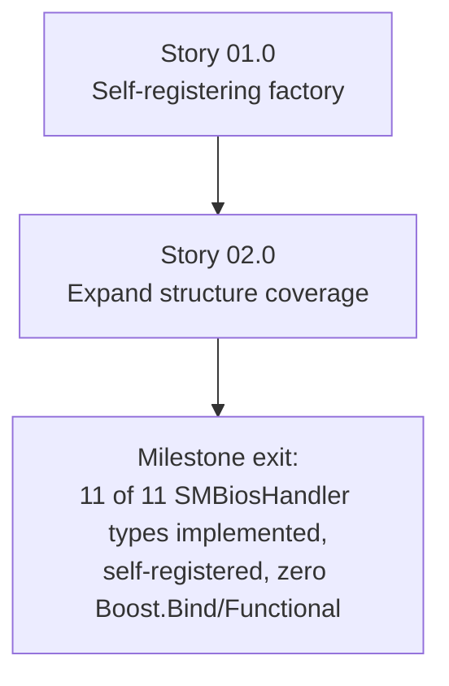

# Milestone 0004 - Entry Model and Factory Modernization

**Package:** `smbios` | **Module root:** `smbios/include/smbios/`, `smbios/src/`

Replaces `SMBiosEntryFactory`'s `boost::bind`/`boost::factory`-based,
manually-registered-in-the-constructor type map with a self-registering
factory built on `std::function`, and uses milestone 0003's field-table
accessor pattern to add the SMBIOS structure types the prototype does not
implement yet - `SystemInformation`, `SystemEnclosure`,
`ProcessorInformation`, `CacheInformation`, `SystemSlots`,
`PhysicalMemoryArray`, `MemoryArrayMappedAddress`, `SystemBootInformation` -
the eight remaining entries in `SMBios::SMBiosHandler`'s own "Required
structures and data" enum that `SMBiosEntryFactory::create()` currently
returns `nullptr` for.

## Stories

| Story | Name                               | Category | Output                                                                          |
|-------|--------------------------------------|----------|------------------------------------------------------------------------------------|
| 01.0  | Self-registering factory            | core     | `boost::function`/`boost::bind` removed; `std::function` + static self-registration; existing three entries migrated |
| 02.0  | Expand structure coverage            | feature  | Eight new entry classes (System Information through System Boot Information) using the 0003 accessor pattern from day one |

## Rationale

`SMBiosEntryFactory`'s constructor
([smbios_entry_factory.cpp:8-13](/smbios/src/smbios_entry_factory.cpp))
hand-wires three `entries_factory_[...] = boost::bind(boost::factory<T*>(),
_1, _2);` lines. Every new entry type means editing this one constructor -
workable at three types, increasingly central-chokepoint-ish at eleven
(the full set `SMBios::SMBiosHandler` already enumerates). A
self-registering pattern - each entry class registers itself with a global
registry at static-init time via a small macro, the same shape as the
registry/discovery pattern used elsewhere in comparable projects - means
adding entry #12 later touches one new file, not the shared factory
constructor. `std::function` replaces `boost::function`/`boost::bind`
because, on a C++20 codebase (milestone 0002), the standard library already
provides everything `boost::bind(boost::factory<T*>(), _1, _2)` was doing,
with less ceremony and one fewer Boost dependency to resolve through vcpkg.

## Key constraints

- Depends on milestone 0003 - every new entry class in Story 02.0 is
  written directly against the `read_uN`/length-guard pattern, never
  against `reinterpret_cast`/`#pragma pack`, so this milestone does not
  create new technical debt of the kind 0003 just removed.
- `SMBios::SMBiosHandler` (the existing enum of type IDs) is not
  renumbered or restructured - new entries register against the existing
  numeric values (`SystemInformation = 1`, `SystemEnclosure = 3`, etc.).
- No change to `AbstractSMBiosEntry`'s public interface beyond what
  milestone 0003 already introduced (`raw_data()`); the self-registration
  mechanism is additive to entry classes, not a base-class redesign.
- `boost-functional`/`boost-bind` stay declared in `vcpkg.json` (milestone
  0001) only if something else in the codebase still needs them after this
  milestone's Story 01.0 - confirm and remove the vcpkg dependency entry if
  nothing does.

## Dependency graph

**Why the factory rebuild comes first:** Story 02.0 adds eight new entry
classes; doing that against the old "edit the shared constructor" factory
would mean eight edits to the same chokepoint file in quick succession,
exactly the friction this milestone exists to remove. Rebuilding the
factory first means every new entry class in Story 02.0 is written once,
against its final registration mechanism.
