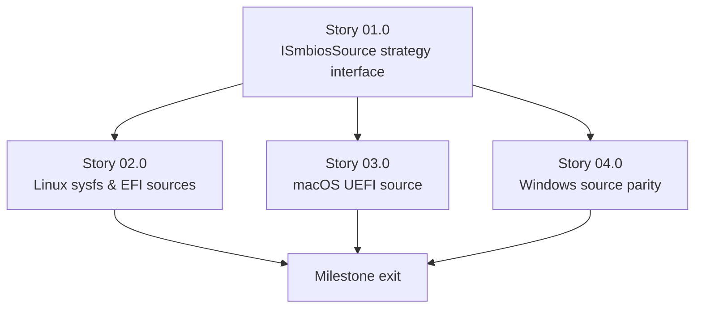

# Milestone 0005 - Native Source Abstraction and UEFI Support (Linux & macOS)

**Package:** `smbios` | **Module root:** `smbios/include/smbios/`, `smbios/src/`

This is the milestone that closes the gap the project's own CLAUDE.md
names directly: "Mac has no native SMBIOS source (README asks for a UEFI
implementation)," and the gap milestone 0002 documented honestly rather
than fixed - `unix_bios.cpp`'s `sysfs_table_exists()` hardcoded `false`,
`reading_from_efi()`/`reading_from_sysfs()` empty `// TODO` bodies. It
replaces the `#if defined(_WIN32) / win_bios.h / else / unix_bios.h`
compile-time dispatch (`smbios.cpp:1-4`) with a runtime **strategy**
interface, `ISmbiosSource`, and implements real sources: Linux sysfs,
Linux/macOS UEFI, and an explicit, demoted-to-last-resort legacy
physical-memory scan - the same scan that is the *only* thing currently
running on every `*nix` platform today, now correctly positioned as a
fallback instead of the accidental default.

## Stories

| Story | Name                                       | Category    | Output                                                                              |
|-------|-----------------------------------------------|-------------|----------------------------------------------------------------------------------------|
| 01.0  | `ISmbiosSource` strategy interface           | core        | Runtime source-chain interface replacing the `#if _WIN32` compile-time split          |
| 02.0  | Linux sysfs & EFI sources                     | feature     | Real (non-stubbed) `/sys/firmware/dmi/tables` and `/sys/firmware/efi/systab` sources |
| 03.0  | macOS UEFI source                             | feature     | New: IORegistry-based SMBIOS entry-point/table reader for macOS                       |
| 04.0  | Windows source parity                         | integration | Existing Windows native-API source adapted to the new interface, unchanged behavior   |

## Rationale

Today, `SMBios`'s constructor ([smbios.cpp:43-89](/smbios/src/smbios.cpp))
calls exactly one compile-time-selected `SMBiosImpl`, and falls back to a
raw legacy BIOS shadow-ROM scan (0xF0000-0xFFFFF) if that fails. On Windows
this is a real native API and the fallback is rarely exercised. On every
`*nix` target - Linux included - the "native" path is permanently
unavailable (`sysfs_table_exists()` returns `false` unconditionally,
`efi_table_exists()` only detects EFI's presence via `/sys/firmware/efi/
systab`/`/proc/efi/systab` but never actually *reads* the table even when
it finds it, since `reading_from_efi()` is empty), so the "fallback" is, in
practice, the only thing that has ever run on Linux. That legacy scan
depends on a BIOS-era memory layout that does not exist on UEFI-only boot
and cannot exist on Apple Silicon, which is the direct cause of "Mac has no
native SMBIOS source." A strategy interface with an ordered **chain** of
sources (native sysfs → native UEFI → legacy scan, tried in that order,
each one's availability checked independently) both fixes Linux properly
and gives macOS a real UEFI-based path for the first time.

## Reference material

Per explicit direction: this milestone **ports the algorithms and
approaches in `c-versions/dmidecode_linux` and `c-versions/dmidecode_macos`
directly**, rather than re-deriving them - both are real, working
reference implementations (the Acidanthera fork for macOS, upstream
dmidecode for Linux), reachable via symlink from this repo, not the empty
placeholders an earlier pass of this roadmap mistakenly assumed. Story
02.0 ports `dmidecode_linux`'s sysfs/EFI-systab logic almost verbatim (the
paths and formats already match what `unix_bios.cpp`'s own TODO comments
describe); Story 03.0 ports `dmidecode_macos`'s IORegistry mechanism,
**with one deliberate deviation**: the reference reaches
`mem_chunk_ioreg()` only through a call site compiled under `#if defined
__i386__ || defined __x86_64__` ([dmidecode.c:6395](/c-versions/dmidecode_macos/dmidecode.c))
- on a native Apple Silicon build, that guard would skip the IORegistry
path entirely despite the Acidanthera changelog claiming Apple Silicon
support (plausibly relying on the tool shipping as an x86_64 binary
running under Rosetta 2, where IOKit calls work unchanged regardless of
emulation). This project's own `MacOsUefiSource` (Story 03.0, Task 02)
calls the IORegistry path **unconditionally on `__APPLE__`**, independent
of CPU architecture, since IOKit property reads have nothing to do with
whether the running binary is arm64 or x86_64 - native Apple Silicon
support is a design goal here, not an inherited accident of a reference
implementation's historical `#if` guard.

## Requirements

1. **R1** - `ISmbiosSource` replaces `SMBiosImpl` as the abstraction
   `SMBios` depends on; it is selected and chained at **runtime**, not via
   `#if defined(_WIN32)`.
2. **R2** - Each `ISmbiosSource` implementation reports its own
   availability (`bool is_available() const`) independently of the others;
   `SMBios`'s constructor tries each source in a documented, platform-
   specific priority order and stops at the first available one.
3. **R3** - The legacy physical-memory scan
   (`SMBios::scan_physical_memory`) becomes the explicit **last-resort**
   source in every platform's chain, never the accidental default -
   logged distinctly from a native source succeeding, so a consumer of
   this library can tell which path actually produced its data (useful for
   diagnosing why a result looks stale on a locked-down kernel).
4. **R4** - Linux gains a real `/sys/firmware/dmi/tables/{smbios_entry_point,DMI}`
   reader (sysfs) and a real `/sys/firmware/efi/systab`-driven table read
   (not just detection) - both currently stubbed to do nothing per milestone
   0002's Story 02.0, Task 02 finding. Both paths, and the EFI systab's
   `SMBIOS=`/`SMBIOS3=` line format, are confirmed (not assumed) against
   this project's own `c-versions/dmidecode_linux` reference -
   `dmidecode.c`'s `SYS_ENTRY_FILE`/`SYS_TABLE_FILE` constants and
   `address_from_efi()`.
5. **R5** - macOS gains a new `ISmbiosSource` implementation reading the
   SMBIOS entry point and table from IOKit's `AppleSMBIOS` registry
   entry, porting the exact mechanism confirmed in this project's own
   `c-versions/dmidecode_macos` reference (the Acidanthera dmidecode fork -
   see `util.c`'s `mem_chunk_ioreg()` and `dmidecode.c`'s `main()`): look
   up `IOService:/AppleACPIPlatformExpert/bios/AppleSMBIOS` via
   `IORegistryEntryFromPath`, read its `"SMBIOS-EPS"` property (CFData) for
   the entry point, decode it to learn the real table address/length (not
   actually used for addressing - IORegistry ignores it), then read the
   `"SMBIOS"` property for the raw table itself. (This directory is a real,
   working reference, not an empty placeholder - it is reached via a
   symlink checked out alongside `dmidecode_linux`; both were previously
   mis-assessed as empty before being inspected directly.)
9. **R9** - Entry-point version values are passed through the same
   quirk-correction `dmidecode_linux`/`dmidecode.c` applies
   (`dmi_fixup_version()`: some BIOSes report `2.31`/`2.33`/`2.51`-style
   malformed `(major,minor)` pairs that should read as `2.3`/`2.6`) before
   `SMBiosVersion` is constructed from them - ported as a small shared
   helper (Story 01.0, Task 02) called by every `ISmbiosSource`
   implementation that decodes a raw entry point, not reimplemented
   per-source.
6. **R6** - Windows keeps its exact current behavior
   (`win_bios.h`/`win_native_api_helper.h`) - this milestone adapts it to
   implement `ISmbiosSource`, it does not rewrite its native-API logic.
7. **R7** - No elevated-privilege requirement is *introduced* by this
   milestone beyond what each native mechanism already needs (sysfs reads
   may need root depending on distro permissions on
   `/sys/firmware/dmi/tables`; IORegistry reads on macOS typically do not
   need elevated privileges, which is itself a usability improvement over
   the legacy scan's `/dev/mem` requirement, worth calling out in the
   milestone's documentation touch-list).
8. **R8** - `#if defined(_WIN32)` / `#else` at the top of `smbios.cpp`
   either goes away entirely (each platform always compiles and links
   every `ISmbiosSource` it is capable of building, discovering
   availability at runtime) or shrinks to selecting *which sources exist
   on this platform at compile time* while chaining/ordering/fallback logic
   is runtime and platform-neutral - the exact shape is an open question
   for Story 01.0, Task 01 to resolve and record.

## Shared contracts

### C1 - `ISmbiosSource` interface (`smbios/include/smbios/ismbios_source.h`, new)

```cpp
namespace smbios {

class ISmbiosSource {
public:
    virtual ~ISmbiosSource() = default;

    /// @brief Cheap check: can this source plausibly provide a table on this machine right now?
    virtual bool is_available() const = 0;

    /// @brief Attempt the read; returns false if the source was available but the read still failed.
    virtual bool try_read(std::vector<uint8_t>& out_table, size_t& major_version, size_t& minor_version) const = 0;

    /// @brief Human-readable name for diagnostics ("linux-sysfs", "macos-uefi", "legacy-scan", "windows-native").
    virtual const char* source_name() const = 0;
};

} // namespace smbios
```

### C2 - Source chain and fallback policy

`SMBios`'s constructor is rewritten to hold an ordered
`std::vector<std::unique_ptr<ISmbiosSource>>` built by a small
per-platform factory function (`make_default_source_chain()`, one
implementation per platform behind the minimal remaining `#if`), try each
in order, and record which one succeeded (R3) for `render_to_description()`
or a new diagnostic accessor to surface.

## Non-goals

- Changing anything in milestones 0003/0004's entry-model or parsing code
  - this milestone only changes **where the raw table bytes come from**,
  not how they are parsed once obtained.
- Windows UEFI-vs-legacy-BIOS distinction - Windows' existing native
  firmware-table API already abstracts that away; this milestone does not
  add a second Windows source.
- Any source beyond sysfs/UEFI/legacy-scan (Linux) and UEFI (macOS) - e.g.
  no ACPI-table-direct-read source, no network/remote-SMBIOS source.

## Dependency graph



Stories 02.0, 03.0 and 04.0 all depend only on Story 01.0's interface and
touch disjoint platform-specific files, so they can proceed in parallel
once the interface is settled.
