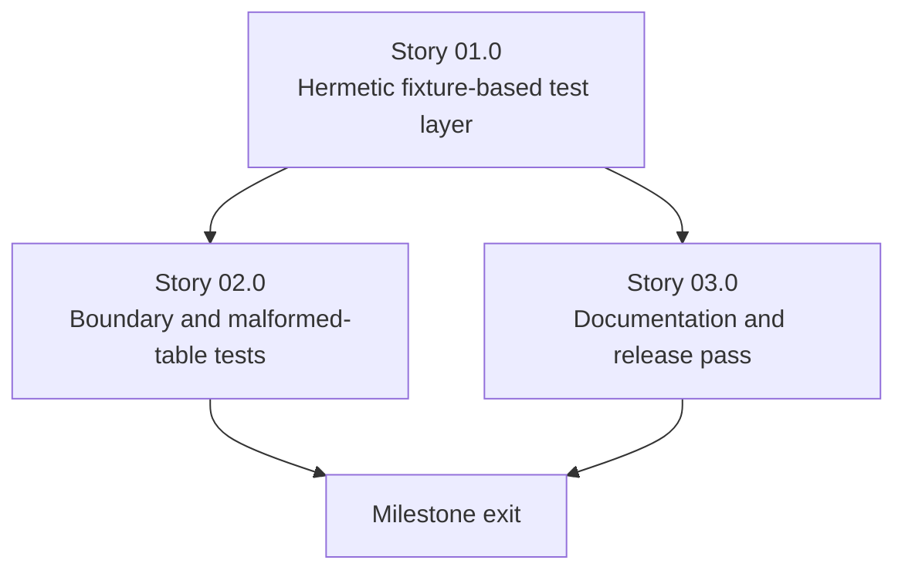

# Milestone 0006 - Hermetic Testing, Boundary Hardening and Documentation

**Package:** `smbios` / `smbios_util` | **Module root:** `smbios/test/`, `docs/`

Closes the program. Every prior milestone's tests leaned on "run against
real hardware, needs root/admin" (CLAUDE.md's own documented constraint on
`smbios_functional_test`). This milestone adds a **hermetic** test layer -
synthetic SMBIOS tables built in-memory, no privileges required - so CI
(milestone 0001) can run real assertions on every push instead of a
build-only signal, adds the boundary/malformed-table tests the earlier
milestones' tasks already called for but deferred to "this milestone," and
finishes with a documentation pass bringing Doxygen comments, CLAUDE.md,
and the README in line with everything milestones 0001-0005 actually
built.

## Stories

| Story | Name                                    | Category   | Output                                                                  |
|-------|--------------------------------------------|------------|----------------------------------------------------------------------------|
| 01.0  | Hermetic fixture-based test layer         | testing    | Synthetic-table builder; CI runs real assertions unprivileged            |
| 02.0  | Boundary and malformed-table tests        | testing    | Truncated/oversized-length/fuzzed fixtures proving milestone 0003's hardening |
| 03.0  | Documentation and release pass            | docs       | Doxygen audit; CLAUDE.md and README brought current; architecture doc    |

## Rationale

Every "Tests" task in milestones 0002-0005 says some combination of
"verified on real hardware" and "needs root/admin" - accurate to how this
project's functional tests work today, but it means CI (milestone 0001)
has only ever been able to prove the code *builds*, not that it *behaves
correctly*, on the platforms it runs on. A synthetic-table builder -
constructing a well-formed (or deliberately malformed) in-memory SMBIOS
table byte-for-byte, bypassing every `ISmbiosSource` entirely - lets every
entry-model test from milestones 0003/0004 and the table-walk hardening
tests from milestone 0003's Story 03.0 run in CI, unprivileged, on every
push, which is the actual point of having CI at all.

## Requirements

1. **R1** - A `SyntheticTableBuilder` (or equivalent) can construct an
   in-memory byte buffer representing a well-formed SMBIOS table with an
   arbitrary set of structures, usable as input to `SMBios`'s
   `read_smbios_table()`/`count_smbios_structures()` directly, without
   going through any `ISmbiosSource`.
2. **R2** - Every synthetic-buffer test written ad hoc in milestones
   0003/0004's task specs (e.g. "a synthetic buffer at each length tier")
   is migrated onto the shared `SyntheticTableBuilder` rather than each
   test hand-rolling its own byte array, so a future structure-type
   addition does not mean reinventing table construction again.
3. **R3** - At least one CI job runs the full hermetic suite unprivileged
   on every push, closing the gap milestone 0001's Story 02.0 Task 03 left
   open ("where a test genuinely cannot run unprivileged ... build-only").
4. **R4** - Boundary tests exist for: a structure whose `length` claims
   more bytes than remain in the table; a table missing its terminating
   double-null string-section marker; a table whose declared structure
   count disagrees with how many structures are actually found before
   `EndOfTable`; and at least one libFuzzer/AFL-style fuzz harness entry
   point feeding arbitrary bytes into `read_smbios_table()` (not run
   continuously in CI by this milestone - a documented, locally-runnable
   harness is sufficient; continuous fuzzing infrastructure is a
   non-goal).
5. **R5** - Every public class/function across `smbios/include/smbios/`
   has a complete Doxygen comment (not just a one-line `@brief`) -
   audited, not assumed, since several existing comments already in the
   codebase (e.g. `BiosInformationEntry`'s enum comments) are good
   examples to match, not just preserve.
6. **R6** - CLAUDE.md is rewritten to describe the system as it exists
   after milestones 0001-0005 (vcpkg/presets, C++20, the `ISmbiosSource`
   chain replacing the `#if _WIN32` split, the field-table accessor
   pattern replacing versioned structs, the self-registering factory) -
   not patched incrementally; a clean rewrite against the as-built system
   is explicitly preferred over reconciling five milestones' worth of
   incremental edits.
7. **R7** - The root README's platform-support statement ("Windows/Linux
   are the real targets... Mac has no native SMBIOS source") is corrected
   to reflect milestone 0005's outcome.

## Non-goals

- Replacing the existing root/admin-requiring real-hardware functional
  test suite - it stays, as the final cross-check this milestone's
  hermetic tests cannot fully replace (a synthetic table proves the
  *parser*; only real hardware proves the *source* layer against an
  actual firmware implementation).
- Continuous/scheduled fuzzing infrastructure (OSS-Fuzz integration or
  similar) - R4's fuzz harness is locally-runnable, not wired into CI on
  a schedule, in this milestone.
- Any new feature or structure type - this milestone is pure hardening and
  documentation.

## Dependency graph

Story 03.0 (documentation) depends only on Story 01.0 existing (so it can
document the final test strategy) and can proceed in parallel with Story
02.0's boundary-test work once Story 01.0 lands.
