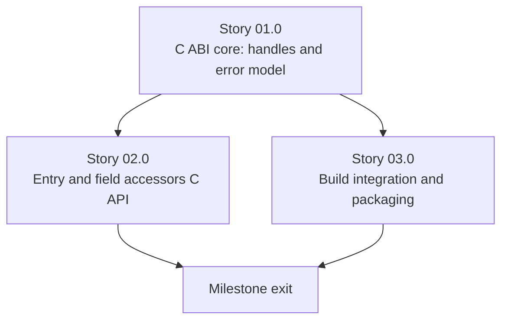

# Milestone 0007 - C ABI Shim for Cross-Language Interop

**Package:** new `smbios_c` | **Module root:** `smbios_c/include/smbios_c/`, `smbios_c/src/`

Adds a C-callable interface alongside the existing C++ one, so this
library can be linked from Python/Rust/C#/Go/plain-C callers via FFI, not
just from other C++ code. The architectural decision this milestone
implements: a **thin, separately-versioned C ABI shim wrapping the
existing C++ core behind opaque handles** (`smbios_handle_t`,
`smbios_entry_handle_t`) and a flat set of `extern "C"` functions, with
every C++ exception caught and translated into an integer error code at
the boundary - not a second, independently-written C implementation, and
not an attempt to make the existing C++ headers themselves C-compatible
(neither is possible: C has no virtual dispatch, no exceptions, no
`std::string`/`std::vector` in a stable-ABI signature).

## Stories

| Story | Name                                        | Category     | Output                                                                         |
|-------|------------------------------------------------|--------------|-----------------------------------------------------------------------------------|
| 01.0  | C ABI core: handles and error model           | core         | `smbios_handle_t`/`smbios_entry_handle_t`; `smbios_error_t`; exception boundary |
| 02.0  | Entry and field accessors C API               | core         | Iteration, type/length/handle, rendered description, a curated set of typed getters |
| 03.0  | Build integration and packaging               | infrastructure | `smbios_c` CMake target; pkg-config file; vcpkg port metadata                  |

## Rationale

`SMBios`/`AbstractSMBiosEntry` are ordinary C++ classes - virtual methods,
`std::unique_ptr`, `std::string` return values, a C++ iterator, and
constructors that `throw` on a type mismatch
(`BiosInformationEntry`'s constructor, for one). None of that crosses a C
ABI boundary safely: C++ name mangling is compiler-specific (a C API
callable from GCC-built Rust and MSVC-built C# alike needs to not depend
on either compiler's mangling), and an uncaught C++ exception unwinding
into a C caller's stack frame is undefined behavior. The opaque-handle +
flat-function + error-code pattern is the standard answer (SQLite's public
API wrapping an internal engine, cURL's `CURL*` handle, this project's own
internal `SMBiosImpl`/`NativePhysicalMemory` PImpl idiom moved out to the
*public* boundary instead of staying implementation-private).

## Key constraints

- **Depends on milestone 0004** (entry model and factory finalized) - the
  C API wraps a settled C++ surface; building it against an entry model
  still being redesigned (milestones 0002/0003) would mean rewriting the
  shim twice.
- **Not a 1:1 mirror of the C++ API.** Wrapping every one of
  `BiosInformationEntry`'s ~20 typed getters (and the equivalent for ten
  other entry types, per milestone 0004) one-for-one in C would mean a C
  wrapper function for every current and future C++ getter - exactly the
  maintenance-burden tradeoff flagged when this milestone was proposed.
  Story 02.0 instead wraps: (a) entry iteration and
  type/length/handle, (b) every entry's existing `render_to_description()`
  string (zero new C++ surface needed - every `AbstractSMBiosEntry`
  subclass already implements this), and (c) a small, explicitly curated
  set of high-value typed getters (BIOS vendor/version, System UUID,
  Memory Device size/speed) rather than universal coverage. A caller
  needing an unwrapped field reads it from the rendered description
  string or waits for a future milestone to curate it in - this is a
  deliberate, revisitable scope line, not an oversight.
- Every C++ exception thrown across the C ABI boundary is caught in the
  wrapper function that could throw and converted to a `smbios_error_t`
  return value - never propagated.
- The C API is additive - no change to any existing C++ header's public
  interface.

## Non-goals

- A second, independently-written C parsing implementation (the
  alternative considered and rejected when this milestone was proposed).
- Full 1:1 coverage of every C++ getter (see Key constraints) - this is
  explicitly deferred, curated incrementally in future milestones as real
  consumers ask for specific fields.
- Bindings for any specific target language (Python ctypes/cffi wrapper,
  Rust `bindgen` crate, etc.) - this milestone produces the C ABI those
  bindings would consume, not the bindings themselves.
- ABI *stability guarantees* across `smbios_c` versions (semantic
  versioning policy, a stable v1 freeze) - out of scope until the API
  surface from Story 02.0 has had real external users; this milestone
  ships a first version, not a frozen one.

## Shared contracts

### C1 - Opaque handles and error model (`smbios_c/include/smbios_c/smbios_c.h`, new)

```c
#ifdef __cplusplus
extern "C" {
#endif

typedef struct smbios_handle_s* smbios_handle_t;
typedef struct smbios_entry_handle_s* smbios_entry_handle_t;

typedef enum {
    SMBIOS_OK = 0,
    SMBIOS_ERR_NO_TABLE_FOUND = 1,   /* every ISmbiosSource failed */
    SMBIOS_ERR_INVALID_HANDLE = 2,
    SMBIOS_ERR_INVALID_ARGUMENT = 3,
    SMBIOS_ERR_BUFFER_TOO_SMALL = 4, /* caller-provided output buffer too small */
    SMBIOS_ERR_UNKNOWN = 99         /* an unexpected C++ exception was caught at the boundary */
} smbios_error_t;

#ifdef __cplusplus
}
#endif
```

Callers never see a struct field - only the opaque pointer typedefs, so
the C++ layout behind them can change freely without an ABI break (the
same reasoning this project's own `SMBios::native_impl_` PImpl already
relies on internally, applied at the public boundary).

### C2 - Exception-to-error-code boundary pattern

Every exported function wraps its C++ body in a single, consistently-shaped
try/catch:

```cpp
extern "C" smbios_error_t smbios_open(smbios_handle_t* out_handle) {
    if (out_handle == nullptr) return SMBIOS_ERR_INVALID_ARGUMENT;
    try {
        *out_handle = reinterpret_cast<smbios_handle_t>(new smbios::SMBios());
        return SMBIOS_OK;
    } catch (const std::exception&) {
        *out_handle = nullptr;
        return SMBIOS_ERR_NO_TABLE_FOUND; // or SMBIOS_ERR_UNKNOWN if the exception type doesn't map cleanly
    }
}
```

No exported function is permitted to omit this pattern - Story 01.0,
Task 02 establishes it on the handle-lifecycle functions; Story 02.0
reuses it on every entry/field accessor without exception.

## Dependency graph



Story 03.0 (build/packaging) depends only on Story 01.0's target existing
and can proceed in parallel with Story 02.0's accessor work.
