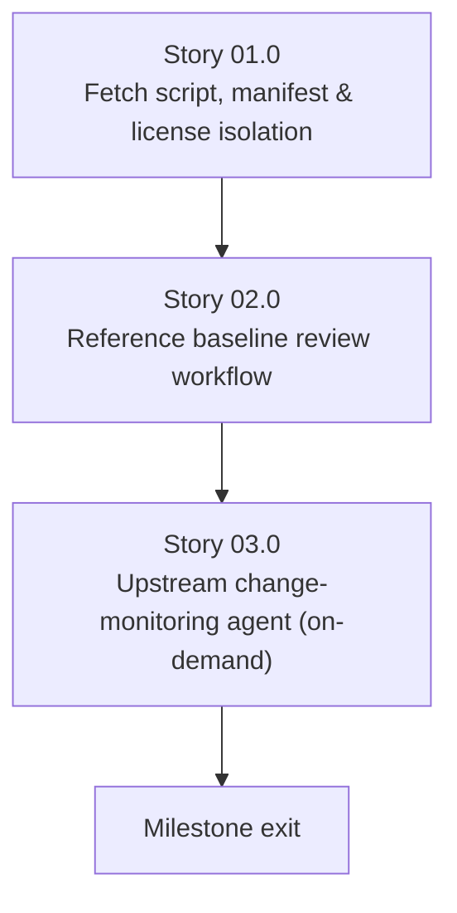

# Milestone 0008 - Upstream Reference Fetch Script and Monitoring Agent

**Package:** repository infrastructure | **Module root:** `scripts/`, `c-versions/` (untracked), `.claude/agents/`

> **Folder name kept on purpose:** this milestone's directory is still
> `0008-upstream-reference-submodules-and-monitoring-agent/` even though
> submodules were dropped (ruling 2026-11-09, see [status.md](status.md));
> external docs link to it, so it is not renamed.

The upstream `dmidecode` references under `c-versions/` used to be two
machine-local symlinks (`dmidecode_linux` → `~/Projects/dmidecode_linux`,
`dmidecode_macos` → `~/Projects/dmidecode_macos`). Those paths are
invisible to git and cannot be reproduced on any other checkout. This
milestone replaces them with a tracked **fetch script**,
`scripts/fetch_upstream_references.py`. The script clones each upstream's
default-branch HEAD into `c-versions/<name>` from URLs recorded in a
tracked **manifest**, `scripts/upstream_references.json`. Both upstreams
are GPL-2.0-or-later, so `c-versions/` stays git-ignored. No upstream code
or text is ever tracked in this repository: no submodules, no vendoring.
The manifest records only metadata (name, path, URL, and the last
upstream commit SHA a human has triaged). The milestone also adds an
on-demand agent that diffs each upstream from that recorded baseline to
its current HEAD and reports whether anything is worth porting.

This closes the loop exposed by the earlier `dmidecode_macos`
mis-assessment, where the reference was mistaken for an empty placeholder
because `find` does not follow symlinks. With this milestone a reference
is reproducible (anyone can run the script), its reviewed state is
recorded (`baseline_sha`), and it is watched (the agent).

## Stories

| Story | Name                                                   | Category       | Output                                                                                                   |
|-------|---------------------------------------------------------|----------------|-----------------------------------------------------------------------------------------------------------|
| 01.0  | Upstream reference fetch script and license isolation   | infrastructure | `scripts/fetch_upstream_references.py` + `scripts/upstream_references.json`; an extended GPL-isolation guard in CI |
| 02.0  | Reference baseline review workflow                      | infrastructure | `docs/dev/upstream_reference_review.md`: a documented, human-approved `baseline_sha` advance procedure     |
| 03.0  | Upstream change-monitoring agent                        | tooling        | `.claude/agents/dmidecode-upstream-watcher.md`; on-demand invocation; `docs/reviews/` reports             |

## Confirmed upstreams (clone targets)

The fetch script clones these. They are **not** submodules and nothing
under `c-versions/` is tracked. The manifest
(`scripts/upstream_references.json`) is the single source of truth for
these URLs. This table only mirrors it.

| Name / path                   | Clone URL                                       | Seed `baseline_sha`                         | What it is                                                                  |
|--------------------------------|--------------------------------------------------|----------------------------------------------|------------------------------------------------------------------------------|
| `dmidecode_linux` → `c-versions/dmidecode_linux` | `https://github.com/mirror/dmidecode.git`      | `b70f6ee0f2e879deebc630da20d27d350407889e` | GitHub mirror of the canonical upstream (`git://git.savannah.gnu.org/dmidecode.git`, per that repo's own README) |
| `dmidecode_macos` → `c-versions/dmidecode_macos` | `https://github.com/acidanthera/dmidecode.git` | `334e53aae57632329adf11fe5e852749b038a793` | The macOS-specific fork already cited throughout milestone 0005 (IORegistry/IOKit SMBIOS access) |

Both seed SHAs were each upstream's HEAD on 2026-11-09, verified via
`git ls-remote`.

**Windows is deliberately excluded from this milestone** (user decision,
2026-11-03). No canonical, actively-maintained "dmidecode for Windows"
port is known to exist. Upstream dmidecode's build model assumes
`/dev/mem`, which has no Windows equivalent, and `win_bios.hpp`
(milestone 0005, Story 04.0) already wraps the real Windows-native
mechanism (`GetSystemFirmwareTable`) directly rather than going through a
ported C parser. Windows's "upstream reference" is Microsoft's own public
API documentation, not a git repository, so Story 03.0's monitoring agent
watches that documentation page instead of a third clone target. If a
credible Windows port is identified later, adding it as a third manifest
entry is a small follow-up to this milestone, not a redesign of it.

## Key constraints

- **License isolation is load-bearing, not incidental.** Both
  `dmidecode_linux` and `dmidecode_macos` are GPL-2.0-or-later (per their
  own `LICENSE` files). This project's own license stays unaffected only
  if neither upstream's code or text is ever:
  - tracked in this repository in any form (no submodule, no
    `.gitmodules`, no vendored copy, no pasted excerpt);
  - compiled into any `libsmbios`/`smbios`/`smbios_c` build target;
  - statically or dynamically linked with any of those targets;
  - textually copied into any of those targets.

  `c-versions/` stays git-ignored. The `.gitignore` line `/c-versions/` is
  now load-bearing and must not be removed. Story 01.0 enforces all of
  this structurally rather than leaving it as a documentation promise.
- **A SHA is metadata, not GPL content.** The tracked manifest may record
  upstream URLs and commit SHAs. It must never contain upstream source,
  patches, or excerpts.
- **The local checkout floats; the baseline does not.** The script always
  moves each clone to its upstream's default-branch HEAD. The reviewed
  state lives in the manifest's `baseline_sha`, which is advanced only by
  a human-reviewed PR (R3) and never automatically.
- **No upstream is a build dependency of any kind.** That means no
  `add_subdirectory`, no `include_directories`, and no vcpkg entry
  referencing either path. Nothing in the build or test suite requires
  `c-versions/` to exist.
- **The script never deletes.** An existing symlink or non-git directory
  at a target path is warned about and skipped. It is never replaced.
  Machine-local symlinks to a developer's own checkouts therefore keep
  working.

## Requirements

1. **R1** - `scripts/fetch_upstream_references.py` (Python, cross-platform,
   consistent with the existing `scripts/*.py`) reads
   `scripts/upstream_references.json` (one entry per upstream: `name`,
   `path`, `url`, `baseline_sha`). For each entry it does the following:
   - If the path is absent, it makes a **full** clone of the default-branch
     HEAD into `c-versions/<name>`. The clone is not shallow, because the
     watcher needs `git log <baseline_sha>..HEAD` ranges.
   - If a git clone already exists there, it fetches and fast-forwards it.
   - If the path is a symlink or a non-git directory, it warns and skips.
   - It prints the resulting HEAD SHA.

   URLs are HTTPS only. The repository contains no `.gitmodules` and
   tracks nothing under `c-versions/`.
2. **R2** - `scripts/check_cversions_isolation.py` runs in CI as an
   early, fast-failing step and checks two things.

   **(a) Build references.** It fails if `c-versions` appears in any
   non-comment line of a `CMakeLists.txt`, `*.cmake`, or `vcpkg.json`, or
   in an `#include` line of a `*.h`/`*.hpp`/`*.c`/`*.cpp` file. The scan
   covers every build-product directory: `libsmbios/`, `smbios/` (the
   CLI), `sys_interface/`, `libsmbios_win/`, `libsmbios_macos/`,
   `libsmbios_linux/`, `libsmbios_win_legacy/`, `libsmbios_posix_legacy/`,
   and `smbios_c/`. Provenance comments citing `c-versions/...` stay
   legitimate, because a comment cannot link GPL code into a binary (about
   40 exist today; see status.md's Phase R audit note).

   **(b) Tracking.** It fails if `.gitmodules` exists with any entry, or
   if `git ls-files c-versions` is non-empty.

   Together these are the structural enforcement of the license-isolation
   constraint.
3. **R3** - `docs/dev/upstream_reference_review.md` documents the
   **baseline-advance procedure** and answers three questions:
   - **When** may an upstream's `baseline_sha` be advanced? Only after a
     Story 03.0 watcher report has triaged the whole range up to the new
     SHA.
   - **How** is it advanced? By editing `scripts/upstream_references.json`
     in a normal, human-reviewed PR that cites the report. This is never
     automated.
   - **What** must be re-checked per upstream? Each check names real,
     current files in this tree, plus the test suite.
4. **R4** - `.claude/agents/dmidecode-upstream-watcher.md` exists and
   follows this project's established agent-definition convention
   (frontmatter: `name`, `description`, `model`, `tools`, `allowed-tools`;
   see `.claude/agents/background-reviewer.md` for the pattern). Its scope
   is the two confirmed upstreams (fetched via the R1 script) plus the
   Windows API documentation page (per the exclusion above). It writes
   dated reports to `docs/reviews/` following that directory's existing
   naming convention (`<type>-<scope>-<YYYY-MM-DD>.md`). It runs
   **on-demand only** (user decision, 2026-11-09): there is no scheduled
   workflow.
5. **R5** - The agent's report labels each upstream change it finds with
   exactly one of these categories:
   - *cosmetic*: formatting, comment, or CI-config changes. No action.
   - *new information*: a new SMBIOS structure, field, or quirk this
     project's milestones 0003-0005 don't yet cover. Worth a future
     roadmap task.
   - *correctness*: an upstream bug fix that this project's
     already-ported logic should mirror. Worth a prioritized follow-up.

   Not every upstream commit is "worth fixing". The agent's job is
   triage, not blind change-forwarding.

## Non-goals

- Automatically applying any upstream change to this project's own
  `libsmbios`/`smbios` source. Every finding is a recommendation in a
  report. A human or another agent reviews and ports it in a separate,
  normal change, never through an automated merge.
- Automatically advancing any `baseline_sha`. The watcher recommends; a
  human edits the manifest.
- Vendoring or submoduling any GPL upstream.
- A Windows clone target (see "Confirmed upstreams" above).
- A scheduled or CI-hosted watcher run (on-demand only; see R4).
- Re-litigating any decision already made in milestones 0003/0004/0005
  about what was ported from these references. This milestone is about
  *keeping pace with future upstream changes*, not re-auditing past ones.

## Dependency graph

Story 03.0 depends on Story 02.0's baseline-advance procedure, because
the agent's reports are meaningless without a documented process for
acting on them. Story 02.0 in turn depends on Story 01.0, because the
fetch script and manifest must exist first.
