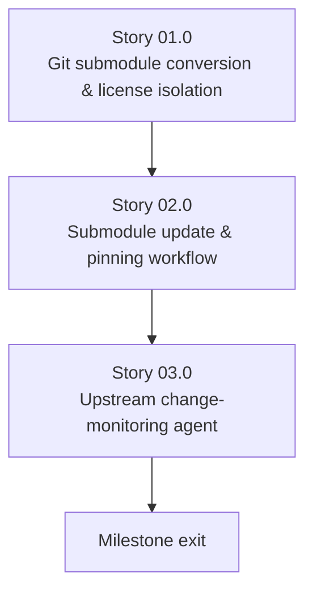

# Milestone 0008 - Upstream Reference Submodules and Monitoring Agent

**Package:** repository infrastructure | **Module root:** `c-versions/`, `.claude/agents/`

Replaces the two ad hoc symlinks under `c-versions/` (`dmidecode_linux` →
`~/Projects/dmidecode_linux`, `dmidecode_macos` → `~/Projects/dmidecode_macos`
- machine-local paths, invisible to git, unreproducible on any other
checkout) with real **git submodules** pinned to confirmed upstream
repositories, and adds a dedicated agent that periodically checks those
upstreams for changes and reports whether any are worth porting into this
project - closing the loop the earlier `dmidecode_macos` mis-assessment
(mistaken for an empty placeholder because symlinks don't `find` the way
real directories do) exposed: a reference that isn't tracked by git can't
be diffed, pinned, or watched for updates.

## Stories

| Story | Name                                          | Category       | Output                                                                       |
|-------|---------------------------------------------------|----------------|---------------------------------------------------------------------------------|
| 01.0  | Git submodule conversion and license isolation    | infrastructure | `.gitmodules` with both confirmed upstreams; a build-time guard against GPL leakage |
| 02.0  | Submodule update and pinning workflow             | infrastructure | A documented, human-approved bump procedure; CI verifies pinned SHAs         |
| 03.0  | Upstream change-monitoring agent                  | tooling        | `.claude/agents/dmidecode-upstream-watcher.md`; scheduled run; `docs/reviews/` reports |

## Confirmed upstreams

| Path                       | Submodule URL                                   | What it is                                                                  |
|-----------------------------|--------------------------------------------------|------------------------------------------------------------------------------|
| `c-versions/dmidecode_linux` | `https://github.com/mirror/dmidecode.git`       | GitHub mirror of the canonical upstream (`git://git.savannah.gnu.org/dmidecode.git`, per that repo's own README) |
| `c-versions/dmidecode_macos` | `https://github.com/acidanthera/dmidecode.git`  | The macOS-specific fork already cited throughout milestone 0005 (IORegistry/IOKit SMBIOS access) |

**Windows is deliberately excluded from this milestone** (user decision,
2026-11-03): no canonical, actively-maintained "dmidecode for Windows"
port is known to exist - upstream dmidecode's own build model assumes
`/dev/mem`, which Windows has no equivalent of, and `win_bios.h`
(milestone 0005, Story 04.0) already wraps the real Windows-native
mechanism (`GetSystemFirmwareTable`) directly rather than through a ported
C parser. Windows's "upstream reference" is Microsoft's own public API
documentation, not a git repository - Story 03.0's monitoring agent
watches that documentation page for changes instead of a third submodule.
If a credible Windows port is identified later, adding it as a third
submodule is a small follow-up to this milestone, not a redesign of it.

## Key constraints

- **License isolation is load-bearing, not incidental.** Both
  `dmidecode_linux` and `dmidecode_macos` are GPL-2.0-or-later (per their
  own `LICENSE` files, already present in the symlinked checkouts). This
  project's own license is unaffected only as long as neither submodule's
  code is ever compiled into, statically or dynamically linked with, or
  textually copied into any `libsmbios`/`smbios`/`smbios_c` build
  target - exactly what CLAUDE.md's existing "untracked reference
  material... not part of the build" statement already asserts, now
  enforced structurally (Story 01.0) rather than left as a documentation
  promise alone.
- Submodules are pinned to an exact commit SHA, never a floating branch -
  this project's whole point in this milestone is controlled, reviewed
  updates, not silently drifting upstream code.
- No submodule is added as a build dependency of any kind - no
  `add_subdirectory`, no `include_directories`, no vcpkg entry referencing
  either path.

## Requirements

1. **R1** - `c-versions/dmidecode_linux` and `c-versions/dmidecode_macos`
   are real git submodules (`.gitmodules` entries), not symlinks, pinned
   to the confirmed URLs above at an explicit commit SHA.
2. **R2** - A CI check (or pre-commit hook) fails the build if either
   submodule's path is ever referenced from any `CMakeLists.txt`,
   `vcpkg.json`, or `#include` directive anywhere under any of this
   project's own build-product directories: `libsmbios/`, `smbios/`
   (the CLI), `sys_interface/`, `libsmbios_win/`, `libsmbios_macos/`,
   `libsmbios_linux/`, `libsmbios_win_legacy/`, `libsmbios_posix_legacy/`,
   or `smbios_c/` once it exists - the full repo-root library set as of
   the later build-layout restructure (see CLAUDE.md), not just the two
   named when this milestone was first specced. The structural
   enforcement of the license-isolation constraint above.
3. **R3** - A documented procedure exists for bumping a submodule's pinned
   commit: who/what proposes a bump (the Story 03.0 agent, via its
   report), who approves it (a human, via normal PR review - never an
   automated merge), and what must be re-verified afterward (the
   functional test suite, since a bumped reference could change which
   algorithms milestones 0003/0005 should have ported but haven't yet).
4. **R4** - `.claude/agents/dmidecode-upstream-watcher.md` exists,
   following this project's established agent-definition convention
   (frontmatter: `name`, `description`, `model`, `tools`, `allowed-tools`;
   see `.claude/agents/background-reviewer.md` for the pattern), scoped
   specifically to the two (confirmed) submodules plus the Windows API
   documentation page (per the exclusion above), writing dated reports to
   `docs/reviews/` per that directory's existing naming convention
   (`<type>-<scope>-<YYYY-MM-DD>.md`).
5. **R5** - The agent's report distinguishes, per upstream change found:
   *cosmetic* (formatting, comment, CI-config changes - no action), *new
   information* (a new SMBIOS structure/field/quirk this project's
   milestones 0003-0005 don't yet cover - worth a future roadmap task),
   and *correctness* (a bug fix upstream that this project's already-ported
   logic should mirror - worth a prioritized follow-up). Not every
   upstream commit is "worth fixing" - the agent's job is triage, not
   blind change-forwarding.

## Non-goals

- Automatically applying any upstream change to this project's own
  `libsmbios`/`smbios` source - every finding is a recommendation in a
  report, reviewed and ported by a human/another agent in a separate,
  normal change, never an automated merge.
- A Windows submodule (see "Confirmed upstreams" above).
- Re-litigating any decision already made in milestones 0003/0004/0005
  about what was already ported from these references - this milestone
  is about *keeping pace with future upstream changes*, not re-auditing
  past ones.

## Dependency graph

Story 03.0 depends on Story 02.0's bump procedure existing (the agent's
reports are meaningless without a documented process for acting on them),
which depends on Story 01.0's submodules existing at all.
