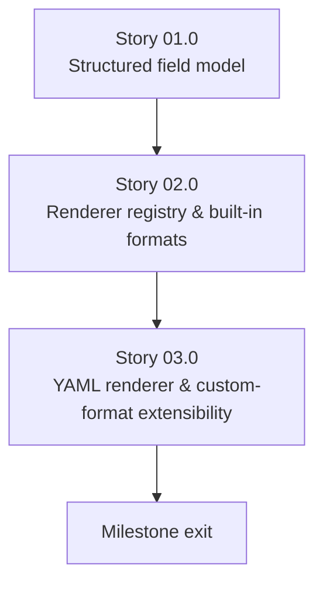

# Milestone 0009 - Structured Output Formats

**Package:** `smbios` / `smbios_util` | **Module root:** `smbios/include/smbios/`, `smbios_util/`

Today, `smbios_util` has exactly one output path:
`main.cpp` calls `entry->render_to_description()` per structure and writes
the resulting free-form, human-readable text straight to `std::cout`
([main.cpp:84-92](/smbios/src/main.cpp)). That string is meant for a
person to read, not a program to parse - which is precisely the complaint
behind every third-party `dmidecode`-output scraper that has ever had to
regex a vendor string out of indented text. This milestone adds a real
**structured field model** underneath every entry type, and a
**self-registering output-formatter registry** (the same pattern milestone
0004 already established for entry types) producing text, XML, JSON, and
YAML from that one shared model - plus a documented extension point so a
"custom format" is a registration, not a fork.

## Stories

| Story | Name                                             | Category | Output                                                                         |
|-------|-----------------------------------------------------|----------|-----------------------------------------------------------------------------------|
| 01.0  | Structured field model                             | core     | `FieldValue` variant; `get_fields()` on every entry type (milestone 0004's eleven) |
| 02.0  | Renderer registry and built-in formats             | core     | `IOutputFormatter`; self-registering registry; text/XML/JSON renderers           |
| 03.0  | YAML renderer and custom-format extensibility      | feature  | YAML renderer; a worked third-party-formatter example; `--format` CLI wiring     |

## Rationale

`render_to_description()` exists on every `AbstractSMBiosEntry` subclass
and is genuinely useful - it stays, as the default/`text` format. But it's
a `std::stringstream` building prose with embedded `\t`/`\n` formatting
baked in; there is no way to ask one of these entries "give me your fields
as data" without re-parsing that prose back apart, which is exactly the
anti-pattern every `dmidecode | awk '/Vendor/{print $2}'` script already
suffers from. The fix is a second, parallel representation - a flat list
of `(name, value)` pairs, where `value` is a small typed variant (string /
unsigned integer / boolean / raw bytes) - that every renderer (including a
rewritten text renderer, for consistency) walks generically, instead of
each output format needing its own per-entry-type knowledge.

## Requirements

1. **R1** - Every entry type implements `get_fields() ->
   std::vector<NamedField>` (contract **C1**), covering the same
   information `render_to_description()` already prints - built from the
   same already-decoded getters (milestone 0003/0004's `read_uN`
   accessors), not a second independent decode path.
2. **R2** - `IOutputFormatter` (contract **C2**) is a self-registering
   factory keyed by format name string, following milestone 0004 Story
   01.0's `REGISTER_SMBIOS_ENTRY`-style macro pattern exactly - adding a
   new format later is a new file registering itself, not an edit to a
   shared formatter-selection function.
3. **R3** - Built-in formats: `text` (the existing
   `render_to_description()` output, byte-identical, so no currently
   working invocation of `smbios_util` changes behavior - this is the
   default when `--format` is omitted), `xml`, `json`. YAML is Story
   03.0, not this requirement.
4. **R4** - Every renderer operates on `get_fields()`'s output alone for
   `xml`/`json`/`yaml` - none of them calls any entry-type-specific getter
   directly. (The `text` formatter is the one permitted exception, reusing
   `render_to_description()` verbatim for exact backward compatibility,
   per R3.)
5. **R5** - The "custom format" ask is satisfied by the extension point
   itself (R2's registry), demonstrated with one concrete, real example
   format (a CSV formatter, Story 03.0) proving a third party can add a
   format with zero changes to `smbios`/`smbios_util`'s existing files -
   not a fifth hardcoded built-in format bolted on alongside the other
   four.
6. **R6** - `--format <name>` is added to `smbios_util`'s CLI
   (`command_line_parser.cpp`), validated against the registry at
   startup (an unknown format name is a clear command-line error, not a
   crash).

## Shared contracts

### C1 - Structured field model (`smbios/include/smbios/field_value.hpp`, `named_field.hpp`, new)

```cpp
namespace smbios {

using FieldValue = std::variant<std::string, uint64_t, bool, std::vector<uint8_t>>;

struct NamedField {
    std::string name;   // e.g. "Vendor", "BIOS Characteristics"
    FieldValue value;
};

// Added to AbstractSMBiosEntry (pure virtual - every concrete entry must implement it):
virtual std::vector<NamedField> get_fields() const = 0;

} // namespace smbios
```

A bitmask property list (e.g. `BiosInformationEntry`'s
`get_properties_string()`) becomes one `NamedField` per *set* bit (name =
the property's string, value = `true`), not one field holding a
comma-joined string - so a JSON/YAML consumer gets a real array/object,
not more prose to re-split.

### C2 - Self-registering output-formatter registry (`smbios/include/smbios/output_formatter.hpp`, new)

```cpp
namespace smbios {

class IOutputFormatter {
public:
    virtual ~IOutputFormatter() = default;
    virtual std::string render(const AbstractSMBiosEntry& entry) const = 0;
    virtual std::string format_name() const = 0;
};

void register_output_formatter(std::unique_ptr<IOutputFormatter> formatter);
const IOutputFormatter* get_output_formatter(const std::string& name); // nullptr if unregistered

} // namespace smbios

#define REGISTER_OUTPUT_FORMATTER(class_name) /* same static-init self-registration shape as REGISTER_SMBIOS_ENTRY, milestone 0004 Story 01.0 */
```

## Non-goals

- Re-deriving values independently per format - every non-text format
  reads `get_fields()` only (R4).
- A binary/compact format (protobuf, MessagePack) - text/XML/JSON/YAML
  plus the documented extension point cover the ask; a binary format is a
  future milestone if a real consumer asks for one.
- Changing `smbios_util`'s existing default invocation's output -
  `text` stays byte-identical (R3).
- A schema/DTD for the XML or JSON output - the shape is "one element/
  object per entry, one field per NamedField," not a formally versioned
  schema, in this first version.

## Dependency graph



**Depends on milestone 0004** (all eleven entry types and their getters
must already exist for Story 01.0 to wrap). Can proceed independently of
milestones 0005/0006/0007/0008.
