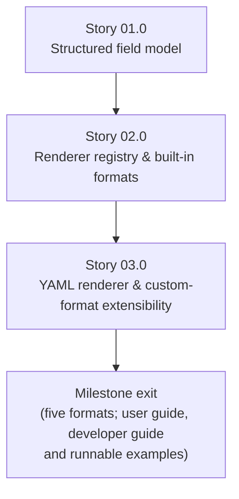

# Milestone 0009 - Structured Output Formats

**Package:** `libsmbios` (core library) / `smbios` (CLI) | **Module root:** `libsmbios/include/libsmbios/`, `libsmbios/src/`, `smbios/`

Today, the `smbios` CLI has exactly one output path:
`main.cpp` calls `entry->render_to_description()` per structure and writes
the resulting free-form, human-readable text straight to `std::cout`
([main.cpp:115-124](/smbios/src/main.cpp)). That string is meant for a
person to read, not a program to parse - which is precisely the complaint
behind every third-party `dmidecode`-output scraper that has ever had to
regex a vendor string out of indented text. This milestone adds a real
**structured field model** underneath every entry type, and a
**self-registering output-formatter registry** (the same pattern milestone
0004 already established for entry types) producing text, XML, JSON, and
YAML from that one shared model - plus a documented extension point so a
"custom format" is a registration, not a fork.

## Stories

| Story | Name                                             | Category | Output                                                                         |
|-------|-----------------------------------------------------|----------|-----------------------------------------------------------------------------------|
| 01.0  | Structured field model                             | core     | `FieldValue`/`NamedField`; `get_fields()` on all 45 registered entry types, migrated in four green batches |
| 02.0  | Renderer registry and built-in formats             | core     | `IOutputFormatter`; self-registering registry; text/XML/JSON renderers (hand-rolled JSON) |
| 03.0  | YAML renderer and custom-format extensibility      | feature  | Hand-rolled YAML renderer; a worked third-party CSV formatter; `--format` CLI wiring; runnable `examples/` run in CTest, fixture-generated doc samples, user and developer guides (R7, added 2026-11-10) |

## Rationale

`render_to_description()` exists on every `AbstractSMBiosEntry` subclass
and is genuinely useful - it stays, as the default/`text` format. But it's
a `std::stringstream` building prose with embedded `\t`/`\n` formatting
baked in; there is no way to ask one of these entries "give me your fields
as data" without re-parsing that prose back apart, which is exactly the
anti-pattern every `dmidecode | awk '/Vendor/{print $2}'` script already
suffers from. The fix is a second, parallel representation - a flat list
of `(name, value)` pairs, where `value` is a small typed variant (string /
unsigned integer / boolean / raw bytes) - that every renderer walks
generically, instead of each output format needing its own
per-entry-type knowledge.

## Scope: the 45 entry types

Milestone 0010 expanded the entry model from milestone 0004's eleven types
to **45 concrete `AbstractSMBiosEntry` subclasses**, each registered by
exactly one `REGISTER_SMBIOS_ENTRY` invocation in its own
`libsmbios/src/*_entry.cpp`, with its header under
`libsmbios/include/libsmbios/tables/`. There is no intermediate base class:
every one derives directly from `AbstractSMBiosEntry`. All 45 are in scope
for R1; Story 01.0's README lists them, grouped into the four migration
batches.

Two **test doubles** also derive from `AbstractSMBiosEntry` and must gain a
`get_fields()` override when it becomes pure virtual (Story 01.0's last
batch): `FakeTestEntry` (`tests/unit/smbios_entry_factory_test.cpp`) and
`TestEntry` (`tests/unit/dmi_string_parsing_test.cpp`). The `smbios_c` shim
(`smbios_c/src/smbios_c.cpp`) only *consumes* entries via
`SMBiosEntryFactory::create()`/`render_to_description()` and its typed
getters; it does not subclass `AbstractSMBiosEntry`, so the C1 change is
source-compatible for it, and its C ABI is unchanged by this milestone.

## Requirements

1. **R1** - Every entry type implements `get_fields() ->
   std::vector<NamedField>` (contract **C1**), covering the same
   information `render_to_description()` already prints - built from the
   same already-decoded getters (the `read_uN`-based accessors from
   milestones 0003/0004/0010), not a second independent decode path.
   `get_fields()` is **pure virtual** at milestone exit (ratified
   2026-11-10, see `status.md`).
2. **R2** - `IOutputFormatter` (contract **C2**) is a self-registering
   factory keyed by format name string, following milestone 0004 Story
   01.0's `REGISTER_SMBIOS_ENTRY`-style macro pattern exactly - adding a
   new format later is a new file registering itself, not an edit to a
   shared formatter-selection function.
3. **R3** - Built-in formats: `text` (the existing
   `render_to_description()` output, byte-identical, so no currently
   working invocation of the `smbios` CLI changes behavior - this is the
   default when `--format` is omitted), `xml`, `json`. YAML is Story
   03.0, not this requirement.
4. **R4** - Every renderer operates on `get_fields()`'s output alone (plus
   `get_type()` for the structure's label) for `xml`/`json`/`yaml` - none
   of them calls any entry-type-specific getter directly. (The `text`
   formatter is the one permitted exception, reusing
   `render_to_description()` verbatim for exact backward compatibility,
   per R3.)
5. **R5** - The "custom format" ask is satisfied by the extension point
   itself (R2's registry), demonstrated with one concrete, real example
   format (a CSV formatter, Story 03.0) proving a third party can add a
   format with zero changes to `libsmbios`'s or `smbios`'s existing source
   files - not a fifth hardcoded built-in format bolted on alongside the
   other four.
6. **R6** - `--format <name>` is added to the `smbios` CLI
   (`smbios/src/command_line_parser.cpp`, alongside today's `--help`,
   `--version`, `--memory-scan`, `--read-file`, `--dump-file`), validated
   against the registry at startup (an unknown format name is a clear
   command-line error with a non-zero exit, not a crash).
7. **R7** - **Examples and documentation** (added 2026-11-10 at the user's
   request; Story 03.0 Task 03).
   - Self-contained example programs are built by default and run in CTest
     on all three OSes, so they cannot rot. They cover:
     - a formatter-by-name consumer;
     - a direct `get_fields()`/`std::visit` consumer;
     - the CSV formatter (R5) as the documented "write your own formatter"
       walkthrough;
     - a CTest-checked JSON-consumption snippet.
   - A user guide (`docs/output-formats.md`) and a developer guide
     (`docs/dev/custom-output-formatter.md`) are added.
   - Every output sample in them is generated from a synthetic fixture that
     contains no real identifiers, and a check fails the build if a sample
     drifts from the code.
   - Doxygen comments are complete on every new public header.
   - The existing docs (`CLAUDE.md`, `README.md`, `docs/cli-usage.md`,
     `docs/architecture/overview.md`) are updated.

## Shared contracts

### C1 - Structured field model (`libsmbios/include/libsmbios/field_value.hpp`, new)

```cpp
namespace smbios {

/// One decoded value. std::vector<uint8_t> is for raw byte fields (UUID raw
/// form, Processor ID) where stringifying would be lossy or premature.
using FieldValue = std::variant<std::string, uint64_t, bool, std::vector<uint8_t>>;

struct NamedField {
    std::string name;   // e.g. "Vendor", "BIOS Characteristics"
    FieldValue value;
};

} // namespace smbios

// Added to AbstractSMBiosEntry (libsmbios/include/libsmbios/abstract_smbios_entry.hpp).
// Pure virtual at milestone exit; TEMPORARILY a non-pure virtual returning {}
// between Story 01.0 Task 01 and Task 05 (see Story 01.0 README).
virtual std::vector<NamedField> get_fields() const = 0;
```

`NamedField` lives in the same header as `FieldValue` (one header, not
two). A bitmask property list (e.g. `BiosInformationEntry`'s
`get_properties_string()`) becomes one `NamedField` per *set* bit (name =
the property's string, value = `true`), not one field holding a
comma-joined string - so a JSON/YAML consumer gets a real array/object,
not more prose to re-split. The `"Header type: ..."` line every
`render_to_description()` starts with is **not** a field: renderers take
the structure label from `get_type()`. Field names are unique within one
entry's `get_fields()` result (repeated groups carry a 1-based index
suffix), so map-shaped formats (JSON objects, YAML mappings) never see a
duplicate key.

### C2 - Self-registering output-formatter registry (`libsmbios/include/libsmbios/output_formatter.hpp`, new)

```cpp
namespace smbios {

class IOutputFormatter {
public:
    virtual ~IOutputFormatter() = default;
    virtual std::string render(const AbstractSMBiosEntry& entry) const = 0;
    virtual std::string format_name() const = 0;
};

void register_output_formatter(std::unique_ptr<IOutputFormatter> formatter); // throws std::logic_error on duplicate name
const IOutputFormatter* get_output_formatter(const std::string& name);       // nullptr if unregistered
std::vector<std::string> registered_output_formatter_names();              // sorted; for --help and the unknown-format error

} // namespace smbios

#define REGISTER_OUTPUT_FORMATTER(class_name) /* same static-init self-registration shape as REGISTER_SMBIOS_ENTRY, milestone 0004 Story 01.0 */
```

`registered_output_formatter_names()` is an addition over the first draft
of C2: R6's "clear error listing registered format names" needs an
enumeration API, and none existed.

**Linking note.** `REGISTER_OUTPUT_FORMATTER`, like
`REGISTER_SMBIOS_ENTRY`, only runs if its object file is linked. The `smbios`
CLI (`smbios/src/CMakeLists.txt`), `smbios_c` (`smbios_c/CMakeLists.txt`)
and the `tests/c_abi` targets already force-load `libsmbios` as a whole
archive, so built-in formatters placed in `libsmbios/src/` register there
automatically. `smbios_unit_test` (`tests/unit/CMakeLists.txt`) links
`libsmbios` as a plain archive: a unit test that looks a built-in formatter
up by name must also name that formatter's class (so its object file is
pulled in), exactly as the entry tests already do by constructing concrete
entry classes - see Story 02.0.

## Non-goals

- Re-deriving values independently per format - every non-text format
  reads `get_fields()` only (R4).
- A binary/compact format (protobuf, MessagePack) - text/XML/JSON/YAML
  plus the documented extension point cover the ask; a binary format is a
  future milestone if a real consumer asks for one.
- Changing the `smbios` CLI's existing default invocation's output -
  `text` stays byte-identical (R3).
- A schema/DTD for the XML or JSON output - the shape is "one element/
  object per entry, one field per NamedField," not a formally versioned
  schema, in this first version.
- Exposing `get_fields()` or formatters through the `smbios_c` C ABI -
  a possible follow-up milestone, not this one.
- Any new third-party dependency: JSON and YAML emitters are hand-rolled
  (ratified 2026-11-10, see `status.md`).

## Dependency graph



**Milestone exit** means all of the following:

- All five formats work through `smbios --format`.
- `text` is byte-identical to the pre-milestone output.
- The user guide, developer guide and runnable examples (R7) are published.
- The examples and doc samples are green in CI on all three OSes.

**Depends on milestones 0004 and 0010** (the self-registering entry factory,
and all 45 entry types with their getters, must already exist for Story
01.0 to wrap). Uses milestone 0006's `SyntheticTableBuilder` for its unit
tests. Independent of milestones 0005/0007/0008.
