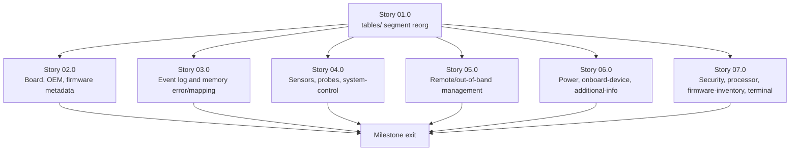

# Milestone 0010 - SMBIOS Structure Coverage Expansion

**Package:** `libsmbios` / `smbios` (core lib / CLI) | **Module root:**
`libsmbios/include/smbios/tables/`, `libsmbios/src/`, `smbios/src/`,
`tests/unit/`

`libsmbios` implements 11 of the 49 SMBIOS structure types the DMTF
SMBIOS 3.9.0 specification (`docs/standard/DSP0134_3.9.0.md`) defines:
Types 0, 1, 3, 4, 7, 8, 9, 16, 17, 19, 32. This milestone (1) reorganizes
those 11 entry classes - plus every one this milestone adds - into a
`tables/` segment under `include/smbios/`, matching this repo's own
established `include/<segment>/` convention (see ADR 0002), and (2)
implements entry classes for the 34 remaining non-obsolete types: 2, 11,
12, 13, 14, 15, 18, 20, 21, 22, 23, 24, 25, 26, 27, 28, 29, 30, 31, 33, 34,
35, 36, 37, 38, 39, 40, 41, 42, 43, 44, 45, 46, 126.

Types 5 (Memory Controller Information), 6 (Memory Module Information),
and 10 (On Board Devices Information) are excluded - confirmed by the
spec's own table of contents, which labels each of the three
"**(Type N, Obsolete)**" explicitly (`DSP0134_3.9.0.md` lines 91, 99, 127).
Implementing a structure the spec itself calls obsolete would mean writing
and testing parsing logic for a structure no SMBIOS-conformant firmware
built after the obsoleting revision should ever emit.

## Stories

| Story | Name                                                              | Category     | Output                                                                                     |
|-------|--------------------------------------------------------------------|--------------|----------------------------------------------------------------------------------------------|
| 01.0  | `tables/` segment reorg                                            | refactor     | 11 existing entry headers relocated to `include/smbios/tables/`; zero behavior change        |
| 02.0  | Board, OEM, and firmware metadata structures                      | feature      | Types 2, 11, 12, 13, 14                                                                        |
| 03.0  | Event log and memory error/mapping structures                     | feature      | Types 15, 18, 20, 33                                                                           |
| 04.0  | Sensors, probes, and small system-control structures               | feature      | Types 21, 22, 23, 24, 25, 26, 27, 28, 29                                                        |
| 05.0  | Remote/out-of-band management structures                          | feature      | Types 30, 31, 34, 35, 36, 37, 38, 42                                                           |
| 06.0  | Power, onboard-device, and additional-info structures             | feature      | Types 39, 40, 41                                                                               |
| 07.0  | Security, processor, firmware-inventory, and terminal structures   | feature      | Types 43, 44, 45, 46, 126                                                                      |

34 new types across 6 feature stories (02.0-07.0), each 4-9 types, plus the
one reorg story (01.0) that must land first.

## Rationale

Milestone 0004's Story 02.0 already established the house style for this
exact kind of work: several closely-related `AbstractSMBiosEntry`
subclasses grouped per task, one story, with a shared "Tests" task closing
it out - not one task per type (which would be 34 near-identical task
documents for types whose field counts range from zero, Type 126, to
dozens, Type 15's System Event Log) and not one giant task for all 34
(which violates this project's own "one task = one atomic unit of verified
progress" discipline, the same reasoning milestone 0004's own story README
names explicitly). This milestone's 6 feature stories group types by spec
section proximity and shared field shape - the same two groupings
milestone 0004 used ("System Slots and Memory Array" grouped by shared
"legacy sentinel -> wider field" idiom, not by spec section order alone) -
so that each task's reference-cross-checking work (DSP0134 field tables,
and `c-versions/`'s dmidecode sources as the existing precedent
recommends) covers types that already resemble each other.

The `tables/` reorg lands first, as its own story, specifically so that
none of the 34 new entry classes are written flat and relocated a second
time - see ADR 0002 for the full reorg design and rationale.

## Requirements

1. **R1** - Every existing entry header (11 files) is relocated to
   `libsmbios/include/smbios/tables/*.hpp` per ADR 0002; every corresponding
   `.cpp` stays flat in `libsmbios/src/` (ADR 0002's Decision point 2); the
   one `CMakeLists.txt` glob line is updated; every `#include` call site
   (CLI, tests) is updated to the new path. Full existing test suite passes
   unmodified (assertions unchanged; only `#include` paths change in test
   files that include an entry header directly).
2. **R2** - Each of the 34 remaining non-obsolete SMBIOS structure types
   (2, 11-15, 18, 20-31, 33-46, 126) gets its own `AbstractSMBiosEntry`
   subclass under `libsmbios/include/smbios/tables/`/`libsmbios/src/`,
   written directly against the field-table accessor pattern
   (`read_uN(raw_data(), offset)` behind a `get_entry_size() >= offset +
   width` guard - no `reinterpret_cast`, no version-named struct), matching
   every currently-implemented entry class's shape exactly (constructor
   `(const DMIHeader&, const SMBiosVersion&, const uint8_t*)`, a type check
   against its own `SMBiosHandler` value, `get_type()`/
   `render_to_description()` overrides).
3. **R3** - Each new entry class self-registers via
   `REGISTER_SMBIOS_ENTRY(handler_value, class_name)` in its own `.cpp`
   (never its header) - zero edits to `smbios_entry_factory.{h,cpp}`
   required, per that factory's own existing design.
4. **R4** - Field layouts, offsets, and enum value tables are taken from
   DSP0134 3.9.0 directly for each type (section 7.N, per the spec's own
   table of contents), cross-checked against `c-versions/`'s dmidecode
   sources where that reference covers the same type - matching milestone
   0004's own "spec first, dmidecode as cross-check, not as the primary
   source" precedent.
5. **R5** - Every public class/function added by this milestone has a
   complete Doxygen comment from its first commit (matching milestone
   0006's R5 bar - this milestone does not get a deferred documentation
   pass of its own).
6. **R6** - Each new entry type's tests are built via
   `smbios::test::SyntheticTableBuilder`
   (`tests/unit/synthetic_table_builder.hpp`, milestone 0006 Story 01.0) -
   no hand-rolled byte arrays, per that builder's own stated purpose.
7. **R7** - `smbios/src/command_line_parser.cpp`/`main.cpp` (the CLI) gains
   display support for every new type as part of the same task that adds
   the type - not deferred to a later pass, matching milestone 0004 Story
   02.0's own "Key constraints" on this point.
8. **R8** - Where a structure type's variable-length trailing payload is
   genuinely open-ended per spec (e.g. Type 15's event-log records, Type 40's
   additional-information entries, Type 44's processor-specific blocks),
   the entry class documents an explicit, deliberate scope cutoff in its
   class-doc comment (matching `SystemSlotsEntry`'s and
   `SystemBootInformationEntry`'s own precedent) rather than silently
   stopping short with no explanation.

## Non-goals

- **Types 5, 6, 10 (Obsolete)** - excluded; confirmed Obsolete by the
  spec's own table of contents labelling. Not implemented by this
  milestone or any future one, barring a future user request that
  explicitly overrides this.
- **Type 126 (Inactive)** - included, but deliberately *not* given its own
  story or task: per spec (7.48), it has no fields of its own - the
  structure's `type`/`length`/`handle` header alone, with `type` itself
  being the only information it carries ("ignore this structure"). It is
  tacked onto Story 07.0's Task 03 as a one-line addition (a trivial
  `InactiveEntry` whose `render_to_description()` says exactly that),
  rather than warranting its own task document.
- **Migrating any entry class (existing or new) onto milestone 0009's
  planned `FieldValue`/structured-output model.** Milestone 0009
  (`docs/roadmap/0009-structured-output-formats/`) is independent,
  currently "Not started," and proposes changing every entry's rendering
  interface. This milestone's 34 new classes are written against the
  *current* `get_type()`/`render_to_description()` shape, matching every
  existing entry class as of this writing. If milestone 0009 lands first,
  its own migration story is responsible for carrying these new classes
  along with the rest - this milestone does not attempt to pre-empt or
  coordinate with that unstarted design.
- **Any change to `ISmbiosSource`, the acquisition pipeline, or the CLI's
  output-format selection.** Out of scope; this milestone is purely about
  structure-type *coverage*, not how bytes are acquired or how output is
  shaped beyond R7's plain-text CLI display.
- **Performance tuning.** No new performance requirements; `tests/perf/`
  is untouched by this milestone beyond whatever incidental effect having
  34 more registered entry types has on enumeration time (expected
  negligible - `SMBiosEntryFactory::create()` is an O(log n) map lookup
  per structure, not a linear scan).

## Dependency graph

Story 01.0 is the only hard dependency - every new entry header must land
in `include/smbios/tables/` from its first commit (ADR 0002), so no
feature story can start writing files until the directory exists and the
CMake glob picks it up. Stories 02.0-07.0 touch disjoint sets of entry
class files and have no dependency on each other; they can proceed in any
order or in parallel. The one shared file every story's last task touches
- `smbios/src/command_line_parser.cpp`/`main.cpp` (R7) - is a real
sequencing risk (merge conflicts, not a logical dependency) if stories run
concurrently; recommend serializing the CLI-display edit specifically, or
running stories 02.0-07.0 in table order to minimize conflict churn, even
though nothing in this plan *requires* that order.
