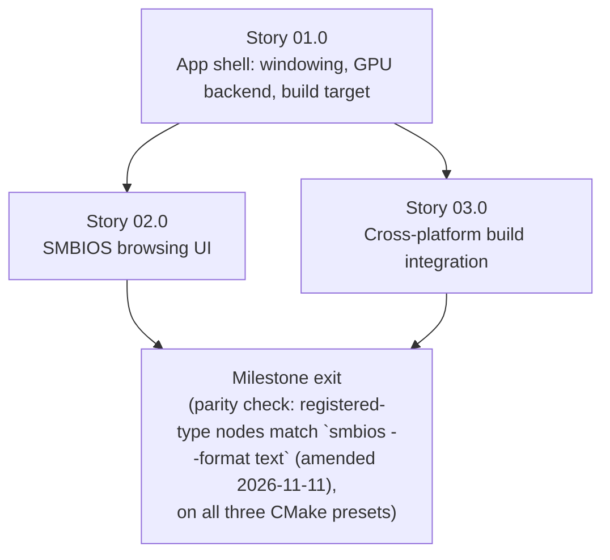

# Milestone 0011 - GUI Visualization Tool

**Package:** new `smbios_gui` | **Module root:** `smbios_gui/include/smbios/gui/`, `smbios_gui/src/`

Every way to look at a parsed SMBIOS table today is textual: the `smbios`
CLI's default `render_to_description()` output, or - since milestone 0009 -
one of `IOutputFormatter`'s registered `text`/`xml`/`json`/`yaml`/`csv`
formats. There is still no way to *browse* a table interactively - expand
one structure, inspect one field, compare two memory devices side by side -
without piping that text through another tool. This milestone builds that
browser: a cross-platform desktop GUI, `smbios_gui`, that links `libsmbios`
directly and walks its milestone-0009 structured-field seam
(`SMBios` iteration + `SMBiosEntryFactory::create()` + `get_fields()`)
straight into a tree-and-field-table view, with a "copy as..." action that
reuses the existing `IOutputFormatter` registry instead of embedding a
second renderer.

This milestone implements
[docs/adr/0003-gui-toolkit-for-smbios-visualization.md](/docs/adr/0003-gui-toolkit-for-smbios-visualization.md)
(**Dear ImGui**, status Proposed as of this writing - this milestone is the
"future roadmap milestone" that ADR anticipated). Nothing below is
implemented yet; every story and task starts "Not started."

## Stories

| Story | Name                                             | Category | Output                                                                         |
|-------|-----------------------------------------------------|----------|-----------------------------------------------------------------------------------|
| 01.0  | App shell: windowing, GPU backend and build target | core     | `smbios_gui` CMake target; GLFW+OpenGL3 window/frame loop; Dear ImGui context; whole-archive link of `libsmbios` |
| 02.0  | SMBIOS browsing UI: entry tree and field table     | feature  | View-model layer over `get_fields()`; tree + field-table rendering; "copy as..." via the existing formatter registry |
| 03.0  | Cross-platform build integration                   | infrastructure | `CMakePresets.json`/root `CMakeLists.txt` wiring on Windows/Linux/macOS; CI build-only wiring |

## Rationale

ADR 0003 already did the toolkit comparison (Dear ImGui vs. Qt Widgets vs.
wxWidgets vs. a deferred Tauri/web-view path) and recommends Dear ImGui on
six decision drivers: consuming the real `get_fields()` seam directly
(DD1), packaging weight proportional to a solo/small-team OSS project
(DD2), an MIT license that puts no copyleft or commercial obligation on
`libsmbios`'s link graph (DD3), not designing around a Rust/Python/C#
binding that does not exist (DD4), no retained widget-tree/signal-slot/
MOC-step maintenance burden (DD5), and fitting the existing
`CMakePresets.json`/vcpkg pipeline without a second build mechanism (DD6).
This milestone does not re-litigate that comparison; it schedules and
decomposes the work the ADR's own Decision and Validation/Rollout sections
already describe: a new, independent CMake target that links `libsmbios`
as a whole archive (ADR 0003's Decision), a tree view keyed by `SMBios`
iteration + `DMIHeader::get_type()` expanding into one row per `NamedField`
from `get_fields()` (ADR 0003's Decision), and a "copy as..." action that
calls `get_output_formatter(name)` rather than a second JSON/XML/YAML
writer (ADR 0003's Decision; milestone 0009's R4/R5 non-goal of
reimplementing format logic a second time applies here too).

The ADR's own rollout bar is this milestone's own bar: "a minimal spike
(one window, one `SMBios` instance, a tree of real structures from the
current host, `get_fields()` rendered as rows) ... on all three CMake
presets ... before any further UI work" and "the GUI shows the same
structures, in the same count, as `smbios`'s own `--format text` output for
the same live table." Story 01.0 is that spike; Story 02.0's exit gate is
that parity check.

> **Amended 2026-11-11 (maintainer ruling, see `status.md`):** "same structures, in the same count" means the *registered-type* structures. The CLI's `render_document()` skips structure types with no registered entry class, while the GUI keeps them as `Unknown (0xNN)` nodes (GC1). The parity gate therefore compares registered-type nodes only (count and type order) against `smbios --format text`/`json`; unregistered structures are extra GUI-only nodes.

## Key constraints

- **Links `libsmbios` whole-archive, exactly like `smbios` and `smbios_c`
  do.** `smbios_gui` names no concrete `AbstractSMBiosEntry` subclass or
  `IOutputFormatter` subclass directly, so without the same
  `-force_load`/`/WHOLEARCHIVE`/`--whole-archive` three-way block
  `smbios/src/CMakeLists.txt`, `smbios_c/CMakeLists.txt` and
  `examples/CMakeLists.txt` already use, no `REGISTER_SMBIOS_ENTRY` or
  `REGISTER_OUTPUT_FORMATTER` static initializer would run inside this
  binary, and both `SMBiosEntryFactory::create()` and
  `get_output_formatter()` would silently return `nullptr` for every type/
  format. See Story 01.0, Task 02.
- **Depends on milestone 0009's structured field model.** `get_fields()` is
  pure virtual on every `AbstractSMBiosEntry` subclass and
  `IOutputFormatter`/`get_output_formatter()`/
  `registered_output_formatter_names()` exist exactly as milestone 0009
  Story 02.0 shipped them - this milestone adds no new field-decoding or
  rendering logic of its own (ADR 0003 DD1; mirrors milestone 0009's own R4:
  every non-text consumer reads `get_fields()` only).
- **Immediate-mode means no retained widget-tree lifecycle.** Dear ImGui
  rebuilds its entire UI from the view model every frame; there is no
  persistent widget object graph to construct, destroy, or keep in sync
  with the data (ADR 0003 DD5). The only lifecycle this milestone does
  manage explicitly is the GLFW window/GL context and the Dear ImGui
  context themselves (Story 01.0, Task 02) - a resource-acquisition/
  release pair, not a UI-framework lifecycle.
- **No native look-and-feel - an accepted tradeoff, not a defect.** No
  Windows/macOS/GTK theming, no native menu bar, no OS accessibility-API
  integration. ADR 0003's Decision names this explicitly as the trade a
  read-mostly diagnostic tool makes against Qt/wxWidgets's heavier
  licensing/maintenance cost. Do not scope a "make it look native" task
  into this milestone; revisiting ADR 0003 is the correct path if that is
  ever needed.
- **Read-only.** `smbios_gui` only displays a parsed table; it writes
  nothing back to firmware, to `SMBios`, or to any entry. "Copy as..."
  copies rendered text to the OS clipboard - it does not write a file (no
  `--dump-file`/`--read-file` equivalent in this milestone; see Non-goals).
- **New third-party dependencies, resolved through the existing
  `vcpkg.json` manifest.** Dear ImGui and one windowing/GPU backend are new
  entries in `vcpkg.json`'s `dependencies` list, pinned to the same
  `builtin-baseline` every other dependency already uses - not a second
  dependency-resolution mechanism (ADR 0003 DD6). See Story 01.0, Task 01.
- **One windowing/GPU backend for every platform, not three.** GLFW +
  OpenGL3 (the standard Dear ImGui example backend pairing the ADR itself
  names) is used uniformly on Windows, Linux and macOS, rather than
  Win32+D3D11 on Windows and Metal on macOS. This keeps Story 01.0's build
  wiring, and Story 03.0's per-OS preset wiring, to one backend pair
  instead of three - the smaller-footprint reading of ADR 0003 DD2/DD6 for
  a solo/small-team project. OpenGL being formally deprecated (but still
  functional) on recent macOS is accepted under the same DD5/DD2 reasoning
  the ADR already applied to native look-and-feel: revisit only if a real
  macOS compatibility problem appears, not speculatively.
- **Follows this project's `include/smbios/<segment>/` convention.**
  `smbios_gui` is an executable, like `smbios` (the CLI) and `smbios_c`
  (the C ABI shim) - both of which place their own private headers under
  `include/smbios/...` even though their directory names differ from
  `smbios` (root `CLAUDE.md`'s Architecture section). `smbios_gui`'s own
  private headers therefore live at `smbios_gui/include/smbios/gui/*.hpp`
  (segment `gui`), sources flat in `smbios_gui/src/*.cpp`, and view-model
  types are declared in a nested `smbios::gui` namespace - the same
  `smbios::` namespace every other library in this repo uses, per
  `CLAUDE.md`'s "same namespace everywhere regardless of directory" rule.

## Non-goals

- **Native look-and-feel, accessibility-API integration, a native menu
  bar.** Explicitly ruled out by ADR 0003's Decision; see Key constraints.
- **Editing or writing SMBIOS data.** Read-only viewer; no write-back path
  of any kind.
- **`--read-file`/loading a saved dump into the GUI.** `smbios`'s own
  `--read-file` is still an unimplemented `TODO`
  (`smbios/src/main.cpp`, per milestone 0009's `status.md` carried-forward
  notes) and `SMBios` has no public buffer-injecting constructor outside
  the test-only `SmbiosTableWalkTestAccess` friend seam. `smbios_gui`
  therefore reads only the live machine, exactly like the milestone 0009
  `examples/` programs, and degrades to an empty, well-formed view (not a
  crash) when no `ISmbiosSource` succeeds. Loading a saved dump is a future
  milestone, gated on `--read-file` landing first.
- **A full packaging/installer pipeline** (code signing, `.app`/`.dmg`/
  `.msi`/AppImage bundling, an application icon). Story 03.0 covers CMake/
  CTest build wiring across the three presets only - see that story's own
  Non-goals for the explicit line.
- **Any new C ABI surface, or exposing `get_fields()`/`IOutputFormatter`
  through `smbios_c`.** `smbios_gui` links `libsmbios`'s C++ headers
  directly (ADR 0003 DD1/DD4); it has no relationship to `smbios_c`
  whatsoever, matching milestone 0009's own non-goal on this point.
- **A Rust/Python/C# binding, or a web-view/Tauri-style shell.** Ruled out
  by ADR 0003's DD4 and Alternative E; no such binding exists today, and
  building one is not in scope for a GUI milestone that does not need it.
- **Pixel-level / visual-regression UI testing.** See each story's final
  "tests" task for the explicit testing-scope call: only the data-fetch/
  view-model logic layer is unit-tested; the Dear ImGui rendering calls
  themselves are verified by manual run, not by an automated pixel or
  widget-tree assertion. This is a deliberate scope line, not an oversight
  - see the per-story tests tasks for why an automated pixel test is not a
  realistic bar for an immediate-mode UI in this project's CI.
- **Multi-table diffing/comparison view, search/filter UI, light/dark
  theme switching, or any other UI feature beyond "browse one live table's
  structures and fields."** A future milestone's scope if a real need
  appears; this milestone is the minimal browsing tool the ADR scoped.

## Shared contracts

### GC1 - GUI view-model types (`smbios_gui/include/smbios/gui/view_model.hpp`, new)

A pure-data, Dear-ImGui-free layer between `libsmbios`'s entry model and
the rendering code (Story 02.0, Task 01), so the view construction logic is
unit-testable without a window, a GPU context, or Dear ImGui linked in at
all:

```cpp
namespace smbios::gui {

/// One row of an entry's field table - a direct copy of one NamedField,
/// plus nothing else. No GUI-specific decoding: FieldValue's std::variant
/// alternative is still the renderer's (Story 02.0 Task 02's) decision to
/// make, via std::visit, exactly as the milestone 0009 examples already do.
struct FieldRow {
    std::string name;
    smbios::FieldValue value;
};

/// One tree node - one DMIHeader with no registered AbstractSMBiosEntry
/// (SMBiosEntryFactory::create() returned nullptr) still becomes a node
/// with an empty `fields` list and a label built from its raw type number
/// alone, never silently dropped: the tree's structure count must always
/// equal SMBios's own iteration count, which is this story's own exit-gate
/// parity check (see Story 02.0's README).
struct EntryNode {
    size_t type;           // DMIHeader::get_type()
    uint16_t handle;        // DMIHeader::handle
    std::string label;      // e.g. "BIOS Information" (from SMBios::SMBiosHandler), or "Unknown (0x80)" for an OEM/unregistered type
    std::vector<FieldRow> fields; // get_fields() result, copied as-is; empty if unregistered
};

/// Builds one EntryNode per structure in `bios`, in SMBios iteration order.
/// Pure function: no Dear ImGui call, no I/O beyond what SMBios/
/// SMBiosEntryFactory/get_fields() already do. Never throws except
/// std::bad_alloc.
std::vector<EntryNode> build_entry_tree(smbios::SMBios& bios);

} // namespace smbios::gui
```

`build_entry_tree()` is the one function Story 02.0's unit tests exercise
directly (via `SyntheticTableBuilder` fixtures, milestone 0006); the
rendering code (Story 02.0, Task 02) consumes its `std::vector<EntryNode>`
result and nothing else of `libsmbios`'s model directly, so the two layers
can be developed and tested independently. "Copy as..." (Story 02.0, Task
03) does not go through GC1 at all - it calls `get_output_formatter(name)`/
`render_document()` directly against the live `SMBios`/entries, per ADR
0003's Decision.

## Dependency graph



Story 03.0 (per-OS preset/CI wiring) depends only on Story 01.0's
`smbios_gui` target existing and can proceed in parallel with Story 02.0's
UI work, the same relationship milestone 0007's Story 03.0 had to its
Story 02.0.

**Depends on milestone 0009** (R1's `get_fields()` on every entry type, R2's
`IOutputFormatter` registry, both already shipped - see
[docs/roadmap/0009-structured-output-formats/plan.md](/docs/roadmap/0009-structured-output-formats/plan.md))
and on
[docs/adr/0003-gui-toolkit-for-smbios-visualization.md](/docs/adr/0003-gui-toolkit-for-smbios-visualization.md)
(the toolkit decision this milestone implements). Uses milestone 0006's
`SyntheticTableBuilder` for Story 02.0's view-model unit tests. Independent
of milestones 0005/0007/0008/0010.
