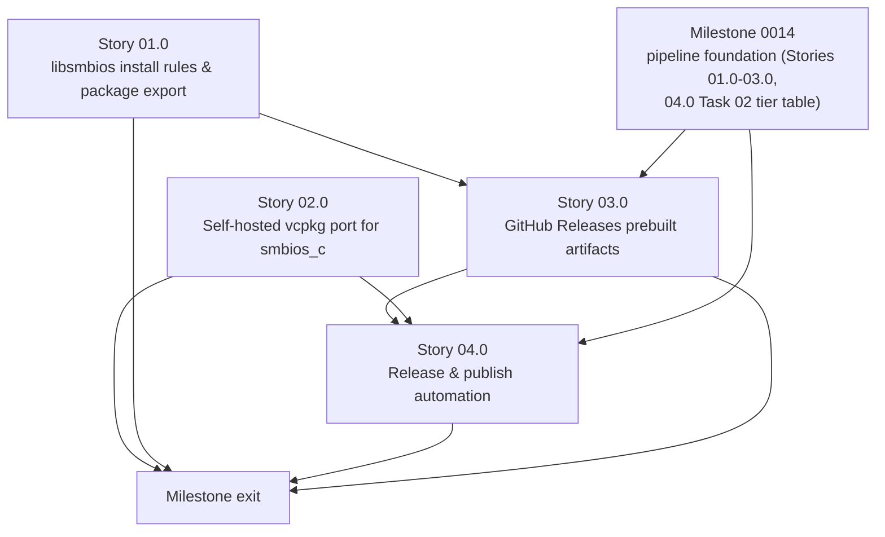

# Milestone 0012 - Package Manager Distribution for `libsmbios` and `smbios_c`

**Package:** `libsmbios` (new `install()`/export rules) and `smbios_c` (new self-hosted vcpkg port) | **Module root:** `libsmbios/CMakeLists.txt`, `libsmbios/src/CMakeLists.txt`, `ports/smbios-c/`, `vcpkg-configuration.json`, `.github/workflows/`

Implements [docs/adr/0004-package-manager-distribution.md](/docs/adr/0004-package-manager-distribution.md)
in full: a self-hosted vcpkg port for `smbios_c` (not a central
`microsoft/vcpkg` submission, not Conan), a GitHub Releases baseline of
prebuilt per-platform artifacts running in parallel, and - closing the one
gap the ADR's own Context section names as real, unresolved prerequisite
work - `libsmbios`'s first `install()`/CMake-package-export rules, so the
whole-archive footgun described there (`target_link_libraries(consumer
PRIVATE libsmbios)` silently losing every `REGISTER_SMBIOS_ENTRY`) is fixed
by construction rather than left for a future milestone to discover again.
Nothing in this milestone is implemented yet; every story and task below
starts "Not started."

**Amended 2026-11-12 by [ADR 0005](/docs/adr/0005-unified-build-package-publish-pipeline.md)**
(unified build, package and publish pipeline). This milestone's workflow
work is no longer a separate `release.yml`. It defines the `package`,
`verify` and `publish` **stages** of the one pipeline
(`lint -> build/test -> package -> verify -> publish`). That pipeline's
shared foundation is owned by
[milestone 0014](/docs/roadmap/0014-ci-rework-from-scratch/plan.md):

- the step runner and report contract (RC1-RC5), with reporter backends;
- neutral `CI_*` environment names;
- the pinned toolchain;
- the policy gate (P1-P13);
- `scripts/ci/stage.py`;
- `scripts/ci/check_versions.py`;
- the entry workflow and the reusable stage workflows;
- stage contracts SC1-SC4.

This milestone consumes that foundation. It does not restate it.

- Story 03.0 is the `package` stage definition.
- Story 04.0 is the `verify` and `publish` stage definitions, plus the
  version sites and release preparation.

## Stories

| Story | Name                                                  | Category       | Output                                                                                   |
|-------|-----------------------------------------------------------|----------------|---------------------------------------------------------------------------------------------|
| 01.0  | `libsmbios` install rules and whole-archive-safe package export | infrastructure | `install()` rules for `libsmbios` + its per-OS/legacy libraries; `libsmbiosConfig.cmake` exporting `libsmbios::libsmbios` with the whole-archive link baked in as an `INTERFACE` link option |
| 02.0  | Self-hosted vcpkg overlay/registry port for `smbios_c`   | infrastructure | `ports/smbios-c/{portfile.cmake,vcpkg.json}`; a self-hosted vcpkg git-registry layout (`versions/baseline.json` + per-port version files) a consumer points their own `vcpkg-configuration.json` at |
| 03.0  | GitHub Releases prebuilt artifacts (Windows/Linux/macOS)  | infrastructure | The pipeline's **`package` stage** (ADR 0005 D1/D4): `stage.py package` archives the build stage's tested `cmake --install` tree per packaging leg (`smbios_c` + `libsmbios`), with `.sha256` files and `manifest.json`. No rebuild, no separate `release.yml` |
| 04.0  | Release and publish automation                            | infrastructure | The pipeline's **`verify` and `publish` stages** (ADR 0005 D6) plus release preparation: the D5 version derivation and new version-site rows for 0014's `check_versions.py`; a clean-room verify of the exact archives; a gated draft -> promote GitHub Release; a registry PR; a post-publish check (see [review](/docs/reviews/milestone-0012-packaging-automation-2026-11-12.md)) |

## Rationale

ADR 0004 ([docs/adr/0004-package-manager-distribution.md](/docs/adr/0004-package-manager-distribution.md))
decides to package **`smbios_c` first**, via a **self-hosted vcpkg
overlay/registry port**, with a **GitHub Releases baseline running in
parallel** - and to defer both `libsmbios`'s own C++-surface packaging and
any Conan work. The ADR's own Decision drivers explain why `smbios_c`
leads:

- **DD1 (don't package a footgun)** - `smbios_c` is built `SHARED` and
  already whole-archive-links `libsmbios` plus an explicit export allowlist
  inside its own `CMakeLists.txt` (milestone 0007), so it is self-contained:
  a consumer links `smbios_c` alone and gets every `REGISTER_SMBIOS_ENTRY`
  static initializer for free. `libsmbios` itself has **no `install()` rule
  at all** today (confirmed: neither `libsmbios/CMakeLists.txt` nor
  `libsmbios/src/CMakeLists.txt` calls `install()`), and a naive
  `target_link_libraries(consumer PRIVATE libsmbios)` from an external
  project would reproduce the exact silent-`nullptr`-from-`SMBiosEntryFactory::create()`
  bug the three in-tree consumers (`smbios` CLI, `smbios_c`, the fuzzer
  target) all work around with an identical `-force_load`/`/WHOLEARCHIVE`/
  `--whole-archive` link-option block. Packaging `libsmbios` naively would
  hand that bug to every downstream consumer.
- **DD2 (minimize recipe/registry maintenance)** - a self-hosted vcpkg
  registry iterates at this project's own commit cadence with no external
  review queue, matching this project's single-maintainer scale and its
  informal, pre-v1 C-ABI versioning policy (milestone 0007's own
  Non-goals).
- **DD3 (reach matched to audience)** - `smbios_c`'s own motivation
  (Python/Rust/C#/Go FFI bindings) wants a prebuilt shared library + a
  discovery mechanism their own tooling already understands (`pkg-config`,
  now also vcpkg); C/C++ consumers of `libsmbios` directly, if any emerge,
  are more likely to already be CMake + vcpkg users than Conan users.
- **DD4 (build on, don't duplicate, milestone 0007's work)** - the vcpkg
  portfile is a thin `vcpkg_cmake_configure()` + `vcpkg_cmake_install()` +
  `vcpkg_fixup_pkgconfig()` wrapper around the existing, already-verified
  `cmake --install` + `smbios_c.pc` path - not a second packaging
  implementation.

This milestone implements that decision end to end, in the sequence the
ADR itself lays out: Story 01.0 does the one piece of "real design-and-
implementation work this ADR deliberately does not resolve inline" (its
own words, Decision point 1) - `libsmbios` `install()` rules and a
whole-archive-safe exported package config - so that neither this
milestone's GitHub Releases artifacts (Story 03.0, which bundle
`libsmbios` alongside `smbios_c` once it exists) nor any later milestone
that does decide to package `libsmbios`'s C++ surface starts from the
footgun DD1 describes. Story 02.0 then implements the ADR's actual
Decision outcome - the self-hosted vcpkg port for `smbios_c` - and Story
03.0 implements the ADR's adopted parallel baseline (Alternative 3 in the
ADR's own table), reusing Story 01.0's `install()` output for a *complete*
per-platform tarball rather than a `smbios_c`-only one.

## Key constraints

- **`libsmbios` has no `install()` rules today and needs them before this
  milestone's GitHub Releases artifacts can honestly include it.** Story
  01.0 is sequenced first for this reason: Story 03.0 (release tarballs)
  has a real, technical dependency on it. Story 02.0 (the `smbios_c`
  vcpkg port) does **not** have the same hard dependency - `smbios_c` is
  already self-contained per DD1/ADR Context - but Story 01.0 still lands
  first as the named prerequisite the ADR flagged, and as this roadmap's
  usual "foundation before the dependent work" sequencing; see each
  story's own Depends-on field for the literal technical relationship,
  not just the narrative one.
- **The vcpkg port is self-hosted, not submitted to `microsoft/vcpkg`'s
  central registry.** ADR 0004 Decision point 2 and Alternative 1a
  explicitly defer central-registry submission until a named real external
  consumer depends on the self-hosted port; no roadmap task in this
  milestone opens a PR against `microsoft/vcpkg`.
- **Conan is explicitly out of scope for this milestone.** ADR 0004
  Decision point 3 and Alternatives 2a/2b defer all Conan work (`conanfile.py`,
  a self-hosted Conan remote, Conan Center submission) until a named real
  external consumer specifically asks, per DD3. No task below produces a
  `conanfile.py`.
- **The existing `smbios_c.pc` pkg-config path (milestone 0007) must keep
  working unchanged.** The vcpkg portfile (Story 02.0) wraps the existing
  `cmake --install` output; it must not fork, duplicate, or require
  modifying `smbios_c/CMakeLists.txt`'s `install()` rules or
  `smbios_c/smbios_c.pc.in` to make the port work.
- **No ABI-stability or semantic-versioning guarantee is established by
  this milestone.** Per ADR 0004 DD2 and milestone 0007's own Non-goals,
  `smbios_c`'s version stays informal; Story 03.0's artifact-naming task is
  scoped to a reproducible filename/tag convention, not a semver policy.
- **`libsmbios`'s C++ surface is not published via any package-manager
  port in this milestone.** ADR 0004 Decision point 1 scopes
  package-manager *distribution* to `smbios_c` only; Story 01.0 only closes
  the `install()`/export gap (benefiting the GitHub Releases artifacts and
  any future packaging milestone) - it does not add a `ports/libsmbios/`
  vcpkg port.
- **All CI work follows ADR 0005 and milestone 0014's foundation.** The
  rules come from there, not from this plan: every step is one
  `stage.py` invocation, logic lives only in neutral scripts, every stage
  uses the pinned runners and tools, and the stage contracts SC1-SC4,
  RC1-RC5 and policy rules P1-P13 apply. Nothing in this milestone adds a
  workflow file other than `stage-package.yml`, `stage-verify.yml` and
  `stage-publish.yml`, or a job to the entry workflow.
- **One version source (ADR 0005 D5).** The root `CMakeLists.txt`
  `project(... VERSION)` is authoritative. `SMBIOS_C_VERSION`/
  `LIBSMBIOS_VERSION` derive from it, while the port `vcpkg.json`, the
  registry baseline and the release tag are checked against it. This
  supersedes Story 03.0 Task 02's "versions may drift". The derivation is
  a root-CMake change owned by Story 04.0 Task 01.
- **Every verification task in this milestone is a packaging-correctness
  test, not a unit test.** None of them is a Boost.Test case under
  `tests/unit|mock|perf|integration/` (the four categories
  `docs/dev/cpp_coding_standard.md` defines) - they are clean-room
  consumer smoke tests (a scratch external project with no reference to
  this repo's source tree, built only against installed/published
  artifacts) run as their own CI step, exactly as milestone 0007's Story
  03.0 Task 02 already did for `pkg-config` discovery.

## Non-goals

- Central `microsoft/vcpkg` or Conan Center registry submission (deferred
  per ADR 0004's Validation/Rollout "Promotion triggers" - revisit only
  once a named external consumer asks).
- Any Conan recipe or remote (`conanfile.py`), for either `smbios_c` or
  `libsmbios`.
- A `ports/libsmbios/` (or equivalent) vcpkg port publishing `libsmbios`'s
  C++ surface as its own installable package - Story 01.0 does the
  prerequisite `install()`/export work only; actually publishing it is
  explicitly out of scope per ADR 0004 Decision point 1.
- A semantic-versioning or ABI-stability policy for `smbios_c` or
  `libsmbios` - still deferred, per milestone 0007's own Non-goals and ADR
  0004 DD2.
- System-package distribution (Homebrew formula, `apt`, distro packaging)
  of the `smbios` CLI - ADR 0004's Alternative 4, explicitly out of scope
  for this ADR and this milestone; a candidate for its own future ADR.
- Rewriting or relocating any existing `smbios_c` C ABI surface, entry
  type, or output formatter - this milestone is purely a distribution-
  channel change, with zero C/C++ API surface changes.

## Shared contracts

### C1 - Exported `libsmbios` CMake package target (`libsmbios/cmake/libsmbiosConfig.cmake.in`, new)

An installed, `find_package(libsmbios CONFIG)`-discoverable config that
exports exactly one consumer-facing target, `libsmbios::libsmbios`, whose
`INTERFACE_LINK_OPTIONS` already carries the same per-platform
whole-archive flag every in-tree consumer (`smbios`, `smbios_c`, the
fuzzer target) currently repeats by hand:

```cmake
# Installed alongside libsmbios's own install(EXPORT ...) target file.
# find_package(libsmbios CONFIG REQUIRED) then makes libsmbios::libsmbios
# available with no further action from the consumer's own CMakeLists.txt -
# no -force_load//WHOLEARCHIVE/--whole-archive flag of their own required.
include(CMakeFindDependencyMacro)
include("${CMAKE_CURRENT_LIST_DIR}/libsmbiosTargets.cmake")
# libsmbiosTargets.cmake (generated by install(EXPORT ...)) defines the
# imported target libsmbios::libsmbios with:
#   INTERFACE_INCLUDE_DIRECTORIES  -> installed libsmbios/include path
#   INTERFACE_LINK_LIBRARIES       -> sys_interface, the installed legacy
#                                      flavor, and the installed per-OS
#                                      library actually built for this
#                                      platform (never both legacy flavors)
#   INTERFACE_LINK_OPTIONS         -> the whole-archive flag, keyed by
#                                      generator expression on
#                                      $<CXX_COMPILER_ID:...>/$<PLATFORM_ID:...>,
#                                      matching the exact three-way branch
#                                      smbios/src/CMakeLists.txt and
#                                      smbios_c/CMakeLists.txt already use
#                                      (APPLE: -force_load; MSVC:
#                                      /WHOLEARCHIVE; else:
#                                      --whole-archive/--no-whole-archive)
```

A consumer's own `CMakeLists.txt` becomes exactly:

```cmake
find_package(libsmbios CONFIG REQUIRED)
target_link_libraries(my_app PRIVATE libsmbios::libsmbios)
```

with every `REGISTER_SMBIOS_ENTRY` static initializer already linked in -
"correct by construction," per ADR 0004's own Decision point 1 framing,
not correct only if the consumer independently discovers and copies this
project's own `CMakeLists.txt` comments. Story 01.0's Task 02 is the
design-and-implementation task for this contract's exact generator-
expression shape and the package-version file
(`libsmbiosConfigVersion.cmake`, `SameMajorVersion` compatibility).

### C2 - Self-hosted vcpkg registry contract (`ports/smbios-c/`, new; consumer-side `vcpkg-configuration.json`)

A vcpkg git registry hosted in this repository (the mechanism this
project's own root `vcpkg-configuration.json` already uses for its
`default-registry`, just pointed at `microsoft/vcpkg` instead of at
itself), not an overlay-ports directory - see Story 02.0's README for the
full comparison. Repository-side layout (vcpkg's own registry contract,
not invented here):

```
ports/smbios-c/
  vcpkg.json       # port-level manifest: name "smbios-c", version,
                    # description, homepage, dependencies (boost-iostreams
                    # transitively, via libsmbios's own CMake build)
  portfile.cmake    # vcpkg_from_git (this repo, pinned ref) + vcpkg_cmake_configure()
                    # + vcpkg_cmake_install() + vcpkg_fixup_pkgconfig(),
                    # wrapping smbios_c/CMakeLists.txt's install() rules
                    # unchanged
versions/
  baseline.json     # { "default": { "smbios-c": { "baseline": "<version>", "port-version": 0 } } }
  s-/smbios-c.json  # per-version port metadata vcpkg's versioning system requires
```

A consumer adds this repository as a registry (not `vcpkg install
smbios-c` out of the box - ADR 0004's named, accepted trade-off):

```jsonc
// consumer's own vcpkg-configuration.json
{
  "default-registry": { "...": "unchanged, still microsoft/vcpkg" },
  "registries": [
    {
      "kind": "git",
      "repository": "https://github.com/<org>/SmbiosSdk",
      "baseline": "<pinned commit SHA>",
      "packages": ["smbios-c"]
    }
  ]
}
```

then declares `"smbios-c"` as an ordinary dependency in their own
`vcpkg.json`. Story 02.0's Task 02 is the design-and-implementation task
for the exact `versions/` layout and the baseline-bump procedure.

## Dependency graph



**The workflow work depends on milestone 0014 (ADR 0005).** Story 03.0
(the `package` stage) and Story 04.0 (the `verify`/`publish` stages) can
only start when 0014 has delivered:

- the step runner, reporter backends and neutral env names (Story 01.0);
- the pins and the policy gate (Story 02.0);
- `stage.py`, the reusable stage workflows, `check_versions.py` and the
  install-tree export from the build stage (Story 03.0);
- the tier table rows for package/verify/publish (Story 04.0 Task 02).

Stories 01.0 and 02.0 (CMake install/export, port files) do not touch CI
and do not depend on 0014.

Story 03.0 has a real, technical dependency on Story 01.0: its
per-platform release tarball bundles `libsmbios`'s own `install()` output
(new as of Story 01.0) alongside `smbios_c`'s (already install()-able
since milestone 0007), so it cannot honestly ship a complete C++-plus-C-ABI
artifact until Story 01.0 lands. Story 02.0 (the `smbios_c` vcpkg port) has
**no** technical dependency on Story 01.0 - `smbios_c` is already
self-contained (DD1) - and could proceed in parallel; it is listed second
here only as this roadmap's usual foundation-first sequencing, not because
anything blocks it. All three stories are otherwise independent of one
another's file sets (CMake export files, `ports/smbios-c/`, and
`.github/workflows/` do not overlap), so Stories 01.0 and 02.0 can be
implemented concurrently if desired.

## Links

- **ADR implemented:** [docs/adr/0004-package-manager-distribution.md](/docs/adr/0004-package-manager-distribution.md)
- **Pipeline ADR (CI/packaging/publishing as one subsystem):** [docs/adr/0005-unified-build-package-publish-pipeline.md](/docs/adr/0005-unified-build-package-publish-pipeline.md); foundation in [milestone 0014](/docs/roadmap/0014-ci-rework-from-scratch/plan.md)
- **Direct precedent:** [docs/roadmap/0007-c-abi-shim-for-cross-language-interop/plan.md](/docs/roadmap/0007-c-abi-shim-for-cross-language-interop/plan.md)
  (Story 03.0 built `smbios_c`'s CMake target, `smbios_c.pc`, and deferred
  the vcpkg port decision this milestone now implements) and
  [docs/roadmap/0007-c-abi-shim-for-cross-language-interop/status.md](/docs/roadmap/0007-c-abi-shim-for-cross-language-interop/status.md)
  (Story 03.0 Task 02's deferral note and its trigger condition).
- **Existing vcpkg-consumer tooling this milestone must coexist with:**
  root `vcpkg.json`, `vcpkg-configuration.json`, `CMakePresets.json`.
