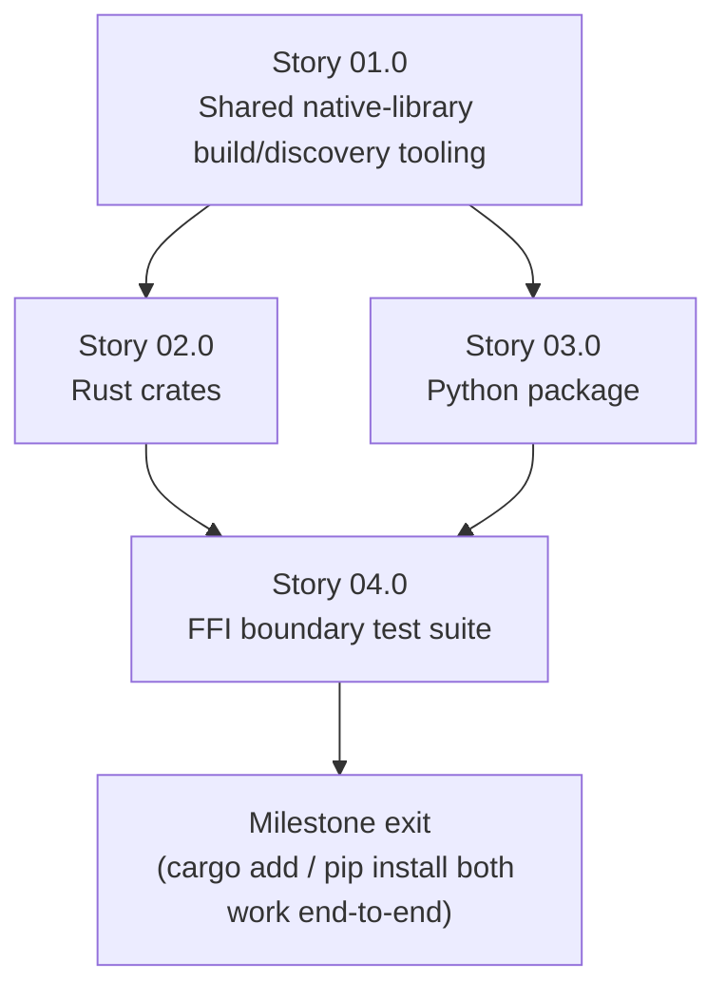

# Milestone 0013 - Language Bindings (Rust and Python)

**Package:** new `bindings/rust` (crates), new `bindings/python` (wheel) | **Module root:** `bindings/rust/`, `bindings/python/`

Wraps the existing `smbios_c` shared-library C ABI (milestone 0007) in
idiomatic packages for other languages, so `libbios` becomes installable
as `cargo add smbios-sys`/`cargo add smbios` and `pip install smbios`, not
just usable from C/C++. This milestone writes **no new `smbios_c`
functions** - it is strictly a consumer of the curated C surface Story
02.0 of milestone 0007 already shipped (entry iteration,
type/length/handle, `render_to_description()`, and five curated typed
getters: BIOS vendor/version, System UUID, Memory Device size/speed). If
a binding needs a field `smbios_c` does not expose, that is a named
cross-milestone follow-up against `smbios_c` itself (see Key constraints),
not scope creep into this milestone.

## Stories

| Story | Name                                           | Category       | Output                                                                              |
|-------|-------------------------------------------------|-----------------|--------------------------------------------------------------------------------------|
| 01.0  | Shared native-library build/discovery tooling  | infrastructure  | A documented, reusable "how does a language binding's own build step get a built `smbios_c`" contract that both Stories 02.0 and 03.0 implement against |
| 02.0  | Rust crates (`smbios-sys` + `smbios`)          | feature         | `bindgen`-generated raw FFI crate; a safe, idiomatic wrapper crate (`Drop`, `Result<T, SmbiosError>`); published to crates.io |
| 03.0  | Python package (`smbios`)                      | feature         | `cffi`-based FFI binding; a Pythonic wrapper (context manager, exceptions); built as a wheel, published to PyPI |
| 04.0  | FFI boundary test suite (both languages)       | core            | Handle-lifecycle, error-mapping and round-trip tests for both bindings, run in CI    |

## Rationale

`CLAUDE.md`'s own `smbios_c` paragraph states its purpose plainly: the
shim exists "for a Python/Rust/C#/etc. binding that cannot link C++
directly." Milestone 0007 built and shipped that shim - opaque handles,
an exception-to-error-code boundary, an explicit export allowlist - but
deliberately stopped there; its own Non-goals list "Bindings for any
specific target language ... this milestone produces the C ABI those
bindings would consume, not the bindings themselves." This milestone is
that follow-through, three years (in roadmap-sequence terms) after the
shim's own plan.md named it as the motivating use case.

Rust and Python are the first two languages, not an arbitrary pair:

- **Rust** can call a C ABI directly via `bindgen` with no runtime and no
  garbage collector in the way, and `cargo`'s `build.rs` mechanism is
  purpose-built for "locate or build a native dependency first" - the
  exact shape `smbios_c` plus milestone 0012's packaging work produces.
  A safe Rust wrapper is also the highest-value proof that the opaque
  handle contract (C1 in milestone 0007's plan.md) is sound: Rust's
  ownership model maps almost one-to-one onto "a handle must be closed
  exactly once and never used after," so a `Drop`-based wrapper either
  makes that statically enforced or exposes a real gap in the C
  contract.
- **Python** is the highest-reach scripting consumer named in both
  `CLAUDE.md` and milestone 0007's own rationale (`dmidecode`'s own
  ecosystem has long-standing Python tooling expectations), and `ctypes`
  (stdlib, zero extra build dependency) or `cffi` (a slightly richer
  declarative ABI mode) can both load a prebuilt shared library directly
  with no C compiler required at `pip install` time if a wheel ships the
  library pre-built - a meaningfully lower adoption bar than Rust's
  `bindgen` step, which is why it is named explicitly as "at minimum"
  alongside Rust rather than deferred.

Both are explicitly named in `CLAUDE.md`'s `smbios_c` paragraph
("Python/Rust/C#/etc."); C# and Go are real future candidates but are
left to a later milestone once these first two bindings have proven the
packaging pattern (Story 01.0) is actually reusable, not just asserted to
be.

## Key constraints

- **Bindings only wrap `smbios_c`'s existing curated C surface.** Neither
  binding links `libsmbios`'s C++ headers directly, includes any
  `libsmbios`/`sys_interface` header, or re-implements any parsing logic -
  every field either binding exposes is one `smbios_c_*` (sic -
  `smbios_*`, see next bullet) function call away, never a reimplementation.
- **Every exported function name an FFI declaration binds against must
  match the linker allowlist exactly.** The real exported symbol prefix
  is `smbios_` (not `smbios_c_`; see `smbios_c/smbios_c.exported_symbols`
  and `smbios_c/smbios_c.version`, both enumerating exactly 13 names:
  `smbios_open`, `smbios_close`, `smbios_entry_count`, `smbios_entry_at`,
  `smbios_entry_type`, `smbios_entry_length`, `smbios_entry_handle_id`,
  `smbios_entry_render`, `smbios_bios_vendor`, `smbios_bios_version`,
  `smbios_system_uuid`, `smbios_memory_device_size`,
  `smbios_memory_device_speed`). `bindgen`'s raw output and the Python
  `cffi`/`ctypes` declarations must both be generated from, or checked
  against, `smbios_c/include/smbios/smbios.h` directly (not hand-typed
  from memory, and not from the roadmap docs' own occasional `.hpp`
  typo - the real header is `smbios.h`, a plain C header; see
  `docs/roadmap/0007-c-abi-shim-for-cross-language-interop/status.md`'s
  own correction of this exact mistake) - a mismatch here is a build-time
  or (worse) load-time failure, not a compile warning, on at least one
  platform's linker.
- **No new `smbios_c` functions are invented by this milestone.** If a
  binding's idiomatic surface would be materially improved by a field
  `smbios_c` does not curate today (e.g. Processor socket/speed, Chassis
  type - real fields neither binding can reach), record it as a named,
  cross-milestone follow-up against `smbios_c`/milestone 0007 in
  `status.md`, with the specific missing getter and which binding wanted
  it - do not silently assume the C function exists, stub around its
  absence with undocumented behavior, or expand `smbios_c` as a "small
  side fix" inside this milestone's own scope.
- **Each language binding is its own independently-versioned package**,
  not a single polyglot repo structure forced into one release cadence.
  `bindings/rust/smbios-sys` and `bindings/rust/smbios` carry Cargo's own
  semver (`Cargo.toml` `version`); `bindings/python/` carries its own
  Python-ecosystem version (`pyproject.toml` `version`). Neither is tied
  to `smbios_c`'s own `SMBIOS_C_VERSION` (currently `1.0.0`,
  `smbios_c/CMakeLists.txt`) or to each other - a Rust crate point
  release must be possible without also cutting a PyPI release the same
  day, and vice versa. Each binding's own `CHANGELOG`/release notes name
  the `smbios_c` version range it was built and tested against (see
  Story 01.0), since neither language ecosystem's own versioning scheme
  can express a native-library ABI compatibility range on its own.
- **This milestone depends on milestone 0012's packaging story for how a
  binding's build step locates a built `smbios_c`** (see Dependency on
  milestone 0012, below) - it does not re-derive its own packaging
  mechanism for the native library from scratch.
- **No implementation code is written in this milestone's own planning
  pass** - every story/task below starts `⬜ Not started`; this is net-new
  planning only.

## Dependency on milestone 0012 (C/C++ packaging)

[docs/adr/0004-package-manager-distribution.md](/docs/adr/0004-package-manager-distribution.md)
(written for the sibling milestone 0012) decided to package `smbios_c`
first, as a self-hosted vcpkg overlay/registry port (option 1b), plus a
parallel GitHub Releases baseline of prebuilt tarballs (option 3) - and
explicitly deferred central-registry (`microsoft/vcpkg`) submission and
any Conan work until a real external consumer asks. **This milestone's
own bindings are exactly the "real external consumer" ADR 0004's Links
section names as the trigger for revisiting those deferred promotions** -
Story 01.0 Task 01 below is where that trigger is pulled, by recording
each binding's build-time dependency on 0012's artifacts as a concrete,
named consumer, not a hypothetical one.

Concretely, each binding's build step needs one of the following to
locate or produce a `smbios_c` shared library + `smbios.h` header pair
before its own FFI-generation step can run:

1. **Depend on ADR 0004's self-hosted vcpkg port** (`vcpkg install
   smbios-c` via this project's own overlay/registry) if the binding's
   build environment already has `VCPKG_ROOT` configured the way this
   repo's own `CMakePresets.json` expects - the lowest-maintenance option
   for a contributor already building this repo, but not a reasonable
   assumption for an arbitrary `cargo build`/`pip install` run on a
   machine with no vcpkg at all.
2. **Depend on ADR 0004's parallel GitHub Releases artifacts** - a
   binding's build script downloads a tagged, pre-built `smbios_c`
   tarball for the host triplet rather than building `libsmbios`/`smbios_c`
   from source at all. Lowest build-time cost for an end user (no C++
   toolchain needed beyond what `bindgen`/`cffi` themselves already
   require), but ties each binding release to a specific `smbios_c`
   release tag existing for every platform the binding itself claims to
   support.
3. **Vendor a source build**: the binding's own `build.rs`/`setup.py`
   invokes this repository's own `cmake --preset <os>` +
   `cmake --build` directly against a vendored or git-submoduled copy of
   this repository (or a pinned source tarball), building `smbios_c`
   itself as part of the binding's own build step. Highest build-time
   cost and the only option requiring a full C++ toolchain + vcpkg on the
   end user's machine, but the only option with zero dependency on either
   packaging artifact existing yet for a given platform/architecture
   combination.

Story 01.0 Task 01 is where this three-way choice is actually made (per
option, per binding, since Rust and Python's own ecosystem norms differ -
see that task's own spec) and recorded; this plan.md states the options
rather than pre-deciding between them, since the decision is itself this
milestone's first piece of real work, not a foregone conclusion inherited
from 0012.

## Non-goals

- Any binding beyond Rust and Python (C#, Go, Node.js, etc.) - named as
  future candidates in Rationale, not started here.
- Any new `smbios_c` C function, typed getter, or ABI change (see Key
  constraints) - this milestone is a pure consumer of milestone 0007's
  existing curated surface.
- A central vcpkg (`microsoft/vcpkg`) or Conan submission for `smbios_c`
  itself - that is ADR 0004's own deferred promotion, gated on "a real
  external consumer," and remains milestone 0012's decision to make, not
  this milestone's.
- ABI *stability guarantees* for `smbios_c` across versions - still out
  of scope per milestone 0007's own Non-goals; both bindings therefore
  pin to, and document, a specific `smbios_c` version range rather than
  assuming forward/backward compatibility.
- A C#/.NET or Go binding's own packaging ecosystem (NuGet, Go modules) -
  deferred alongside the language itself.
- Rewriting or extending `smbios_c`'s own test suite
  (`tests/c_abi/`) - Story 04.0 adds boundary tests *in the binding
  languages*, exercising the same contract from the other side of the
  FFI call, not new C++-side `smbios_c` tests.

## Dependency graph

**Milestone exit** means all of the following:

- `smbios-sys`/`smbios` (Rust) are published to crates.io and `cargo add
  smbios` plus a minimal consumer program works on at least Linux and
  macOS (Windows gated on milestone 0012's own Windows packaging
  maturity - see Story 01.0's own notes).
- `smbios` (Python) is published to PyPI as a wheel and `pip install
  smbios` plus a minimal consumer script works on the same platform set.
- Story 04.0's FFI boundary tests (handle lifecycle, error-to-
  exception/Result mapping, a round-trip against a real or synthetic
  SMBIOS source) pass in CI for both languages.
- Every missing-field gap found while building either binding's
  idiomatic surface is recorded as a named follow-up against `smbios_c`
  (Key constraints), not silently worked around.

**Depends on milestone 0007** (the C ABI shim itself - entry iteration,
curated typed getters, the export allowlist) and **on milestone 0012**
(for how a built `smbios_c` + header pair is produced/located - see
Dependency on milestone 0012, above). Independent of milestones
0009/0010/0011 (output formatting and structure-coverage expansion are
both C++-only surfaces this milestone's bindings do not reach, since
`smbios_c` itself does not expose them).
