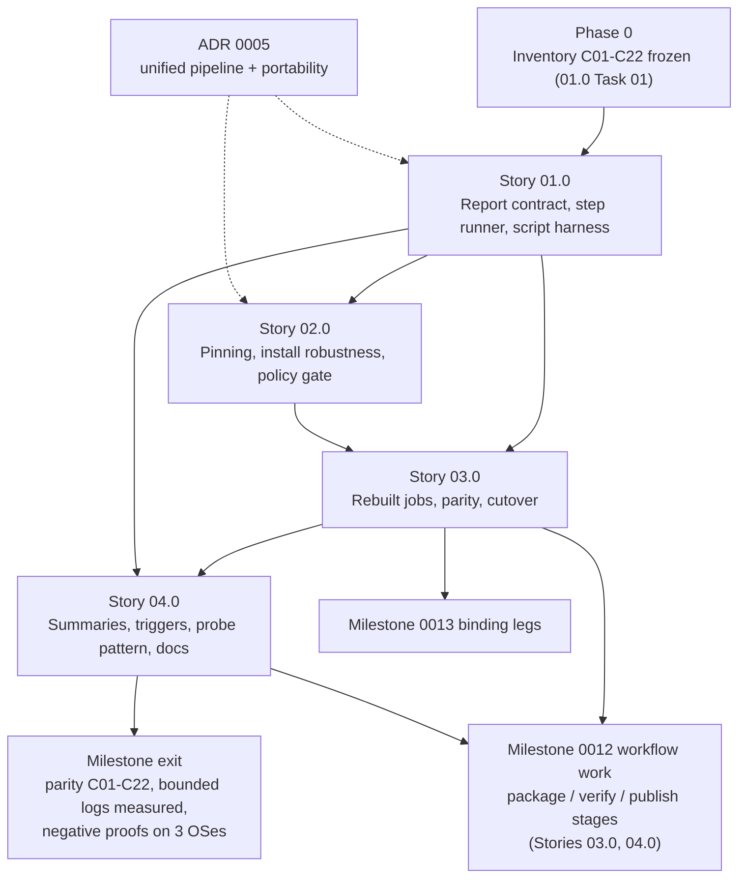

# Milestone 0014 - CI Rework From Scratch

**Package:** CI only | **Module root:** `.github/workflows/`, `scripts/ci/` (new), `docs/dev/ci.md` (new)

The maintainer's request (2026-11-11, verbatim): "On completion, create separate milestone to rework CI in a concise and structured way, to deliver maximum useful information on CI problems in a reasonable amount of text. Printing entire megabytes reports should never repeat, but also this is not the only potential CI problem. It should be reworked from scratch."

This milestone replaces `.github/workflows/ci.yml` with a new workflow built on four things:

- a **report contract**: what every step may print on success and on failure;
- **one tested step runner** that enforces the contract;
- **pinned runners and tools**;
- a **bounded job summary** per job and per run.

**Amended 2026-11-12 by [ADR 0005](/docs/adr/0005-unified-build-package-publish-pipeline.md)** (unified build, package and publish pipeline; CI-platform portability). CI, packaging and publishing are now one pipeline: `lint -> build/test -> package -> verify -> publish`. **This milestone owns that pipeline's shared foundation:**

- the step runner and report contracts (RC1-RC5), with reporter backends and neutral environment names;
- the one pinned toolchain;
- the policy gate (P1-P13);
- the version-consistency check (`scripts/ci/check_versions.py`);
- the platform-neutral stage entrypoint (`scripts/ci/stage.py`);
- the entry workflow plus the reusable `stage-lint.yml`/`stage-build.yml`, and the stage contracts SC1-SC4 below.

Milestone 0012 then defines the `package`/`verify`/`publish` stages on this foundation, and milestone 0013's binding jobs become legs of the same stages. The ADR's [Platform portability](/docs/adr/0005-unified-build-package-publish-pipeline.md#platform-portability) section governs where logic may live: YAML is a thin adapter, and stage logic lives in neutral scripts.

It keeps every check the current workflow performs. Each one is listed by ID in the Phase-0 inventory below, so a check can only be removed by recording a reason, never silently. Shipped code is not touched (no `libsmbios`, `smbios`, `smbios_c` or `smbios_gui` source, CMake target or preset change). Nothing below is implemented yet, and every story starts "Not started".

## Stories

| Story | Name | Category | Output |
|-------|------|----------|--------|
| 01.0 | Report contract, step runner and workflow-script test harness | infrastructure | Frozen check inventory + log-size baseline; `scripts/ci/ci_step.py` (RC1-RC3) with `github`/`teamcity`/`plain` reporter backends and the neutral env-name table (`scripts/ci/env_names.py`, ADR 0005); `scripts/ci/tests/` run under the runner's exact shell flags |
| 02.0 | Pinned toolchain, hardened environment and least privilege | infrastructure | Pinned runner labels and CMake/CTest/Ninja/vcpkg versions in one data file read by every stage; one-line version header (RC4); robust apt install, `bootstrap_vcpkg.py` (replaces `lukka/run-vcpkg`) and vcpkg cache keys with a cache-health line; actionlint + `scripts/ci/check_workflow_policy.py` (P1-P13, incl. ADR 0005 portability and publish-privilege rules) |
| 03.0 | Rebuilt jobs with check parity | infrastructure | `scripts/ci/stage.py` (`lint`/`build`/`test`); entry `ci-next.yml` + reusable `stage-lint.yml`/`stage-build.yml`; `scripts/ci/check_versions.py` in `lint` (SC3); install-tree export on packaging legs (SC2); JUnit-based test reporting; explicit best-effort steps; inventory parity gate, negative proofs, cutover from the old `ci.yml` |
| 04.0 | Summaries, triggers and the probe pattern | infrastructure | Bounded per-job summary (via the reporter backend) + one run-level `report` job; triggers/concurrency/tiering including the ADR 0005 D7 package/verify/publish rows; probe-workflow pattern and single-stage dispatch; `docs/dev/ci.md` and the milestone exit gate |

## Evidence - the problems this milestone fixes

Every item below was seen on the real workflow during milestone 0011, apart from items marked *found by reading*. Those were found while writing this plan, have not been seen failing, and are included because they are the same class of problem: a check that cannot fail, or fails silently. The sources are [docs/roadmap/0011-gui-visualization-tool/status.md](/docs/roadmap/0011-gui-visualization-tool/status.md) (Notes & decisions), [the Story 03.0 Task 02 CI debugging findings](/docs/roadmap/0011-gui-visualization-tool/03.0-cross-platform-build-wiring/02-ci-build-only-wiring.md) and [the Story 04.0 Task 02 as-built notes](/docs/roadmap/0011-gui-visualization-tool/04.0-gui-test-tiers/02-headless-spike-and-ci-wiring.md).

| # | Problem | Evidence | Addressed by |
|---|---------|----------|--------------|
| E1 | Unbounded log output. | The maintainer's complaint: "printing entire megabytes reports". In today's `ci.yml`, only `gui-build` bounds its output (`run_quiet`). The `build` and `sanitizers` jobs stream configure output inline, including the vcpkg manifest install that builds from source on a cache miss. They also stream build output, and `ctest --output-on-failure` output for single-CTest-entry suites. | 01.0 (RC1-RC3), 03.0 |
| E2 | Floating runner labels and tool versions. | `ubuntu-latest` moved to Ubuntu 26.04 without notice to the project. The macOS/Windows runners had ctest 4.4.5 while the Linux runner had 3.31. | 02.0 Task 01 |
| E3 | Dependence on the apt mirror. | DNS for `azure.archive`/`archive`/`security.ubuntu.com` failed on the runners for hours (diagnosed with a probe). `apt-get update` "succeeded" with nothing fetched, and the install then stalled until the 30-minute job ceiling. The kernel.org mirror fallback worked. | 02.0 Task 02 |
| E4 | Tool-output parsing broke on a version change. | The `100% tests passed ...` summary line differs between ctest 3.x and 4.x, so the `gui-ci` gate failed on macOS/Windows. | 03.0 Task 02 (exit codes + JUnit counts) |
| E5 | A script was never tested under the runner's shell flags. | GitHub starts `shell: bash` with `-e -o pipefail`. A bare `"$@" > "$log"` exited before printing any diagnostics. The local test had not used `-e`. | 01.0 Task 03, 02.0 Task 03 |
| E6 | Debugging cost. | Each CI failure in milestone 0011 took a full ~30-minute cycle. Throwaway probe workflows were the fast path, but they were improvised each time. | 04.0 Tasks 02-03 |
| E7 | No least privilege and no run economy. | There is no `permissions:` block (security follow-up F-1 / T-6). `on: [push, pull_request]` runs all 8 jobs on every push, and twice when a same-repo PR is open. There is no concurrency cancel and no step-level timeouts except the apt step. vcpkg cache keys hash only `vcpkg.json`. | 02.0, 04.0 Task 02 |
| E8 | Silent best-effort checks. | `\|\| echo ::warning::` plus `continue-on-error: true` on the integration/perf steps. *Found by reading:* the `build` job's "functional test" step looks for `smbios_functional_test`, which no CMake file defines (only `ci.yml` names it). So it has printed "binary not found" and exited 0 on every run since the test reorganisation. | 03.0 (RC5, inventory C05) |
| E9 | No structured failure summary. | Nothing is written to `$GITHUB_STEP_SUMMARY`. A failure has to be found by opening each job log. | 04.0 Task 01 |
| E10 | GUI-tier CI proofs must survive the rewrite. | The R-7 hook-string check and the R-8 local-tier-absent guard ([docs/security/2026-11-11-gui-test-tiers.md](/docs/security/2026-11-11-gui-test-tiers.md)) are merge-blocking proofs. | 03.0 Task 03 (C18, C20) |
| E11 | *Found by reading:* UBSan cannot fail a test. | The sanitizer configure passes `-fsanitize=undefined` without `-fno-sanitize-recover`, and sets no `UBSAN_OPTIONS=halt_on_error=1`. UBSan reports and continues, the test exits 0, and its output is never shown, because `--output-on-failure` only prints failing tests. | 03.0 Task 02 (maintainer decision D2) |

## Phase 0 - inventory of today's checks (contract)

This table is the parity contract for Story 03.0. Every row must show up in the new workflow with the same gate type or a stronger one, unless its disposition says *drop* and gives a reason. Story 01.0 Task 01 re-verifies the table against `ci.yml` at the commit where work starts and records any drift before anything else changes. Story 03.0 Task 04 checks parity row by row and reports discrepancies only (`<ID>: expected <gate> -> actual <gate>`).

Gate types: **hard** (fails the job), **best-effort** (never fails the job; outcome must be visible, RC5), **info** (a record, never a gate), **dead** (cannot run).

Legs today: `build` = ubuntu-latest/`linux`, windows-latest/`windows`, macos-latest/`macos`; `sanitizers` = ubuntu-latest/`linux`, macos-latest/`macos`; `gui-build` = ubuntu-24.04/`linux-gui`, windows-latest/`windows-gui`, macos-latest/`macos-gui`. Each job has `timeout-minutes: 30` and `fail-fast: false`.

| ID | Job / legs | Check and purpose | Gate | Disposition |
|----|------------|-------------------|------|-------------|
| C01 | build (3), sanitizers (2) | `scripts/check_cversions_isolation.py` - nothing builds, includes or tracks the GPL `c-versions/` (milestone 0008 R2) | hard | Keep, run **once** in `lint` (it checks repo content, so the input is identical on every leg; 5 runs per push -> 1) |
| C02 | build (Linux) | `scripts/check_doc_samples.py --check` - doc samples equal the golden files (milestone 0009) | hard | Keep in `lint` |
| C03 | all | `lukka/run-vcpkg` setup + `actions/cache` of vcpkg archives, keys `vcpkg-binarycache[-gui]-<os>[-sanitizers]-<hash(vcpkg.json)>` | infra | Keep, re-keyed + health line (02.0 Task 02) |
| C04 | build (3) | `cmake --preset <os>` + `cmake --build --preset <os>`; `allow_build_failure` is `false` on every leg | hard | Keep; drop the dead `allow_build_failure` knob |
| C05 | build (3) | "Run functional test" - looks for `smbios_functional_test` | dead | **Drop**: no such target exists; superseded by C06/C13 (unit) and C10/C14 (integration) |
| C06 | build (Windows) | `ctest -C Debug --timeout 60 -R "smbios_unit_test\|smbios_mock_test\|smbios_c_\|smbios_cli_unknown_format\|smbios_example_"` - the only unprivileged test run on Windows (no MSVC sanitizers) | hard | Keep |
| C07 | build (3) | Every `--format` (text/xml/json/yaml/csv) through the real `smbios` CLI, validated by `examples/scripts/check_structured_output.py` (counts only, values never printed; Linux under `sudo`); `::warning::` when a document is well-formed but empty | hard (+ warning) | Keep, counts only |
| C08 | build (3) | No-flag output byte-equals `--format text` (`cmp`, contents never printed) | hard | Keep |
| C09 | build (Linux) | `ls -l /sys/firmware/dmi/tables` - records the sysfs mode for `docs/cli-usage.md` | info | Keep as one `info:` line |
| C10 | build (Windows) | `ctest -R "smbios_integration_test\|smbios_perf_test\|smbios_cli_format_csv"` `\|\| echo ::warning::`, `continue-on-error` | best-effort (silent) | Keep as explicit best-effort (RC5) |
| C11 | all | Job ceiling 30 min; `ctest --timeout 60` per test (the 2026-11-09 `smbios_c.dll` hang) | hard | Keep; add step budgets (02.0 Task 03) |
| C12 | sanitizers (2) | Configure into `build/<preset>-asan` with `-fsanitize=address,undefined -fno-omit-frame-pointer -g` + build | hard | Keep; UBSan made fatal (D2) |
| C13 | sanitizers (2) | Unprivileged ctest with the C06 regex under `ASAN_OPTIONS=detect_container_overflow=0` (+ `detect_leaks=0` on macOS) - the only Linux/macOS run of the unit/mock/C-ABI/example tests | hard | Keep, including both `ASAN_OPTIONS` reasons as comments |
| C14 | sanitizers (2) | Privileged-subset ctest (integration/perf/`smbios_cli_format_csv`) under sanitizers, not under `sudo`, `\|\| echo ::warning::` | best-effort (silent) | Keep as explicit best-effort (RC5); see open question Q4 |
| C15 | gui-build (Linux) | apt GLFW/X11/autotools packages; DNS probe of `azure.archive.ubuntu.com` with kernel.org fallback; `DPkg::Lock::Timeout=120`, `Acquire::Retries=1`, 20 s fetch timeouts; step timeout 10 min | hard | Keep, moved into a tested script (02.0 Task 02) |
| C16 | gui-build (3) | `cmake --preset <os>-gui` + build, bounded (`run_quiet`) | hard | Keep via the step runner |
| C17 | gui-build (3) | Shipped `smbios_gui` binary found; `ok: <path> (<bytes> bytes)` | hard | Keep |
| C18 | gui-build (3) | **R-7**: `grep -a -c -F -e` of `--exit-after-frames` and `usage: --exit-after-frames` in the shipped binary must be 0; grep exit >1 or a non-number fails closed | hard (merge-blocking) | Keep with **identical semantics** (03.0 Task 03) |
| C19 | gui-build (3) | `ctest -L gui-ci --no-tests=error --timeout 60` + the "tests passed" summary must be present | hard | Keep; count from JUnit, not from summary text (E4) |
| C20 | gui-build (3) | **R-8**: `ctest -N -L gui-local` and `ctest -N -R 'smbios_gui_local_test\|smbios_gui_autoexit'` each report `Total Tests: 0` (a missing line fails); `find` (no `-type f`) for both names finds nothing | hard (merge-blocking) | Keep with **identical semantics** (03.0 Task 03) |
| C21 | workflow | Action SHA pinning with version comments (`checkout` v7.0.1, `cache` v6.1.0, `run-vcpkg` v11.6) | policy | Keep, enforced by the policy gate (02.0 Task 03) |
| C22 | workflow | No secrets, no `pull_request_target` (0011 security review: no finding) | policy | Keep, enforced by the policy gate |

Known gaps recorded, not regressions. (1) On Linux/macOS the non-sanitized test binaries are never executed; only the sanitized ones are (C13). The rework keeps that split unless the maintainer decides otherwise. (2) The 0011 Story 04.0 Non-goal "sanitizer builds of the GUI tiers in CI ... left to the CI-rework milestone" is answered in Non-goals below.

## Shared contracts

### RC1 - Step report contract

Every `run:` step that the project owns prints according to this grammar. Output from third-party actions (`checkout`, `cache`, `run-vcpkg`) is outside the project's control. It is measured and budgeted (03.0 Task 04), not reformatted.

- **Success:** exactly one line, `ok: <label>[: <summary>] (<elapsed>s)`. `<summary>` has counts, versions and paths only, and is at most 160 characters. Passing tool output is never printed.
- **Failure:** in this order, printed once:
  1. one annotation, `::error title=<label>::<label> failed (exit <rc>, <elapsed>s): <first diagnostic, escaped, <=160 chars>`;
  2. `--- <label>: first <n> of <m> diagnostic lines ---`, then at most **20** lines matching the step's diagnostic pattern set, each prefixed `L<line>: ` and cut to 200 characters;
  3. `--- <label>: last <t> lines ---`, then at most **40** tail lines, cut to 200 characters, **leaving out lines already printed in step 2** (no repetition);
  4. nothing else. The hard ceiling is 64 lines and 16 KiB per failing step. The full log stays in a file (RC2).
- **Best-effort:** see RC5.
- **Workflow-command safety (threat model T-3, CWE-77):** every excerpt of tool output is printed between `::stop-commands::<random token>` and `::<token>::`, so a hostile line cannot inject `::error::`, `::add-mask::` or similar. Annotation text is escaped (`%`->`%25`, CR->`%0D`, LF->`%0A`).
- **Platform-neutral form (ADR 0005).** The `::error`/`::warning` annotations, the `%` escaping, the `stop-commands` fence and the summary file above are the **`github` reporter backend's** rendering of neutral events:
  - `step_ok`
  - `step_fail`
  - `step_warn`
  - `step_skip`
  - `begin/end_untrusted_block`
  - `job_summary`

  The `teamcity` backend renders the same events as `##teamcity[buildProblem ...]`/`##teamcity[message ... status='WARNING']` service messages, with `|`-escaping, and fences untrusted excerpts with `##teamcity[disableServiceMessages]`/`enableServiceMessages`. The `plain` backend (local runs) prints `error:`/`warning:` lines. The line and byte ceilings, the discrepancy form and data hygiene are applied before rendering and are identical for every backend. The mapping table is in [ADR 0005](/docs/adr/0005-unified-build-package-publish-pipeline.md#platform-specific-pieces-of-rc1-rc4-that-move-behind-the-reporter).
- **Data hygiene:** a step that reads the live SMBIOS table (C07, C08, C10, C14) prints counts, formats and structure types only. Its excerpt is limited to CTest's own status lines (test name + status), never test stdout. These steps never use `--output-on-failure`, and their logs and JUnit files are never uploaded as artifacts.
- **Discrepancy form:** a gate that compares values prints one line per difference, `<what>: expected <x> -> actual <y>`, shortened to 160 characters, at most 20 lines plus `(+<k> more)`. This is the maintainer's standing preference.

### RC2 - Step runner interface (`scripts/ci/ci_step.py`, Python 3 stdlib only)

```text
python3 scripts/ci/ci_step.py run --label <label>
        [--patterns <set>[,<set>...]]     # cxx, cmake, vcpkg, ctest, boost, sanitizer, python, apt (default: all)
        [--best-effort "<why this may fail>"]
        [--summary "<text>"]               # appended to the ok: line
        [--max-diag 20] [--tail 40]
        -- <command> [args...]
python3 scripts/ci/ci_step.py self-test   # one-line ok/fail, used by every job's first step
```

- It runs the command **without a shell** (argv list), sends stdout+stderr to `<logdir>/<label>.log`, and prints only RC1 output. `<logdir>` is `$CI_LOG_DIR` (default `$CI_TEMP_DIR/ci-logs`), or a fresh temp directory when run locally.
- **Reporter backend (ADR 0005).** `--reporter github|teamcity|plain` selects the backend, and defaults to `$CI_REPORTER`, or to `plain` when that is unset. Only `scripts/ci/reporters/` emits platform commands.
- **Neutral inputs (ADR 0005).** The runner and every `scripts/ci/` script read only the neutral names in `scripts/ci/env_names.py`:
  - `CI_PLATFORM`, `CI_REPORTER`
  - `CI_RUN_ID`, `CI_RUN_URL`
  - `CI_EVENT`, `CI_REF`, `CI_REF_NAME`, `CI_COMMIT`, `CI_BASE_COMMIT`
  - `CI_JOB`, `CI_LEG`
  - `CI_WORKSPACE`, `CI_TEMP_DIR`, `CI_ARTIFACT_DIR`
  - `CI_LOG_DIR`, `CI_RESULTS_FILE`, `CI_SUMMARY_FILE`
  - `CI_IMAGE`
  - `CI_PUBLISH_TOKEN`

  They never read `GITHUB_*`, `RUNNER_*` or TeamCity parameters. The workflow adapter maps them (the ADR's table gives the GitHub and TeamCity sources).
- Exit code: hard mode returns the command's exit code (a signal maps to 128+n). Best-effort mode always returns 0.
- Each call appends one RC3 record. It never reads `${{ }}` expressions. Callers pass matrix values through `env:` or argv (expression-injection rule, 02.0 Task 03).
- It is the only place that implements truncation, escaping and `stop-commands`. Story 03.0 adds two siblings that **use** it and print RC1 output: `ctest_report.py` and `gui_guards.py`.

### RC3 - Step result record (`$CI_RESULTS_FILE`, default `$CI_TEMP_DIR/ci-results.jsonl`, one JSON object per line)

```json
{"label": "build", "mode": "hard|best-effort|info", "outcome": "ok|fail|warn|skip",
 "exit": 0, "elapsed_s": 312.4, "summary": "...", "first_diagnostic": "... or null",
 "counts": {"passed": 0, "failed": 0, "skipped": 0, "not_run": 0}}
```

Story 04.0 builds the job summary and the run summary only from these records and from RC4. It never re-reads a log.

### RC4 - Version header

This is the first project-owned step of every job: one line, at most 240 characters, also written as the first line of the job summary:

```text
env: <job>/<leg> image=<CI_IMAGE> | cmake <v> | ctest <v> | ninja <v|-> | cxx <id> <v> | python <v> | vcpkg <sha12> | cache <exact|partial|miss>
```

On GitHub, the adapter sets `CI_IMAGE` from `ImageOS` + `ImageVersion` (ADR 0005 neutral-name table).

### RC5 - Best-effort semantics

A best-effort step is declared with `--best-effort "<reason>"` and never with `continue-on-error`, which is banned by the policy gate. It never fails the job. On a non-zero exit it prints one `::warning title=best-effort: <label>::<reason> (exit <rc>)` line plus the RC1 excerpt, and its outcome shows in the job summary's best-effort column. A best-effort step that cannot pass in a given environment is not run there. It is replaced by a one-line `skip: <label>: <reason>`, so that permanent warnings do not train readers to ignore warnings.

## Pipeline stage contracts (ADR 0005)

These are the contracts this milestone fixes for **every** stage. Milestone 0012 implements `package`/`verify`/`publish` against them, and milestone 0013's binding jobs are legs of the same stages. This milestone implements only `lint` and `build/test`. Until 0012 lands, the tier table reports the other stages as `not run: stage not defined`.

### SC1 - Stage command (Story 03.0 Task 01)

```text
python3 scripts/ci/stage.py <lint|build|test|package|verify|publish> [--leg <leg>] [--only <step>]
```

- **One workflow step is one stage-command invocation** (policy rules P7/P10).
- **Inside the command**, every sub-step goes through the `ci_step` library (RC1-RC3).
- **Exit codes:** 0 success; 1 gate failed; 2 usage or environment error (a missing neutral variable or an unknown leg); 128+n killed by signal n.
- **Locally**, the command runs the same way with `CI_REPORTER=plain` and default temp directories.
- **Legs** are declared once, in `scripts/ci/legs.json`. Packaging legs are named `<os>-<arch>` (`linux-x64`, `windows-x64`, `macos-arm64`). Sanitizer and GUI legs are never packaging legs.

### SC2 - Artifact layout and hand-off (Story 03.0 Task 01 for `install/`; 0012 for `dist/`)

```text
$CI_ARTIFACT_DIR/install/<leg>/                      # build stage, packaging legs only: cmake --install output of the tested build
$CI_ARTIFACT_DIR/dist/libbios-<version>-<leg>.<ext>   # package stage (0012): archive of install/<leg>/, never a rebuild
$CI_ARTIFACT_DIR/dist/*.sha256, dist/manifest.json    # package stage (0012): digests; verify/publish refuse any digest mismatch
```

- **The build stage on a packaging leg builds the shipped configuration once, tests that build, and exports `install/<leg>/`** as a stage artifact. The shipped configuration is decided by 0012 Story 03.0. The policy is "tested equals shipped" (ADR 0005 D1).
- **This touches the C06 inventory row.** Today C06 runs `ctest -C Debug`. If 0012 picks a non-Debug configuration, C06's configuration changes on packaging legs. That is a recorded disposition change for the maintainer, not a silent one.

### SC3 - Version consistency (Story 03.0 Task 01, runs in `lint`)

- **Authoritative value:** the root `CMakeLists.txt` `project(... VERSION X.Y.Z)` (ADR 0005 D5).
- **The check:** `scripts/ci/check_versions.py` reads `scripts/ci/version_sites.json`, where each row is `{site, file, extractor, rule: derived|equal}`. It prints mismatches in RC1 discrepancy form and exits 1 on any mismatch.
- **Tag events:** `--tag "$CI_REF_NAME"` additionally requires `v<X.Y.Z>[-<pre>]`. A tag not matching `v*`, such as the `-DGIT_TAG` scheme, is not a release.
- **Rows:** this milestone ships the rows for the sites that exist today. 0012 adds rows for the sites it creates: `LIBSMBIOS_VERSION`, the port `vcpkg.json` and the registry baseline.
- **Prerequisite:** the root `project()` VERSION does not exist yet, so the derivation change is a 0012 product-build task. Until it lands, this milestone's row set treats `SMBIOS_C_VERSION` as the only site, and the check passes trivially.

### SC4 - Publish gating and privilege (policy gate P8, P13; Story 04.0 Task 02 for triggers)

- **Publish jobs:**
  - live only in `stage-publish.yml`;
  - run only on a `v*` tag event (bindings: their own trigger, decided by 0013);
  - declare `needs:` on the `verify` job of the same run;
  - use the `release` environment;
  - are the only jobs that may widen `permissions` (`contents: write`, `pull-requests: write`, `id-token: write`) or reference a credential.
- **Release creation and registry PRs** are done by neutral scripts calling the GitHub REST API with `CI_PUBLISH_TOKEN`, never by a marketplace action (P13).
- **Registry validation runs inside the publish run, before the PR is opened.** A PR opened with `GITHUB_TOKEN` triggers no workflow.

## Key constraints

- **CI only.** The milestone changes `.github/workflows/`, `scripts/ci/`, docs, and possibly `.gitignore`. It makes no product source, CMake target, preset, `vcpkg.json` or test-code change. If a rebuilt check exposes a product bug (UBSan, D2), it goes to `cpp-expert` as a separate item. It is not fixed inside this milestone.
- **Parity before cutover.** The old `ci.yml` stays live until Story 03.0 Task 04 shows every inventory row in the new workflow (built as `ci-next.yml` and renamed at cutover). There is never a period with no CI.
- **Logic lives in tested, platform-neutral scripts, not in YAML (ADR 0005 DD5).** A `run:` block is a single stage-command invocation (one line, no control flow). Scripts read only neutral `CI_*` names. Platform syntax lives only in the adapter (workflow files) and in `scripts/ci/reporters/`. Every rule is enforced by the policy gate (02.0 Task 03, P7-P13). Scripts are stdlib-only Python, following the existing `scripts/check_*.py`. Any shell that remains is tested under `bash --noprofile --norc -e -o pipefail` (E5).
- **No new third-party action without a reason.** Every `uses:` is SHA-pinned with a version comment and listed in `scripts/ci/actions_allowlist.json` with a justification and its TeamCity equivalent or `needs reimplementation` (P13). An action a neutral script can replace is rejected, which is why `lukka/run-vcpkg` gives way to `bootstrap_vcpkg.py` (02.0 Task 02).
- **Security stance carries over unchanged, with one scoped exception:**
  - no secrets, except in publish-stage jobs that use the `release` environment (SC4, P8 amended); no job this milestone builds is a publish job;
  - no `pull_request_target`;
  - `permissions: contents: read` at the top;
  - no firmware values in any log, summary or artifact ([docs/security/2026-11-11-gui-browsing-ui.md](/docs/security/2026-11-11-gui-browsing-ui.md) requirement 20; [docs/security/2026-11-11-gui-test-tiers.md](/docs/security/2026-11-11-gui-test-tiers.md) T-3);
  - the R-7/R-8 proofs keep fail-closed semantics.

  Stories 02.0 and 03.0 are flagged `security_sensitive`: a `security-auditor` threat model (`docs/security/<date>-ci-rework.md`) is written before Story 03.0's workflow code.
- **Avoid fragile parsing (E4).** Exit codes decide. Counts come from structured output (`ctest --output-junit`), never from human-readable summary lines. A count that cannot be read is reported as `counts unavailable`. It fails only where the count itself is the gate (R-8's `Total Tests: 0`), and there it fails closed.

## Non-goals

- Any product code, CMake, preset or test change, including the 0011 follow-ups F-2/F-3, and making `HiddenWindowSmoke`/`AutoExitTwinSmoke` skip on an unreadable table.
- New checks that are not about CI itself. The only checks added are the CI self-checks (policy gate, script tests, actionlint) and fatal UBSan if D2 says so. In particular: no doc-link check in CI, no clang-tidy, no coverage, no sanitizer build of the GUI tiers (the 0011 Story 04.0 hand-off is declined here; a candidate for a later milestone), no fuzzing in CI (`docs/dev/fuzzing.md` keeps it local-only).
- Running `smbios_gui` or the `gui-local` tier on CI, `xvfb-run`, or software GL.
- Self-hosted runners, or running macOS/Windows jobs locally. `act` is documented as a Linux-only local aid at most, not as a required tool.
- The bodies of the `package`/`verify`/`publish` stages (milestone 0012) and the binding legs (milestone 0013). They are not built here. This milestone fixes their contracts (SC1-SC4, RC1-RC5, P1-P13) and the shared entry workflow they plug into (ADR 0005). There is no separate `release.yml`.
- An actual TeamCity (or other CI) configuration. This milestone builds the portability seams (reporter backends, neutral names, policy rules). The migration itself follows ADR 0005's checklist if it is ever requested.
- Pinning a full runner image. Hosted images are updated weekly, even under a fixed label. This milestone pins the label and the tools that decide behaviour, and records `ImageVersion` (RC4).

## Open questions for the maintainer

These are genuine forks only. Each has a recommendation; the task that needs the answer is named.

- **Q1 / D1 - Per-push matrix (04.0 Task 02).** Should Windows and macOS run on every push to a branch, or only on PRs to `master`, pushes to `master`, a nightly schedule and manual dispatch? The cost: 8 jobs per push today. The value: the Windows `smbios_c.dll` hang and the ctest 4.x break were Windows/macOS-only. *Recommendation:* push to any branch runs `lint` plus the three Linux legs; PR/`master`/nightly/dispatch run the full matrix.
- **Q2 / D2 - Fatal UBSan (03.0 Task 02).** Should UBSan be made fatal (`-fno-sanitize-recover=undefined` + `UBSAN_OPTIONS=halt_on_error=1:print_stacktrace=1`)? If it exposes existing undefined behaviour, the sanitizers job goes red until `cpp-expert` fixes it. *Recommendation:* yes. A sanitizer that cannot fail is exactly the silent check this milestone removes.
- **Q3 - Failure-log artifacts (03.0 Task 01).** Should the full logs of failing configure/build steps be uploaded as artifacts (only on failure, 3-day retention)? They contain compiler/vcpkg output, never firmware data. Test and live-table logs are never uploaded. *Recommendation:* yes for configure/build only. The alternative is that the bounded excerpt is all a reader ever gets.
- **Q4 - Linux integration tests under `sudo` (03.0 Task 02).** C14 runs integration/perf unprivileged on Linux, so it can most likely never read the table and only produces noise. Should they run under `sudo` (as C07 already does), or be marked `skip:` on Linux? *Recommendation:* `sudo` in the non-sanitized Linux leg, `skip:` under sanitizers.
- **Q5 - Branch protection (03.0 Task 04).** Does `master` have required status checks? The new job names differ, so required checks would need to be updated at cutover.

## Dependency graph



02.0 Task 01 (pinning) does not need the step runner and can start in parallel with 01.0 Tasks 02-03. 04.0 Task 03 (probe template) can start as soon as 02.0 has fixed the pinned labels.

**Relation to milestones 0012 and 0013 (ADR 0005).** This milestone is the foundation of one pipeline. 0012 owns the `package`/`verify`/`publish` stage definitions, and 0013's binding jobs are legs of those stages. Both consume SC1-SC4, RC1-RC5 and P1-P13 instead of writing their own workflow conventions.

- **0012:** its workflow work (Story 03.0 Tasks 01-03 and all of Story 04.0) depends on this milestone's Stories 01.0-03.0 and on Story 04.0 Task 02's tier table. 0012 Stories 01.0/02.0 (CMake install/export, port files) do not depend on this milestone.
- **0013:** its CI tasks (Story 01.0 Task 03, Story 04.0 Task 04) have not been amended yet. They still name `ci.yml` and `-latest` runners, and whoever starts 0013 amends them to ADR 0005.

Depends on: milestone 0011 (C15-C20 exist as specified there), 0008 (C01), 0009 (C02, C07, C08).
